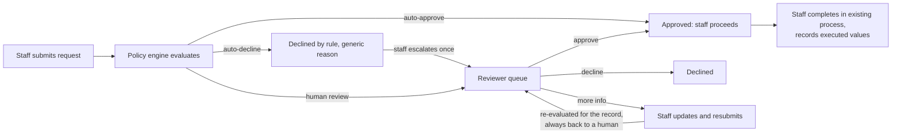
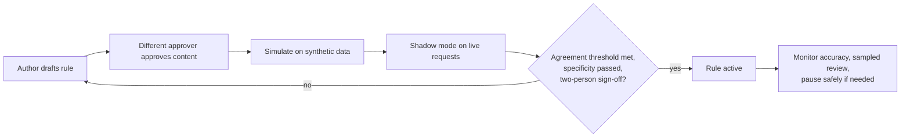

# ExchangeFlow — Product Requirements Document

| | |
|---|---|
| **Product** | ExchangeFlow: exchange request decisioning and approval |
| **Status** | Draft v0.3, for stakeholder review. Revised after the core-engine and regulatory reviews in `reviews/`. Regulatory content is research-based and not yet confirmed by compliance or counsel. |
| **Owner** | Product owner (to be assigned) |
| **Last updated** | 2026-10-01 |
| **Related docs** | `project-brain-stoming.md` (proposal), `application-project-plan.md`, `application-elaboration-plan.md`, `policy-engine-design.md`, `azure-architecture-proposal.md`, `docs/adr/README.md` |
| **Decision log** | `reviews/ba-review.md` §4 is the single log of open questions and decisions |

Requirements marked **[TBD-Stakeholder]** depend on input collected during discovery (backlog item E3b, workshop guide in `reviews/ba-review.md` §3) and are not final until confirmed.

**Release IDs** are `REL-0` to `REL-4`. Risk IDs `R1`–`R21` belong to the project plan's risk register.

### Changes from v0.2

- **Target organization:** a Canadian credit union (working assumption, to be confirmed: Ontario, provincially regulated). Regulatory values stay `[TBD-Stakeholder]`; the research (`docs/research/canada-credit-union-fx-requirements.md`) is advisory, and no requirement below cites a claim that compliance has not confirmed.
- **Decisions (2026-10-01):** the guardrail covers all automated outcomes and reads compliance facts (ADR-025, FR-16, FR-18); a restricted compliance channel is built in REL-1 (ADR-026, FR-80 to FR-83); the full multi-host core layout is built (ADR-023).
- **Changed requirements:** FR-01, FR-05, FR-12, FR-13, FR-16, FR-18, FR-19, FR-21, FR-26, FR-43, FR-60, FR-61, NFR-07, NFR-10, NFR-14 (see the rows). Cites: REG-BA-07, REG-ARCH-01 to 05, CE-BA-01 to 09.
- **New requirements:** FR-80 to FR-83 (compliance support), NFR-19 (record production), NFR-20 (data residency, conditional).
- **Release plan:** REL-1 now includes the restricted channel and the multi-host core and is provisionally six iterations (It2 to It7); later releases are re-baselined at the end of REL-0.

### Changes from v0.3 (2026-10-02, product owner decisions)

- **Rate and amount to give (FR-70):** the product owner named a rate source: the uexchange.ca public feed (entry id 20, USD), used server-side to calculate how much the teller gives the member (member sells CAD: give USD at the feed's sell value; member sells USD: give CAD at the feed's buy value). Rounded down to the cent. Indicative only, never used in rule evaluation. Priority moves from Could to Should for the local build. The source's terms of use are unconfirmed (Q10, DL-N40).
- **Names (FR-01, FR-04):** requests show who submitted them, and the member's name is now recorded (overriding the references-only default DL-N11 for the name only). The member name stays out of rules, audit rows, notifications and logs (DL-N39).

### Changes from v0.1

- **Decisions:** two made on 2026-10-01.
  - Resubmitted requests are re-evaluated but always go to a human (FR-06, FR-10).
  - Placeholder rules may auto-decide only outside production (FR-17).
- **Safety and engine behaviour:**
  - Pause semantics are now monotonically safe (FR-34).
  - Shadow isolation is strengthened (FR-15).
  - Fallback causes are extended (FR-12).
  - Determinism is redefined over a stored input (FR-14).
- **New requirements:**
  - Guardrail policy (FR-18).
  - Velocity limits on a pseudonymous customer key (FR-19).
  - Cancellation (FR-26) and expiry (FR-27).
- **Security, from the security review:**
  - Role conflicts and two-person controls (FR-31, FR-33, FR-60, FR-63).
  - Branch scoping raised to Must (FR-62).
  - Completion reconciliation (FR-07).
  - Web security, encryption and backup NFRs (NFR-16 to NFR-18).
- **Clarifications and consistency:**
  - Canonical state table (§7.2) and agreement metric definition (FR-37).
  - Testable rewrites of NFRs, with values tagged TBD where they had no source.
  - Releases renamed `REL-n` and aligned with the project plan iterations.

---

## 1. Summary

Currency exchange branches handle requests that differ in risk. Some are routine and could proceed at once, some need head-office judgment, and some should be refused outright. Today every non-routine case relies on manual messages and follow-up, so staff and customers wait and decisions are hard to trace.

ExchangeFlow is a desktop web application that evaluates each request against business-owned policy and sends it down one of three paths:

- **Auto-approve:** the request proceeds immediately.
- **Auto-decline:** the request is refused with a generic stated reason, and staff can escalate it once.
- **Human review:** the request is queued for an authorized head-office reviewer.

Every decision, whether made by a rule or a person, is recorded with its reason, its responsible actor and the full input it was based on. Automation is transparent and pausable, and it always fails safe to a human.

---

## 2. Problem

| Who | Problem today | Consequence |
|---|---|---|
| Front-line staff | Wait for head office on requests, including routine ones; chase responses manually | Service interruptions, customer waiting, wasted time |
| Head-office reviewers | Receive requests through scattered channels; routine cases mixed with ones that need judgment | Slow turnaround, attention spent on low-risk work |
| Managers | No single view of pending work, turnaround, or decision history | Bottlenecks invisible; inconsistent decisions hard to spot |
| Compliance | Decisions and reasons not reliably recorded | Weak audit trail |

The scale of these problems has not yet been measured. Baselines are a discovery deliverable (§9).

---

## 3. Goals and non-goals

### Goals

1. Routine requests are decided in seconds by approved policy, without waiting for head office.
2. Reviewers see only requests that need judgment, in one queue, with everything needed to decide.
3. Staff always know a request's status and the reason for its outcome.
4. Every decision is traceable to a person or to a specific rule version, and can be replayed.
5. The business controls its own decision policy and can pause automation at any time, safely.

### Non-goals (this release)

- Executing, settling or paying out a currency exchange. Staff complete the transaction in the existing process after approval (Q1, default).
- Replacing point-of-sale, accounting, identity-verification or compliance systems.
- Machine-learning or opaque scoring for decisions.
- A customer-facing portal or customer notifications (D9, recorded as out of scope).
- Live exchange-rate integration (FR-70 is optional, once a permitted source is confirmed).
- Mobile apps. Desktop browsers only.

---

## 4. Users and roles

| Persona | Role(s) | Primary needs |
|---|---|---|
| **Sam, front-line staff** | Staff | Submit fast, get an answer fast, explain the outcome to the customer, escalate when a decline seems wrong |
| **Rana, head-office reviewer** | Reviewer | A focused queue, complete request details, quick decision with reason, no duplicate or conflicting decisions |
| **Priya, policy owner** | Policy owner | Own the policy, co-sign activations, see how rules perform before and after activation |
| **Policy author / approver** | Policy author, Policy approver | Draft rules safely; approve others' rules with a clear impact view |
| **Marc, branch / operations manager** | Manager | See pending work and aging, turnaround, automation rate; sample automated decisions; pause automation |
| **Compliance officer** | Compliance | Own guardrails and regulated classes, co-sign regulated or auto-approve activations, audit any decision |
| **Administrator** | Administrator | Manage users and roles, with a second person approving grants |

Persona names are illustrative. Roles are those of FR-60. The permission matrix is `policy-engine-design.md` §7.

---

## 5. User journeys

### 5.1 Request through decision

### 5.2 Policy change

---

## 6. Functional requirements

Priority uses MoSCoW: **M**ust, **S**hould, **C**ould. **REL** is the release that delivers it (§10). **UC** links the use case in the project plan.

### 6.1 Request submission and tracking (staff) — UC-01, UC-03

| ID | Requirement | Pri | REL |
|---|---|---|---|
| FR-01 | Staff can create, save as Draft, and submit an exchange request with the required fields. **[TBD-Stakeholder: field list; whether admins can configure it, DL-N05]** Member name (required, owner decision 2026-10-02, DL-N39) and 'submitted by' shown from the signed-in user. Candidate additions, each pending the decision-log item shown: payment method (cash or not, DL-N16); a reference to the identity-verification record and the FX transaction ticket held in the existing system, not copies (DL-N11); third-party flag (DL-N21); entity flag (DL-N22); source and destination country (DL-N23). | M | 1 |
| FR-02 | The server validates the request against a strict schema (unknown fields rejected; amounts as decimal strings with an ISO 4217 currency and its minor-unit scale). Errors are explained without losing entered data. | M | 1 |
| FR-03 | On submission, staff see the request ID, status, outcome and a generic reason in the response to the submit action. | M | 1 |
| FR-04 | Staff can list their branch's requests with status, and open any one to see its full history. | M | 1 |
| FR-05 | Staff can escalate an auto-declined request to human review **once**, within the escalation window, giving a reason. Reviewer declines cannot be escalated. **[TBD-Stakeholder: window, BQ-5]** If Quebec members exist, a member may also ask for human review outside the window **[TBD-Stakeholder: DL-N27]**. | M | 1 |
| FR-06 | Staff can update and resubmit a request marked "more information needed". Earlier values are preserved as revisions. The resubmission is re-evaluated for the record, but **always returns to human review**, to the same queue and where possible the same reviewer. | M | 1 |
| FR-07 | Staff mark an approved request Completed by recording the executed amount, currency pair and transaction reference. A mismatch beyond tolerance blocks completion and alerts compliance. **[TBD-Stakeholder: tolerance]** | M once any rule is active; S before | 3 |
| FR-08 | Submission is idempotent: the client sends a key generated when the form opens; the same key and payload returns the original response; the same key with a different payload is rejected. | M | 1 |
| FR-26 | Staff or reviewers can cancel a non-terminal request with a reason. A cancelled request can still be referred to compliance (FR-80). **[TBD-Stakeholder: who, from which states, timeouts, BQ-4]** | M | 1 |
| FR-27 | An approved request that is not completed within its validity period becomes Expired. **[TBD-Stakeholder: period, BQ-3]** | S | 3 |

### 6.2 Automated decisioning (policy engine) — UC-08

| ID | Requirement | Pri | REL |
|---|---|---|---|
| FR-10 | Every submission and resubmission is evaluated against the current policy version and given one outcome: auto-approve, auto-decline or human review. | M | 1 |
| FR-11 | Rules are evaluated together, independent of order, with three-valued logic for missing data and rule scope, following `policy-engine-design.md` §4.2–4.3. | M | 1 |
| FR-12 | The outcome is human review whenever: the engine is paused; it errors, times out or has no valid policy; a human-review rule matches; a paused rule would have matched; an active rule cannot be evaluated for missing data; approve and decline rules both match; the guardrail rejects an approval; no rule matches; or the request is a resubmission; or a compliance fact required by the guardrail is unknown, stale or on hold (restricted cause, ADR-025). Each case records its cause; staff-visible views show only the generic cause. | M | 1 |
| FR-13 | Each decision records the outcome, applied outcome, cause, deciding rule version, matched rules, shadow results, generic reason, and the full input: context snapshot and hash, policy version and hash, control revision, paused rules, evaluation time and engine version. Compliance facts and any restricted reason are held in the restricted part of the record (ADR-026) and are not visible to general roles. | M | 1 |
| FR-14 | Re-running a stored decision's input under the same engine version gives an identical result. | M | 1 |
| FR-15 | Shadow-mode rules are evaluated in isolation and recorded. Their matches, missing data and errors never change the applied outcome. | M | 1 |
| FR-16 | Decision criteria are business-owned configuration in the governed rule store, not code. Rules cannot reference user identity or individual-level fields, and auto-approve rules must pass a specificity test before activation. The guardrail (FR-18), not rules, may read categorical compliance facts (ADR-025). **[TBD-Stakeholder: criteria; specificity parameters]** | M | 2 |
| FR-17 | Rules flagged `nonProduction` (placeholders) may auto-decide only in non-production environments with synthetic data. In production they are rejected at publish, the app refuses to start with a non-production flag, and any such decision raises a Sev-1 alert. | M | 1 |
| FR-18 | A compliance-owned guardrail policy (maximum auto-approve amounts per currency, prohibited request types and currencies, required compliance facts) is applied after the rules to every automated outcome, approve or decline, and can only turn it into human review. Thresholds are compliance parameters, never literals in code. **[TBD-Stakeholder: limits, from compliance only]** | M | 1 (schema and lint), 2 (full policy) |
| FR-19 | Velocity limits (count or cumulative amount per customer per window, across branches) use a pseudonymous customer key and counters updated atomically with the decision. Until this exists, no auto-approve rule is activated where structuring risk applies. State whether the pseudonymous key can satisfy any same-person aggregation that compliance requires (DL-N13). **[TBD-Stakeholder: permitted identifier, windows, Q5]** | M before activation | 3 |

### 6.3 Human review (reviewer) — UC-02

| ID | Requirement | Pri | REL |
|---|---|---|---|
| FR-20 | Reviewers see a queue of requests awaiting review, sortable by age, with escalations, resubmissions and fallback causes flagged. | M | 1 |
| FR-21 | Reviewers can open a request and see its details, revisions, history and the rule results. Shadow results are shown only after the reviewer has decided. Restricted compliance information is never shown (FR-81). | M | 1 |
| FR-22 | Reviewers can approve, decline, or request more information. A reason is required for decline and more information. **[TBD-Stakeholder: whether approval needs a reason, R-03]** | M | 1 |
| FR-23 | A decision on a request that changed since the reviewer opened it is rejected with `409 STALE_REQUEST` and the current state. | M | 1 |
| FR-24 | At most one final decision is recorded per review cycle. A cycle is one evaluation or escalation of a request. | M | 1 |
| FR-25 | Requests can be routed to different queues and authority levels by policy; any amount-based authority is enforced on the server. **[TBD-Stakeholder: routing, authority levels, Q6]** | S | 3 |
| FR-28 | A reviewer cannot decide a request they submitted or edited. **[TBD-Stakeholder: own-branch rule, BQ-6]** | M | 1 |

### 6.4 Policy administration — UC-09

| ID | Requirement | Pri | REL |
|---|---|---|---|
| FR-30 | Authorized users can create rules and new rule versions. Approved versions are immutable; changes create a new version. | M | 2 |
| FR-31 | A rule version needs approval, bound to its content hash, by someone other than its author. Rules in a regulated class, which the system derives from rule content, also need compliance approval. | M | 2 |
| FR-32 | Draft rules can be simulated against synthetic requests with no side effects, showing outcomes and conflicts. | M | 2 |
| FR-33 | Approved rules are placed in shadow mode, then activated by publishing a new policy version. Activating an auto-approve rule needs two people other than the author (approver plus policy owner or compliance), and requires the agreement threshold, minimum shadow duration and sample size, and the specificity test. **[TBD-Stakeholder: thresholds]** | M | 2–3 |
| FR-34 | Authorized users can pause a single rule or the whole engine, with a mandatory reason. Pausing takes effect from the next evaluation, with no automated outcome committed after the pause, and sends every request the rule would have affected to human review. Resuming needs a policy approver; resuming an auto-approve rule needs two people. | M | 2 |
| FR-35 | Rules can have effective-from and effective-to instants (in a named time zone). Effective dating cannot shorten the minimum shadow period. **[TBD-Stakeholder: confirm need]** | C | 4 |
| FR-36 | Every administration action is audited with actor, roles, time, reason and content hash, and raises a security alert where listed in the design. | M | 2 |
| FR-37 | A shadow agreement report shows, per rule, the agreement between shadow outcome and the human final outcome, with sample size and a 95 % lower bound, as defined in `policy-engine-design.md` §10.2. | M | 2 |

### 6.5 Monitoring and audit (manager, compliance) — UC-06, UC-10

| ID | Requirement | Pri | REL |
|---|---|---|---|
| FR-40 | Managers see pending requests by age and queue, and turnaround time by decision path, request type and operating hours. | S | 3 |
| FR-41 | Managers see the share of requests by outcome and by cause. | S | 3 |
| FR-42 | Managers and compliance review a server-chosen random sample of automated decisions and flag any as wrong; flags are tracked per rule and feed the accuracy metric. **[TBD-Stakeholder: sample rate]** | S | 3 |
| FR-43 | Authorized users can search requests and view the read-only audit history of any request within their scope. Restricted compliance information is excluded from search, views and exports for general roles (FR-81). | M | 1 |
| FR-44 | Audit records cannot be altered or deleted: the application role can only insert, records are hash-chained, and the chain is anchored outside the database. | M | 1 |
| FR-45 | When a rule's accuracy falls below the agreed threshold with the minimum sample, the policy owner is alerted and a pause task is opened. **[TBD-Stakeholder: threshold, sample, whether to auto-pause]** | M before activation | 3 |
| FR-46 | The most common request shapes that matched no rule are reported to the policy owner. | C | 3 |

### 6.6 Notifications — UC-04

| ID | Requirement | Pri | REL |
|---|---|---|---|
| FR-50 | Staff see an in-app notification when their request is decided or needs more information, within 30 seconds. | S | 2 |
| FR-51 | Reviewers see new items in their queue within 30 seconds. | S | 2 |
| FR-52 | A notification failure never undoes or hides a saved decision; the request status and queue are always the source of truth. | M | 1 |
| FR-53 | Other channels (email, desktop push) are configurable and carry only the request ID and status, never customer data. **[TBD-Stakeholder: channels, Q8]** | C | 4 |

### 6.7 Users and access — UC-05

| ID | Requirement | Pri | REL |
|---|---|---|---|
| FR-60 | Users sign in with the corporate identity provider and hold roles from the app: staff, reviewer, policy author, policy approver, policy owner, compliance, manager, administrator. A server-enforced conflict matrix blocks incompatible combinations (for example author with approver, or administrator with any policy role; the compliance officer role is separate from submitter, reviewer, author, approver and administrator). | M | 1 |
| FR-61 | Every action is authorized on the server according to the machine-readable permission matrix, including per-object separation of duties and a separate permission to read restricted compliance information. | M | 1 |
| FR-62 | Users see only the branches they are scoped to, enforced in the data layer on every query, search, report and export. Out-of-scope objects return 404. | M | 1 |
| FR-63 | Administrators create, deactivate and change user roles. Grants of reviewer or policy roles need a second person's approval; no one can change their own roles. All changes are audited and alert compliance. | M | 1 |
| FR-64 | Privileged actions (approve, publish, co-sign, pause, resume, role changes) need a fresh MFA step-up. | M | 2 |

### 6.8 Optional

| ID | Requirement | Pri | REL |
|---|---|---|---|
| FR-70 | Users can see an indicative exchange rate and the amount to give the member, clearly labelled as indicative. The source is the uexchange.ca feed (entry id 20, USD, buy and sell values in CAD per USD; owner decision 2026-10-02), fetched server-side from an allow-listed host, the stored quote is recorded with the request, and rates are never used in rule evaluation. Rounding is down to the minor unit. **[TBD-Stakeholder: the source's terms of use, whether the quote is locked at submit or refreshed at completion, and the rounding policy, DL-N40]** | S | 1 (local build) |

### 6.9 Compliance support — new in v0.3

These requirements come from the regulatory research (advisory) and from ADR-025 and ADR-026. Reporting to the regulator is outside ExchangeFlow by default: compliance and the core system file reports; ExchangeFlow stores flags, references and timestamps and provides the audit export (DL-N15).

| ID | Requirement | Pri | REL |
|---|---|---|---|
| FR-80 | Staff, reviewers, managers and compliance can refer any decided, declined or cancelled request to compliance. The referrer sees a generic confirmation and a neutral display state; only the compliance role sees the referral and its basis. | M | 1 |
| FR-81 | Restricted compliance information (compliance facts, referral basis, restricted causes) is held in a separate store and is invisible to every general role, search, export, notification, log and metric. Reason text comes from an approved set (English and French) and never mentions suspicion reports, sanctions or listed-person matches, politically exposed persons, or the regulator. | M | 1 |
| FR-82 | The system accepts compliance facts (identity-verified, PEP/HIO flag, screening result, directive-country flag, cash flag, entity flag, compliance hold) from compliance-owned systems as tri-state values with source, actor, time and time to live, and stores them with the evaluation input. Missing or stale facts count as unknown. **[TBD-Stakeholder: which facts exist and their sources, DL-N12, DL-N19]** | M | 1 (schema), 2 (guardrail use) |
| FR-83 | The regulatory profile (province, federal or provincial, regulator, deposit insurer, privacy regime, language requirements) is configuration, one per deployment, recorded on each decision. **[TBD-Stakeholder: DL-N09]** | M | 1 |

---

## 7. Decision model

### 7.1 Outcome rules

Full detail is in `policy-engine-design.md` §4.3. The first matching row wins.

| # | Condition | Outcome |
|---|---|---|
| 1 | Engine paused | Human review |
| 2 | Engine error, timeout, or no valid policy | Human review |
| 3 | A human-review rule matches | Human review |
| 4 | A paused rule would have matched | Human review |
| 5 | An active rule cannot be evaluated (missing data) | Human review |
| 6 | Approve and decline rules both match | Human review, and the policy owner is alerted |
| 7 | Only decline rules match | Auto-decline |
| 8 | Only approve rules match, and the guardrail allows it | Auto-approve |
| 9 | Only approve rules match, but the guardrail rejects it | Human review |
| 10 | No rule matches | Human review |
| — | Any resubmission | Human review (engine result kept for the record) |

### 7.2 Request states

| Code | Display name | Terminal |
|---|---|:-:|
| `DRAFT` | Draft | |
| `UNDER_REVIEW` | Under review | |
| `MORE_INFO_NEEDED` | More information needed | |
| `APPROVED` | Approved | |
| `AUTO_DECLINED` | Declined by rule (escalatable) | |
| `DECLINED` | Declined | ✔ |
| `COMPLETED` | Completed | ✔ |
| `EXPIRED` | Expired | ✔ |
| `CANCELLED` | Cancelled | ✔ |

The lifecycle diagram and transition rules are in `policy-engine-design.md` §3.

---

## 8. Non-functional requirements

| ID | Category | Requirement |
|---|---|---|
| NFR-01 | Performance | Submit returns an outcome within 2 s at the 95th percentile and 4 s at the 99th, with < 0.1 % errors, at expected peak load for 15 minutes, measured on the perf environment. **[TBD-Stakeholder: target and peak load, Q9]** |
| NFR-02 | Performance | Policy evaluation has a 50 ms soft and 200 ms hard budget; any evaluation over the hard budget results in human review. |
| NFR-03 | Availability | Available during business operating hours across all branches. Proposed ≥ 99.5 % in business hours, measured by availability tests. **[TBD-Stakeholder: hours and target]** |
| NFR-04 | Reliability | Decision, state change, audit event and outbox are saved in one transaction. A nightly reconciliation finds zero requests without a decision record and zero decisions without an audit event. |
| NFR-05 | Security | TLS 1.2+ only; authentication required for every page and API; server-side authorization on every action; the application origin is unreachable except through the edge. |
| NFR-06 | Security | Secrets and keys are in a managed vault and never in source code or configuration files; per-workload identities; CI secret scanning finds nothing. |
| NFR-07 | Privacy | Logs and telemetry contain only allow-listed fields (IDs, codes, outcomes). Canary customer values, and the restricted terms listed in FR-81, submitted in tests appear in no log, notification, response or export visible to a general role. Only customer data the business confirms as necessary is collected. |
| NFR-08 | Privacy | Development, test, perf and demo environments use synthetic data only, enforced by controls (no production backups restored outside production). |
| NFR-09 | Auditability | Every decision and administration action is attributable. Any stored decision can be replayed (FR-14), checked nightly on a random sample. |
| NFR-10 | Retention | Requests, decisions and audit records are retained per business and regulatory policy; PII is kept out of audit records so it can be purged without breaking the hash chain. AML records have a published floor of at least five years (confirm with compliance; FINTRAC page read 2026-10-01); provincial and internal periods may be longer. **[TBD-Stakeholder: periods, clock start per record type, legal hold, BQ-7]** |
| NFR-11 | Usability | At least 80 % of test users submit a routine request in under one minute after brief training. **[TBD-Stakeholder: target, set after baseline observation]** |
| NFR-12 | Accessibility | No serious or critical automated accessibility violations, and a manual keyboard and screen-reader check passed each release. **[TBD: confirm whether WCAG 2.1 AA is mandated]** |
| NFR-13 | Compatibility | Current Chrome, Edge and Firefox on desktop. **[TBD: confirm workstation browsers]** |
| NFR-14 | Operability | Engine errors, conflicts, pauses, outbox lag, notification failures and the alerts in the design §10.3 reach an owned action group within 5 minutes. Privacy incidents have a named owner and path **[TBD-Stakeholder: DL-N26]**. |
| NFR-15 | Scalability | NFR-01 holds at 2× expected peak for one hour. **[TBD-Stakeholder: volumes, Q9]** |
| NFR-16 | Web security | All user-supplied text is output-encoded; strict content security policy with no inline scripts; CSRF protection on every state change; session cookies HttpOnly, Secure and SameSite; no tokens or sensitive data in URLs or browser storage. |
| NFR-17 | Encryption and keys | Data encrypted at rest (database, backups, logs, storage); audit-anchor signing key non-exportable; key rotation scheduled; customer-managed keys per compliance decision. |
| NFR-18 | Backup and support | Point-in-time restore on every environment; restore and audit-chain verification drilled before go-live and twice a year; support hours and on-call defined before pilot (AZ-13). |
| NFR-19 | Record production | Records that compliance must produce to the regulator can be searched and exported (FR-43/44) within a target agreed with compliance; research indicates a 30-day production period for FINTRAC (confirm). **[TBD-Stakeholder: DL-N10]** |
| NFR-20 | Data residency (conditional) | Hosting region and any processing outside Canada (including support access, telemetry, backups) follow the regulatory profile. If Quebec members exist, a privacy impact assessment precedes any cross-border communication and Canada East is evaluated as the primary region. **[TBD-Stakeholder: DL-N24, DL-N25]** |

---

## 9. Success metrics

Baselines are collected during discovery. Targets are set with the business after that.

| Metric | Measures | Source |
|---|---|---|
| Time to decision, by path and request type | Speed for staff and customers | Decision records |
| Automation rate | Share of requests decided automatically | Decision records |
| Reviewer workload | Requests per reviewer per day; queue age | Queue data |
| Automation accuracy | Shadow agreement; overturned escalations; sampled-review error rate | Shadow results, escalations, sample flags |
| Staff follow-up effort | Time spent chasing status | Before and after observation |
| Decision record completeness | Share of decisions with reason and actor | Audit records |
| User satisfaction | Staff and reviewer usability ratings | Survey after pilot |

**Guardrail:** automation must not be less accurate than the human baseline. Any rule whose error rate exceeds its agreed threshold triggers FR-45. **[TBD-Stakeholder: threshold per rule category]**

---

## 10. Release plan

Iterations are two weeks (project plan §6). REL-1 grew in v0.3 (restricted channel, multi-host core); iteration numbers for REL-2 onward are re-baselined at the end of REL-0. The platform work runs alongside (`azure-architecture-proposal.md` §11).

| Release | Iterations | Scope (requirement IDs) | Exit criteria |
|---|---|---|---|
| **REL-0 Discovery** | It1 | Workflow mapping; policy workshops (E3b); baselines; field list; platform requests and decisions AZ-1/3/4/6/9/10/12/14; confirm province and regulatory status (DL-N09); name the compliance officer and privacy officer; schedule counsel review of the regulatory research | Lifecycle, roles, fields and first rule categories confirmed, or accepted as assumptions; Q1–Q5 and BQ-2 answered or defaulted; subscriptions requested |
| **REL-1 Workflow MVP** | It2–It7 (provisional; was It2–It4) | FR-01–08, FR-10–15, FR-17, FR-20–24, FR-26, FR-28, FR-43, FR-44, FR-52, FR-60–63, FR-80–83, NFR-19 (design) | End-to-end demo in test with synthetic data: staff submit; non-production placeholder rules auto-approve, auto-decline and refer; escalation; more information and resubmission; reviewer decision; audit history |
| **REL-2 Policy engine (shadow)** | It5–It6 | FR-16, FR-18, FR-30–34, FR-36, FR-37, FR-50, FR-51, FR-64 | Real draft rules running in shadow in test; agreement report; guardrail in place; pause and resume proven |
| **REL-3 Controlled automation** | It7–It8 | FR-07, FR-19, FR-25, FR-27, FR-33 activation, FR-40–42, FR-45, FR-46; production environment | First low-risk rule category active in prod with synthetic smoke only, after two-person sign-off; sampled review, accuracy alert and kill switch proven; load test passed |
| **REL-4 Pilot** | It9+ | Pilot with agreed branches; FR-35, FR-53, FR-70 if confirmed | Real data after privacy approval; metrics against baseline; pen test passed; go or no-go for production |

---

## 11. Assumptions and dependencies

**Assumptions**
- Staff complete the actual transaction in the existing system after approval (Q1).
- Head-office reviewers are available during operating hours.
- The business can supply decision criteria and a named policy owner.
- Users work at desktop workstations with a supported browser.
- Hosting is Azure Container Apps in Canada Central (AZ-1, AZ-2, provisional). The credit union is assumed provincially regulated in Ontario until DL-N09 is confirmed.

**Dependencies.** Lead times and request-by dates are in `azure-architecture-proposal.md` §11.
- Business sponsor and policy owner available for workshops and sign-offs.
- Compliance review of rule categories, guardrails and residency before activation.
- IT: subscriptions, network, DNS, identity app registrations and licences (Entra P1/P2).
- Security: design review, pen test, SIEM onboarding.
- Finance: Azure budget and licence costs.
- A named platform owner and operating model before the pilot (AZ-13).
- Rate data source only if FR-70 is confirmed.

---

## 12. Risks

| Risk | Mitigation |
|---|---|
| A rule wrongly approves or declines | Shadow mode, replay, specificity test, guardrail, default-to-human, escalation, sampled review, accuracy alert, safe pause |
| Regulation restricts automation for some request types | Compliance-owned guardrail and regulated classes; restricted types stay human-only |
| Insider writes a self-favouring rule | Identity fields forbidden; specificity test; two-person activation; role conflicts |
| Threshold evasion by splitting requests | Pseudonymous customer key with atomic velocity counters (FR-19); generic reasons |
| Policy criteria arrive late | Engine runs on placeholder rules outside production; elicitation escalated early |
| Platform provisioning is slow | Requests in REL-0 week 1; sandbox spike; risk R15 |
| Staff see it as extra work | Design with staff; measure submission time (NFR-11) |
| Regulatory status or parameters unknown or wrong | Regulatory profile as configuration (FR-83); compliance-owned parameters; counsel review (R27, R28, R32) |
| Restricted information leaks to general roles (tipping off) | Partitioned input, projection, approved reason text, canary tests (FR-81, R31) |
| No owner for a reportable trigger | Default: ExchangeFlow does not file; documented handoff in the pilot go/no-go (R29) |

Full register: `application-project-plan.md` §9.

---

## 13. Open questions

The single decision log is `reviews/ba-review.md` §4. The main open items:

| ID | Question | Default if unanswered | Owner |
|---|---|---|---|
| Q1 / D8 | Does auto-approve trigger the transaction? | No; staff complete in the existing process | Product owner |
| Q2 | Which request types and criteria are auto-approve, auto-decline, or always human? | Placeholders only; nothing active in prod | Policy owner |
| Q3 / D4 | Which automated decisions are restricted by regulation? | Human-only until confirmed; enforced by guardrail | Compliance |
| Q4 / D3 | Decline beats approve, or conflict to human? | Conflict to human | Policy owner, compliance |
| Q5 / D7 | Which request fields and customer identifiers are required and permitted? | Minimal set | Policy owner, privacy |
| Q6 | Reviewer levels and routing | Single queue | Operations |
| Q7 / BQ-3/4/5 | Expiry, cancellation, escalation window | States exist; timings TBD | Operations |
| Q8 | Notification channels | In-app only | Product owner |
| Q9 | Volumes, branches, hours, availability | Architecture assumption A2 | Operations, IT |
| Q10 | Indicative rate display and source | Not built | Product owner |
| BQ-2 | Currency of thresholds | Per-currency threshold maps | Policy owner |
| BQ-6 | Can a reviewer decide their own branch's requests? | Not own submissions; branch rule TBD | Compliance |
| BQ-7 | Retention and erasure versus immutable audit | PII kept out of audit rows | Compliance |

Regulatory questions DL-N09 to DL-N27 and the amended BQ-7 are in the decision log, tiered by what they block. Province (DL-N09) and a named compliance officer (DL-N10) gate the rest.

**Decided on 2026-10-01:** guardrail covers all automated outcomes (ADR-025); restricted compliance channel in REL-1 (ADR-026); full multi-host layout (ADR-023). Also decided that day: BQ-1 (resubmission is always human-reviewed) and REL-1 demo scope (placeholders auto-decide only outside production).

---

## 14. Glossary

| Term | Meaning |
|---|---|
| **Exchange request** | A front-line request to perform a currency exchange that ExchangeFlow decides or routes |
| **Decision path** | How a request was decided: auto-approve, auto-decline or human review |
| **Rule** | A business-approved condition that maps matching requests to an outcome |
| **Human-review rule** | A rule whose outcome is human review; when it matches, a person must decide |
| **Policy version** | An immutable manifest of the rule versions in force and their mode (active or shadow) |
| **Guardrail policy** | A compliance-owned limit applied after the rules that can only turn an approval into human review |
| **Shadow mode** | A rule mode in which the rule is evaluated and recorded but cannot change the outcome |
| **Pause** | Switching off a rule or the whole engine; requests it would have affected go to human review |
| **Cycle** | One evaluation or escalation of a request; at most one final decision per cycle |
| **Fallback cause** | Why a request went to human review |
| **Escalation** | Staff asking a reviewer, once, to reconsider an auto-decline |
| **Sampled review** | A manager or compliance checking a random sample of automated decisions |
| **Placeholder rule** | A rule flagged non-production, used for demos and tests; never automates in production |

---

## 15. Approval

| Role | Name | Decision | Date |
|---|---|---|---|
| Product owner | | | |
| Policy owner | | | |
| Compliance | | | |
| Technical lead | | | |
