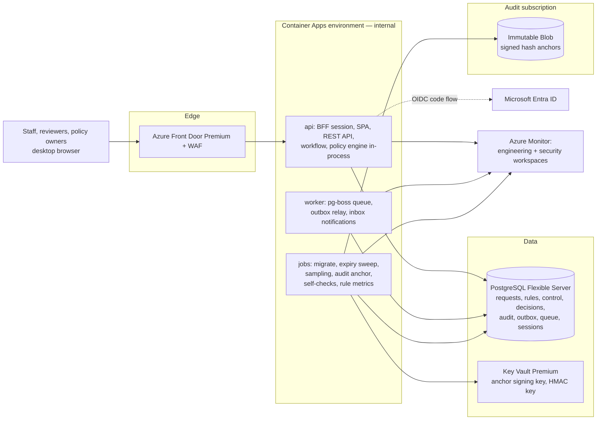
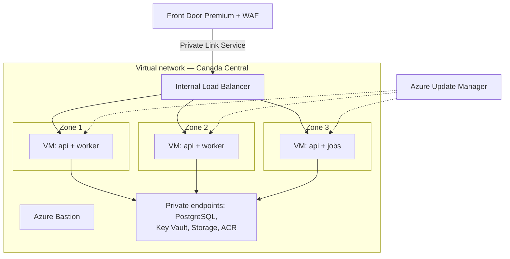
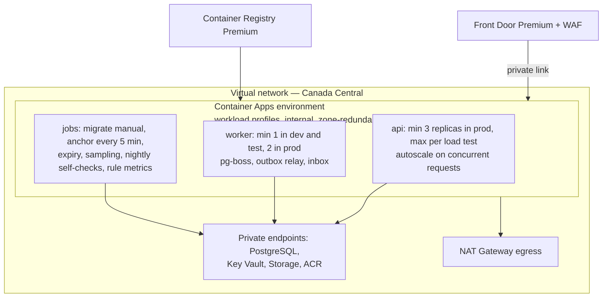
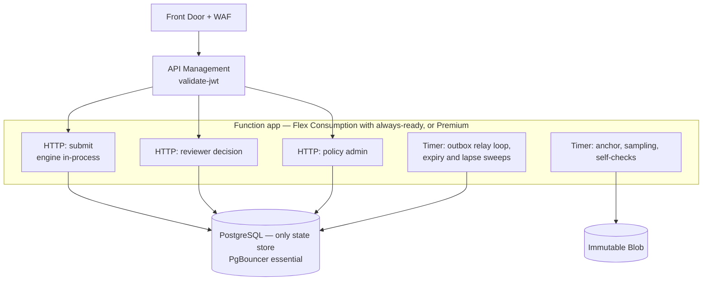
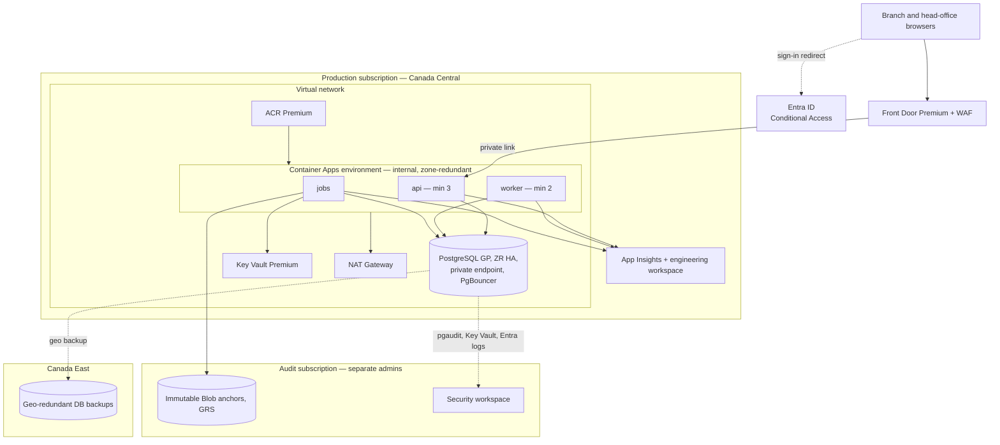
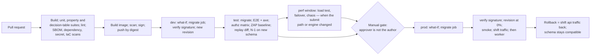

# ExchangeFlow — Azure Cloud Architecture Proposal

| | |
|---|---|
| **Status** | Draft v0.3. Revised after the core-engine and regulatory reviews; v0.2 followed the four validations in `reviews/azure-*-validation.md`. Ready for architecture, IT and security review; not yet for a business go/no-go (§15). |
| **Owner** | Technical lead (to be assigned). **Platform owner:** to be named (AZ-13). |
| **Last updated** | 2026-10-01 |
| **Related docs** | `PRD.md`, `policy-engine-design.md`, `docs/adr/README.md`, `diagrams/azure-architecture.drawio`, `reviews/` |

This proposal compares three ways to host ExchangeFlow on Microsoft Azure and recommends one:

1. **Option 1 — Virtual machines on reserved instances (IaaS)**
2. **Option 2 — Containerized application on Azure Container Apps** (recommended; App Service as a simpler variant)
3. **Option 3 — Serverless (Azure Functions, no Durable Functions: ADR-024)**

No prices are quoted. Azure prices change and depend on region, agreement and sizing. Section 8 lists cost drivers. A Pricing Calculator range per environment is a go/no-go prerequisite (§15).

Items marked **verify** are believed correct but must be confirmed in the platform spike before IaC is written.

### Changes from v0.2

| Change | Why (finding, decision) |
|---|---|
| Option 3 no longer uses Durable Functions; expiry and escalation are sweeps, the outbox relay is a timer loop under a row lease. The §6 diagram and the draw.io Option 3 page are updated. | ADR-024; CE-ARCH-09 |
| Hosts share one core behind ports; per-host differences are in `docs/core-engine-plan.md` §6. Host-specific obligations are added to §6 (relay cadence, pool caps, no session-level PostgreSQL features). | ADR-023; CE-ARCH-04/08, CE-SEC-04/08 |
| Separate identities and database roles for web, worker, migrator and anchor signer from the first environment; audit table owner is a separate admin identity; audit appends use a `SECURITY DEFINER` function. | CE-SEC-05/06; ADR-027 |
| Test-only hooks are compiled out of production artifacts; the Functions admin and master-key surface is disabled in deployed apps; the Function App is reachable only through APIM or Front Door. | CE-SEC-01/04 |
| Region and residency: Canada Central stays provisional for an Ontario credit union; Quebec members would require a privacy impact assessment and evaluation of Canada East as primary. New decision AZ-15. | ADR-028; REG-SEC-07, REG-MGR-01 |
| Restricted compliance store: separate database role and column-level encryption; read-audit alert. | ADR-026; REG-SEC-01 |

### Changes from v0.1

| Change | Why (validation finding) |
|---|---|
| Removed Service Bus, Web PubSub and Static Web Apps. The outbox and job queue live in PostgreSQL (pg-boss), notifications use an in-app inbox the browser polls, and the backend serves the SPA. | Matches architecture review ADR-002/013/020; removes AV-01/02, QA-AZ-01, F-WS-01, F-NW-01 (SPA origin) |
| Sign-in is a backend-for-frontend (BFF) server-side session; roles and branch come from the app database. Entra ID authenticates only. | AV-05, F-02, F-ID-03, F-FL-01/02 |
| Commit-time control-revision check under a lock; idempotency handled; full decision input stored | AV-03/04/06, QA-AZ-08 |
| Migration job with expand/contract schema changes in the pipeline | AV-07, QA-AZ-02 |
| api min 3 replicas in prod; worker always on (min 1) | AV-08, AV-01 |
| Creation-time decisions listed (§10.2); PostgreSQL networking mode and geo-backup decided up front | F-03, AV-10 |
| Security baseline expanded: per-workload identities, Key Vault RBAC with non-exportable key, Azure Policy initiative, Conditional Access table, break-glass, anchor store in a separate subscription anchored every 5 minutes | Security validation §5 |
| Quality gates, perf profile, demo environment, DR runbook, alerts, self-check jobs | QA-AZ-03 to QA-AZ-18 |
| Platform delivery plan, external dependencies, effort, decisions AZ-9 to AZ-14, go/no-go criteria, approval table | Delivery validation |
| Azure fact corrections (zone redundancy replica count, Premium SKUs for private endpoints, Flex Consumption has no slots, PgBouncer not on Burstable) | AV-08, AV-21, AV-22, AV-11 |

---

## 1. What the platform must support

| Need | Source | Platform implication |
|---|---|---|
| Automated outcome in ≤ 2 s p95 | NFR-01 | Always-on API replicas; no cold start on the submit path |
| Engine evaluation 50 ms soft / 200 ms hard | ADR-017 | Engine runs in-process; ≥ 1 vCPU per API replica |
| Decision, state change, audit, outbox in one transaction | NFR-04 | One PostgreSQL transaction |
| No automated outcome after a pause | FR-34, ADR-016 | Control row read every evaluation; `FOR SHARE` check at commit |
| Idempotent submit | FR-08, ADR-011 | Unique key per submitter; stored response replay; safe client retry across PostgreSQL failover |
| Reproducible decisions | NFR-09, ADR-006 | Full evaluation input stored; `engineVersion` from build metadata; replay gate in pipeline |
| Tamper-evident audit | FR-44, ADR-012 | Insert-only DB role, hash chain, signed anchors every 5 minutes to WORM storage in a separate subscription |
| SSO with MFA and step-up; roles in the app | FR-60/61/63, ADR-014/015 | Entra ID as identity provider; BFF session; roles and branch from the app DB |
| Notifications never undo a decision | FR-52 | Transactional outbox; always-on relay; in-app inbox |
| Synthetic data outside production | NFR-08 | Production in its own subscription; restore of prod backups elsewhere denied by policy |
| Business-hours availability | NFR-03 **[TBD]** | Zone-redundant production; geo-restore to Canada East as the minimum DR |
| Data residency | AZ-2 (assumption) | Canada Central primary, Canada East backup. Compliance to confirm. |

---

## 2. Logical architecture (recommended option)



- **One image, three roles.** The same container image runs as the `api` app, the `worker` app and the scheduled jobs, with a different start command. That keeps one build, one SBOM and one signature.
- **The browser talks only to Front Door.** The SPA and API share one origin, so cookies, CSRF protection and the content security policy stay simple.
- **Notifications** are rows in an inbox table, written by the worker from the outbox. The browser polls every 15–30 s (FR-50/51). Web PubSub can be added later as a hint-only channel if polling proves too slow (ADR-AZ-7).
- **Service Bus** is not used until an external system needs events (Q1/D8). Then it is added as Premium, for private endpoints (ADR-AZ-2).

---

## 3. Shared foundation

### 3.1 Services

| Concern | Azure service | Configuration |
|---|---|---|
| Edge, TLS, WAF | **Front Door Premium** + WAF policy | Managed OWASP rules in Prevention mode; rate limits per client IP; private link to the Container Apps environment; security headers and CSP set by a rule set; origin checks the `X-Azure-FDID` header |
| Identity provider | **Microsoft Entra ID** | Single-tenant app registration per environment; confidential client; authorization code + PKCE; exact redirect URIs; "assignment required"; guests blocked. **Entra authenticates; the app database holds roles and branch** (ADR-AZ-5). |
| Workload identity | **User-assigned managed identities**, one per workload | Table in §3.3. No passwords or connection strings. |
| Keys and secrets | **Key Vault Premium** | Azure RBAC model; soft delete and purge protection; public access disabled; private endpoint. HSM-backed, non-exportable **anchor signing key** (sign operation only, anchor job identity only). Separate **HMAC key** for the pseudonymous customer key (SEC-14). OIDC client certificate. |
| Database | **PostgreSQL Flexible Server**, General Purpose or higher in test and prod | **Private endpoint networking mode** with public access disabled (fixed at creation). Zone-redundant HA in prod. **Geo-redundant backup on at creation.** Built-in PgBouncer, transaction mode. Entra authentication only. Separate roles: app, `audit_writer`, migrator, reporting (read-only). TLS required. |
| Queue and outbox | **pg-boss in PostgreSQL** | No broker (ADR-002, ADR-AZ-2) |
| Audit anchors | **Blob Storage** in a separate subscription with different administrators | Container-level time-based immutability; **unlocked in non-prod; locked in prod only after compliance sets retention (NFR-10)**; versioning; shared key and SAS disabled; resource lock; GRS to Canada East |
| Container images | **Container Registry Premium** | Private endpoint; admin user and anonymous pull disabled; `AcrPush` for the pipeline only, `AcrPull` for runtime identities; Defender for Containers scanning |
| Observability | **Application Insights** + two **Log Analytics** workspaces | Engineering workspace and a separate, access-restricted security workspace with long retention. Telemetry allow-list: no SQL text, no request bodies, no query strings, opaque user IDs. Decision events excluded from sampling, but business counts come from PostgreSQL. |
| Egress | **NAT Gateway** (or UDR to Azure Firewall if IT requires inspection) | Allow-list: Entra endpoints, Azure Monitor, ACR, Key Vault, PostgreSQL via private endpoints |
| Private DNS | Private DNS zones linked to the VNet | `privatelink.postgres.database.azure.com`, `privatelink.vaultcore.azure.net`, `privatelink.blob.core.windows.net`, `privatelink.azurecr.io`, and the Container Apps environment zone. In a hub-and-spoke estate, use the corporate DNS Private Resolver. |
| Security posture | **Defender for Cloud** (CSPM, Containers, Storage, Key Vault, Resource Manager, open-source relational databases) and **Azure Policy** (§3.4) | Alerts to the security workspace and SIEM (AZ-7) |
| IaC | **Bicep** with Azure Verified Modules where available (**verify** coverage) | Layout in §10.6 |
| CI/CD | **GitHub Actions** (default if no org standard) | OIDC federation per environment (§3.5) |

### 3.2 Identity and access

**Sign-in (ADR-AZ-5).** The api runs the OIDC authorization code + PKCE flow as a confidential client, using a certificate in Key Vault. (**Verify** whether a federated or managed-identity credential can replace it.) Session details:
- Sessions are stored in PostgreSQL.
- The browser holds only a `__Host-` HttpOnly, Secure, SameSite=Lax cookie; mutations need a CSRF token.
- No tokens are kept in the browser.
- Token validation: single-tenant issuer, `aud` = the app, signature, expiry; ID tokens are never accepted as bearer tokens.

**Roles and branch.** These come from the app database on every request, so role changes are audited in the app (FR-63) and separation-of-duties checks apply per object. Entra groups may feed role *assignments* through an audited sync that still needs the app's second-person approval. They are never the source of truth. Revoking a user ends their sessions within minutes.

**Conditional Access** (needs Entra ID P1; PIM needs P2 or Entra ID Governance, AZ-14):

| Policy | Applies to | Requirement |
|---|---|---|
| Baseline MFA | All app users | MFA; legacy authentication blocked; guests blocked |
| Phishing-resistant MFA | Reviewer, policy author, approver, owner, compliance, admin | FIDO2 / Windows Hello authentication strength |
| Step-up | Approve, publish, co-sign, pause, resume, role changes | Authentication context; the app demands the `acrs` claim and re-challenges |
| Device | Privileged roles | Compliant or managed device (**verify** with IT) |
| Session | All | Sign-in frequency per IT standard; Continuous Access Evaluation where supported |

**Break-glass.** Two cloud-only emergency accounts with FIDO2, excluded from Conditional Access, with an alert on any sign-in and sealed credentials, tested twice a year. The engine kill switch is also reachable through a documented, audited database procedure if Entra is unavailable (SEC-40).

**Azure-plane admin.** Owner and Contributor on production are PIM-eligible only. Database admin access uses a PIM-eligible Entra admin from inside the VNet (Bastion or jump host), time-boxed and session-logged, with pgaudit to the security workspace.

### 3.3 Workload identities

| Identity | Data rights | Never has |
|---|---|---|
| `id-api` | PostgreSQL app role (no UPDATE or DELETE on audit tables); Key Vault: HMAC key `sign` only; `AcrPull` | Anchor signing key; Blob write; migrator role |
| `id-worker` | PostgreSQL app role (outbox and inbox tables); `AcrPull` | Key Vault keys; Blob |
| `id-job-anchor` | PostgreSQL reporting role (read audit); Key Vault Crypto User on the anchor key; Blob Data Contributor on the anchor container (no delete, enforced by immutability) | App role writes |
| `id-job-migrate` | PostgreSQL migrator role | Runtime access; Key Vault |
| `id-job-ops` (expiry, sampling, self-checks, metrics) | PostgreSQL app role through workflow commands only; reporting role for metrics | Key Vault; Blob |
| `id-ci-<env>` | Deploy to its environment's resource group; `AcrPush` | Data-plane rights; role assignment rights |

### 3.4 Azure Policy baseline

Assigned at the management group so production cannot opt out:
- Deny public network access on PostgreSQL, Key Vault, Storage, ACR, and Monitor ingestion where Private Link Scope is used.
- Deny local authentication, shared keys and Key Vault access policies.
- Allowed locations: Canada Central and Canada East.
- Require private endpoints, TLS 1.2+, HTTPS only, diagnostics (deploy-if-not-exists), tags.
- Deny public IPs in the VNet.
- Deny Owner and User Access Administrator assignments at production scope except through PIM.
- Audit Container Apps images not from the project ACR.
- Deny restoring production backups outside the production subscription (NFR-08).

### 3.5 Supply chain and pipeline identity

- One federated identity per environment. The production subject is restricted to `environment:prod` with required reviewers who are not the committer, on protected `main` only. No pull-request subjects.
- Images are signed (Notation or cosign, key in Key Vault). **The pipeline verifies the signature before creating a revision**, and deploys by digest, never by tag.
- Branch protection with CODEOWNERS on the engine, auth, audit and migration modules.
- SBOM, dependency scan, image scan, secret scan and IaC policy scan (PSRule for Azure or Checkov) on every build.

---

## 4. Option 1 — Virtual machines on reserved instances (IaaS)

### Design

Linux VMs in a Virtual Machine Scale Set (Flexible orchestration) across availability zones run the same container image (Docker) as api, worker and scheduled jobs (cron or systemd timers). Compute is bought as **Reserved VM Instances** (1 or 3 years) or covered by an **Azure savings plan for compute**.



| Component | Service |
|---|---|
| Compute | VMSS Flexible, 3 zones, reserved 1 or 3 years |
| Load balancing | Front Door Premium → Private Link Service → internal Load Balancer (**verify** for VMSS). Application Gateway only if IT mandates a regional WAF tier. |
| Admin access | Bastion; no public SSH |
| Patching and hardening | Update Manager, CIS-hardened image, Defender for Servers |

**Strengths:** lowest compute price for steady load once reserved; familiar to traditional IT; full OS control.

**Weaknesses:**
- The team owns OS patching, hardening, scaling and image pipelines.
- Capacity is paid 24/7, including overnight idle time.
- Blue-green releases have to be built by hand.
- Ongoing operations: about **0.4–0.6 FTE**.

---

## 5. Option 2 — Azure Container Apps (recommended)

### Design



| Component | Configuration |
|---|---|
| Environment | Workload profiles type, **internal** ingress only, VNet-integrated, **zone redundancy chosen at creation** (prod only). A private-endpoint subnet separate from the delegated infrastructure subnet. Front Door private endpoint approval automated in IaC (**verify**). |
| api | ≥ 1 vCPU per replica; min 3 replicas in prod (Microsoft guidance for zone redundancy), 1 in dev; max set from the load test; autoscale on concurrent HTTP requests; readiness probe checks DB and Key Vault |
| worker | Always on (min 1, or 2 in prod). Never scales to zero, so the outbox can never stall. Relays use `FOR UPDATE SKIP LOCKED`; delivery is at least once and consumers deduplicate by outbox ID. **INV-OUT-1:** an outbox row is relayed within 10 s. |
| Jobs | `migrate` (manual trigger, migrator identity); `anchor` (every 5 min); `expiry` and `cancel` sweeps (through workflow commands, single instance, advisory lock); `sampling`; `self-check` (nightly replay, reconciliation, chain verification); `rule-metrics` (nightly) |
| Releases | Revisions with traffic splitting for the api. The worker runs in single-revision mode and deploys after the api is verified; message schemas are version-tolerant. |
| Variant | **App Service (Web App for Containers)** runs the same image with fewer concepts. It suits a two-person team, but has no built-in scheduled jobs and no zone-redundant workers at the same price point, so jobs would need WebJobs or a timer function. **AKS** only if the organization already runs a shared Kubernetes platform. |

**Strengths:**
- No servers to patch.
- The always-on API meets the latency target, while jobs scale to zero.
- The same image runs locally, in CI and in every environment.
- Portable to AKS or another cloud.
- Revisions give fast, reversible releases.
- Ongoing operations: about **0.15–0.3 FTE**.

**Weaknesses:**
- The team needs container skills.
- Several settings are fixed at creation (§10.2).
- Private networking forces Premium tiers on ACR and Front Door, so fixed costs dominate at pilot volumes.

---

## 6. Option 3 — Serverless (Azure Functions)

### Design

One function app (one codebase, the shared core) hosts the HTTP functions behind API Management. There is **no Durable Functions** (ADR-024): a reviewer decision is an ordinary command, and expiry and escalation lapse are timer-triggered sweeps through workflow commands under a row lease. The outbox relay runs as a timer loop (INV-OUT-1, 10 s) and needs always-ready or Premium capacity. The Function App accepts traffic only from APIM or Front Door; function keys and the admin surface are not usable from outside.



**Strengths:**
- Pay per execution.
- Timer triggers fit the expiry and escalation sweeps (granularity about 1 minute, finer than the business windows; confirm BQ-3 and BQ-5).
- No servers.

**Weaknesses:**
- Cold starts threaten the 2-second target unless always-ready instances are paid for.
- The relay needs a warm instance to hold the 10 s bound (INV-OUT-1); that is where the pay-per-execution advantage erodes. Measure in the spike (`docs/core-engine-plan.md` §9).
- Flex Consumption has **no deployment slots**, only rolling updates.
- It has the strongest lock-in.
- Ongoing operations: about **0.2–0.35 FTE**, plus the consistency checks between the two stores.

---

## 7. Comparison

| Criterion | Option 1: Reserved VMs | Option 2: Container Apps | Option 2 variant: App Service | Option 3: Functions |
|---|---|---|---|---|
| Operational effort | High | Low–medium | Low | Low, plus consistency checks |
| Meets 2 s p95 | Yes | Yes (min replicas) | Yes (always on) | Only with always-ready or Premium |
| Engine in-process; one transaction | Yes | Yes | Yes | Yes, inside one function |
| Scheduled jobs | Cron on VMs | Container Apps jobs | WebJobs or a timer function | Timer triggers |
| Scales with business hours | Poor (paid 24/7) | Good | Moderate | Very good |
| Release safety | Hand-built blue-green | Revisions, traffic split | Deployment slots | Slots on Premium; rolling on Flex |
| Portability | High | High | High | Low |
| Team skills | Linux admin | Containers | Containers (fewer concepts) | Functions + timer triggers |
| Ongoing ops (FTE) | 0.4–0.6 | 0.15–0.3 | 0.15–0.25 | 0.2–0.35 |
| Best when | IT mandates IaaS; existing reservations | Default for this product | Very small team; IT standard is App Service | Short, low-volume pilot |

FTE figures are indicative assumptions from the delivery validation; confirm with IT.

---

## 8. Cost drivers

| Cost item | Notes |
|---|---|
| **Fixed or semi-fixed** (dominate at pilot volume) | Front Door Premium; ACR Premium; Key Vault Premium (HSM key operations); Defender plans; PostgreSQL General Purpose with zone-redundant HA (prod) and geo-redundant backup; NAT Gateway; log ingestion and retention (two workspaces) |
| **Variable** | Container Apps vCPU-seconds and memory (api minimum replicas are always on); Blob anchor writes; job runs |
| **Removed by v0.2** | Service Bus Premium, Web PubSub, Static Web Apps |
| **Levers** | Smaller, non-zone-redundant tiers in dev; Front Door and Defender deferred in dev (§11); deliberate log retention and allow-listed telemetry; PostgreSQL reserved capacity and a compute savings plan after 1–2 months of pilot data (AZ-8); budgets and alerts per environment in Cost Management |

Ranges per environment (low and high volume, using architecture assumption A2 until Q9 is answered) are produced by the technical lead with finance before the go/no-go (§15).

---

## 9. Recommendation

**Adopt Option 2 (Azure Container Apps)**:
- It meets the latency target without paying for pre-warmed serverless capacity.
- It keeps the modular monolith and the single transaction that the engine's safety properties depend on.
- It removes OS management while staying portable.
- Revisions make releases reversible.

**Fall back to the App Service variant** if IT standardizes on App Service or the team is two people. The application design does not change.

**Choose Option 1** only if IT mandates VMs. **Choose Option 3** only for a short, low-volume pilot, accepting the dual-state design effort.

---

## 10. Recommended deployment (Option 2)

### 10.1 Production topology



### 10.2 Decide before creation

These cannot be changed after the resource exists without a rebuild or migration. Each is decided and recorded in an ADR before the environment is created.

| Setting | Proposed | Decide by | Owner |
|---|---|---|---|
| Container Apps environment type, internal ingress, VNet integration | Workload profiles, internal, VNet-integrated, in every environment | End of It1 | Tech lead |
| Container Apps zone redundancy | Prod only | Before the prod build (It7) | Tech lead |
| PostgreSQL networking mode | Private endpoint, public access disabled, in **every** environment so DNS problems appear in It2 | End of It1 | Tech lead |
| PostgreSQL geo-redundant backup | On in prod | Before the prod build; depends on AZ-5 | Tech lead, product owner |
| PostgreSQL tier | General Purpose or higher in test and prod (HA and PgBouncer are unavailable on Burstable) | It2 | Tech lead |
| Blob immutability lock | Unlocked until compliance sets retention (NFR-10); never locked in non-prod | Before go-live | Compliance |
| Region and residency | Canada Central / Canada East. Ontario credit union (assumed): Canada Central. If Quebec members exist (DL-N24), a privacy impact assessment precedes any cross-border communication and Canada East is evaluated as primary | Provisional It1; confirmed before the prod build | Compliance |
| Subscription layout | Non-prod subscription, prod subscription, audit subscription | End of It1 (AZ-9) | IT |

### 10.3 Environments

| Environment | Purpose | Topology | Data |
|---|---|---|---|
| dev | Developer integration | Private networking as prod; smallest tiers; Container Apps ingress restricted by IP until Front Door is added in REL-2 | Synthetic |
| test | QA, E2E, security tests, demos of the pipeline | Prod topology at small sizes; Front Door + WAF from REL-2 | Synthetic. Non-production placeholder rules may auto-decide (ADR-021). |
| perf (profile of test) | Load, failover and chaos runs | The test environment scaled to prod SKUs with zone redundancy and HA, by a Bicep parameter set, for scheduled windows | Synthetic, generated to Q9 volumes |
| demo | Stakeholder demos | Separate resource group, small tiers, so load and chaos runs never disturb demos | Synthetic |
| prod | Pilot and production | §10.1 | Real data only after privacy and compliance approval (REL-4) |

**Test identities.** A separate non-prod tenant (or dedicated non-prod app registrations) with test users per role and branch, including multi-role and deactivated users. Conditional Access exclusions are scoped to those users and the non-prod app only. Automation authenticates with certificates from a test Key Vault. PIM elevation is tested manually once per release (QA-AZ-09).

**Production safeguards for placeholders:** the pipeline asserts no prod revision has a non-production flag; the app refuses to start with one; publishing rejects `nonProduction` automated rules; a self-check raises Sev-1 on any such decision (QA-AZ-04).

### 10.4 Delivery pipeline



**Migrations (ADR-AZ-6).** Expand/contract only: additive changes ship one release ahead, destructive changes one release after. Every migration is rehearsed in test, and the previous (N-1) revision must pass the smoke suite on the new schema. Audit-table grants and triggers are managed only by migrations.

**Quality gates**

| Gate | Stage | Blocking criterion |
|---|---|---|
| Decision-table suite (DT vectors) | CI | All pass; changes to vectors need policy-owner review |
| Property tests (≥ 1,000 cases each) | CI | All pass; failing seeds kept |
| Replay | test | No unexplained diff for the same engine version; diff report approved when the engine version changes |
| Security | CI + test | No high findings from gitleaks, dependency and image scans, IaC policy scan, authz matrix test, ZAP baseline, `testssl` |
| Accessibility | test | No serious or critical axe violations |
| Performance | perf | NFR-01 p95 and error rate on the perf profile |
| Migration rehearsal | test | Migration succeeds; N-1 smoke passes |
| What-if / drift | each environment | Reviewed at the gate; Azure Policy compliance 100 % |
| Signature | before each revision | Verified, deployed by digest |
| Prod smoke | prod | `/health/ready`, sign-in redirect, a read-only queue query, `GET /version` returns the expected commit and `engineVersion`. No synthetic writes in prod. |
| Manual approval | before prod | All gates green, replay diff approved, what-if reviewed, approver is not the change author |

### 10.5 Operations

**Alerts** (route to action groups owned by the platform owner, policy owner and security; the alert set is fired once per release in test):

| Alert | Severity |
|---|---|
| Automated outcome committed after a pause; non-production rule decision in prod; hash-chain or anchor failure | Sev-1 |
| Engine error or timeout rate; outbox lag > 60 s; PostgreSQL failover; availability test failure; p95 SLO burn | Sev-2 |
| Conflict, missing-data or no-match spike; rule accuracy below threshold; queue-age SLA breach; 409 rate; authz-denied spike; WAF block spike | Sev-3 |
| Rule activation, pause, resume; role grant; off-hours admin action; Key Vault key use outside the anchor job | Security |
| Budget forecast > 120 % | Finance |

**Resilience**

| Item | Approach |
|---|---|
| Zone failure | Zone-redundant Container Apps (≥ 3 api replicas) and PostgreSQL HA. HA failover drops connections; clients retry with the same idempotency key. |
| Region outage | Minimum DR: geo-restore into Canada East (warm standby is out of scope for REL-1 to REL-4). RTO and RPO per AZ-5 **[TBD]**. |
| DR runbook | 1) declare the incident; 2) deploy the Canada East stack from the same Bicep with a region parameter; 3) geo-restore PostgreSQL (new server name, update config); 4) re-point the Front Door origin; 5) let the outbox relay re-send unpublished rows; 6) verify the audit chain against the last anchor (GRS is read-only until failover, so anchor writes fail: alert and backfill); 7) communicate. Drill twice a year with measured RTO and RPO. **Verify** whether Canada East has availability zones. |
| Pause | Stored in PostgreSQL and checked at commit, so it survives restarts and applies to every replica |
| Policy incident | Pause the rule or engine, query affected decisions, publish a corrected policy version. Rolling back the app does not change rule data. |

### 10.6 IaC layout

```text
infra/
  main.bicep                      # per-environment composition
  env/{dev,test,perf,demo,prod}.bicepparam
  modules/
    network/        vnet, subnets, nsg, nat-gateway, private-dns-zones + links
    security/       key-vault, user-assigned identities, role-assignments
    data/           postgres-flex, storage-immutable (audit subscription)
    app/            aca-environment, api, worker, jobs (migrate, anchor, expiry, sampling, self-check, metrics)
    edge/           front-door, waf-policy, rule-set (headers, CSP), private-link approval
    observability/  log-analytics x2, app-insights, alerts, action-groups, availability tests
    governance/     policy initiative assignment, budgets, resource locks
```

---

## 11. Platform delivery plan

Releases follow `PRD.md` §10. Effort assumes a 2–3 person team still learning Azure, and is indicative only.

| Workstream | REL-0 (It1) | REL-1 (It2–4) | REL-2 (It5–6) | REL-3 (It7–8) | REL-4 (It9+) |
|---|---|---|---|---|---|
| Decisions | AZ-1, 3, 4, 6, 9, 10, 12, 14; provisional AZ-2 | — | AZ-5, AZ-13, NFR-10 retention | AZ-2 confirmed | AZ-7 |
| Subscriptions and network | Request subscriptions, IP ranges, DNS integration | dev (It2), test (It3) with private endpoints and DNS proven | Egress rules | prod subscription and VNet | — |
| Identity | App registration; confirm licences | Sign-in, BFF session, roles in DB, CA baseline, test tenant | Step-up auth context | PIM for Azure-plane admin; phishing-resistant MFA for privileged roles before any activation | Access recertification |
| IaC and CI/CD | Sandbox spike: hello-world container, PostgreSQL, Entra sign-in | Modules for CAE, ACR, PG, KV, monitoring; pipeline to dev and test; migrate job | Front Door + WAF in test; replay gate; IaC scanning | prod from IaC; revision release; rollback drill | — |
| Security and audit | — | Insert-only audit role and hash chain; telemetry allow-list; Policy baseline | Anchor job to unlocked immutable Blob; Defender on non-prod; security alerts | Defender on prod; break-glass; restore and chain-verification drill; signature verification enforced | Pen test; incident runbook; privacy sign-off; lock immutability after NFR-10 |
| Resilience and performance | — | PITR on every environment | — | Load test on perf profile; prod zone redundancy and HA | DR drill into Canada East |
| Cost | Pricing ranges; budget approval | Budgets and alerts per environment | Revisit with actuals | Prod budget | Usage data for AZ-8 |

**Minimal platform before REL-1 feature work (start of It3):**
1. dev from Bicep with private networking.
2. A pipeline to dev with OIDC federation.
3. Entra sign-in with distinct staff and reviewer test users, and roles in the app DB.
4. Database roles with insert-only audit grants from the first migration.
5. Managed identities to PostgreSQL and Key Vault.
6. Structured logging with the allow-list.
7. A test environment by the end of It3.

**Effort (indicative):**
- Before REL-1 features: about 6–10 person-weeks.
- Rest of REL-1 to REL-2: about 2–4 person-weeks (Service Bus and Web PubSub removed).
- REL-3 to REL-4: about 5–8 person-weeks, plus pen-test remediation.
- **Total to pilot: about 13–18 person-weeks.** Iteration 2 cannot hold this alone; the project plan shows the capacity taken from features.

### External dependencies

Lead times are assumptions to confirm with each party.

| Party | Need | Typical lead time | Request by | Blocks |
|---|---|---|---|---|
| Cloud / IT platform | Subscriptions (non-prod, prod, audit), management group, RBAC, policy assignment | 2–6 weeks | REL-0 week 1 | REL-1 |
| Network | Address space, hub peering, private DNS, egress | 2–4 weeks | REL-0 week 1 | REL-1 |
| Identity | App registrations, consent, Conditional Access, licences; later PIM | 1–4 weeks | REL-0 (registration, CA); REL-2 (PIM) | REL-1; REL-3 activation gate |
| Security | Design review; Defender and Policy baseline; pen test; SIEM onboarding | 2–8 weeks | Review REL-0; pen test REL-3 | REL-1; REL-4 |
| Compliance and privacy | Residency, retention, privacy impact assessment | 2–8 weeks | Residency REL-0; retention REL-2; PIA REL-3 | REL-3 prod build; REL-4 real data |
| Finance | Azure budget and cost centre; licence costs | 2–6 weeks | REL-0 | Any spend |
| DNS and certificates | Custom domain, TLS | 1–2 weeks | REL-2 | REL-3 |
| Change board | Production changes | Org cadence | REL-3 | REL-3/4 |

---

## 12. Security mapping

### 12.1 Provided by Azure configuration

| Control | Implementation |
|---|---|
| No public exposure | Internal Container Apps environment behind Front Door private link; `publicNetworkAccess` disabled on every data service; Policy deny |
| Authentication strength | Entra Conditional Access table (§3.2); break-glass |
| Secrets and keys | Managed identities per workload; Key Vault RBAC; non-exportable anchor key; no local auth anywhere |
| Audit anchoring | Signed anchors every 5 minutes to immutable Blob in a separate subscription; lock after retention is set |
| Network and web | Front Door WAF, rate limits, security headers and CSP; NAT egress allow-list |
| Supply chain | Signed images verified at deploy; digest deploys; scoped federated credentials; ACR Premium hardening |
| Monitoring | Defender plans; security workspace; SIEM (AZ-7, required before REL-3 activation) |
| Environment isolation | Separate prod and audit subscriptions; no restore of prod outside prod |

### 12.2 Enforced by the application (Azure does not provide these)

| Security item | Where it is specified |
|---|---|
| SEC-01/02/03 role conflicts, two-person grants, two-person activation | `policy-engine-design.md` §7; ADR-015 |
| SEC-04 system-derived regulated class; SEC-05 rule schema restrictions; SEC-06 guardrail policy | Design §6.2, §7, §4.3 |
| SEC-08 content-hash approvals, immutable versions | Design §6.1 |
| SEC-11 rich audit events and stored decision inputs | Design §6.1, §10.1 |
| SEC-12 branch scoping in the data layer | Design §7 |
| SEC-13 monotonic pause | Design §4.3 |
| SEC-14/15 pseudonymous customer key and atomic velocity counters | Design §9; PRD FR-19 |
| SEC-17 completion reconciliation | Design §3.2 |
| SEC-18 immutable requests, idempotency | Design §3.1, §5.1 |
| SEC-19 commit-time pause check | Design §5.1 |
| SEC-23 no placeholder automation in prod | Design §6.2; §10.3 above |
| SEC-24 output encoding, CSRF, CSP | PRD NFR-16; BFF session |
| SEC-28 server-built context | Design §4.1 |

---

## 13. Call flows

`diagrams/azure-architecture.drawio` shows:
- the corrected submit and decide flow, with idempotency, the locked commit check and its alternative branch, BFF cookies, and notification by inbox polling;
- the privileged flows: rule activation with two-person sign-off and step-up, pause, and audit anchoring.

The authoritative submit sequence is `policy-engine-design.md` §5.1.

---

## 14. Decisions

| ID | Decision | Proposed | Needed by | Owner |
|---|---|---|---|---|
| AZ-1 | Hosting option | Option 2, Container Apps (App Service variant as fallback) | End of It1 | Tech lead, IT |
| AZ-2 | Regions and residency | Canada Central / Canada East | Provisional It1; confirmed before prod build | Compliance, IT |
| AZ-3 | IaC tool | Bicep, unless an org standard says Terraform | End of It1 | Tech lead |
| AZ-4 | CI/CD | GitHub Actions, unless an org standard says Azure DevOps | End of It1 | Tech lead |
| AZ-5 | RTO and RPO | Agree with the business | It6 (before prod DB creation) | Product owner, IT |
| AZ-6 | Identity tenant | Organization's Entra tenant for prod; separate non-prod tenant or registrations for test | End of It1 | IT |
| AZ-7 | SIEM | Sentinel or existing SIEM; required before REL-3 activation | It6 | Security |
| AZ-8 | Reservations | After 1–2 months of pilot usage | Post-pilot | Product owner, finance |
| AZ-9 | Subscription layout | Non-prod, prod, audit subscriptions; landing-zone owner named | End of It1 | IT |
| AZ-10 | Role source of truth | **App database** (ADR-015); Entra authenticates | End of It1 | Architect |
| AZ-11 | Messaging and real-time | **pg-boss outbox and polling**; Service Bus / Web PubSub only on measured need (ADR-AZ-2, ADR-AZ-7) | End of It4 | Architect |
| AZ-12 | SPA hosting | **Served by the api container** (ADR-AZ-3) | End of It1 | Architect |
| AZ-13 | Operating model | Platform owner, support hours, on-call, CVE fix service levels | It6 | Sponsor, IT |
| AZ-15 | Regulatory profile and region (ADR-028): province, Quebec members, processing outside Canada, support access, telemetry and backup locations | Ontario provincial assumed; Canada Central; no processing outside Canada | REL-0 for the profile; before the prod build for the region | Compliance, privacy officer |
| AZ-14 | Licences and budget owner | Entra P1 (CA), P2 or Governance (PIM), Defender plans, Azure spend | REL-0 | Project lead, finance |

---

## 15. Go/no-go

**Ready now for:** architecture, IT and security review of the direction.

**Missing for a business go/no-go:**
1. Cost range per environment (low and high volume), including fixed-cost items and the non-prod monthly run-rate from It2.
2. IT confirmation that Option 2 is permitted, plus confirmed subscription, network and identity lead times.
3. Decisions AZ-1, 3, 4, 6, 9, 10, 12 and 14.
4. A named platform owner.
5. Licence and budget confirmation.
6. Compliance residency confirmation (province, Quebec members, AZ-15), or explicit acceptance as an assumption until REL-3.
7. The phased plan (§11) checked against confirmed team size, showing REL-1 is still achievable.

**Proceed with Option 2 when all of these hold:**
1. IT permits Option 2 and confirms lead times.
2. The non-prod budget for REL-1 to REL-3 is approved.
3. AZ-1, 3, 4, 6, 9, 10 and 12 are decided.
4. A platform owner is named.
5. The phased plan shows REL-1 is achievable at the confirmed team size.

## 16. Approval

| Role | Name | Decision | Date |
|---|---|---|---|
| Technical lead | | | |
| IT platform | | | |
| Security | | | |
| Compliance | | | |
| Finance | | | |
