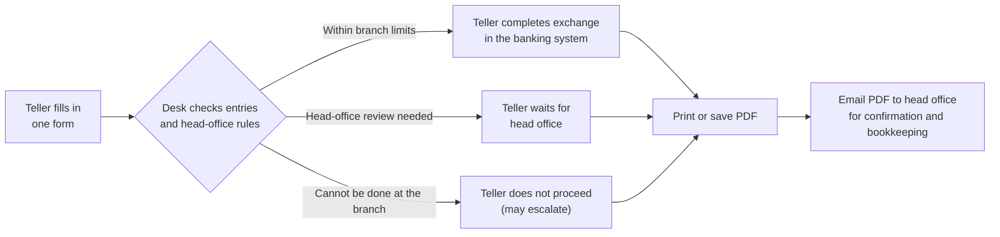
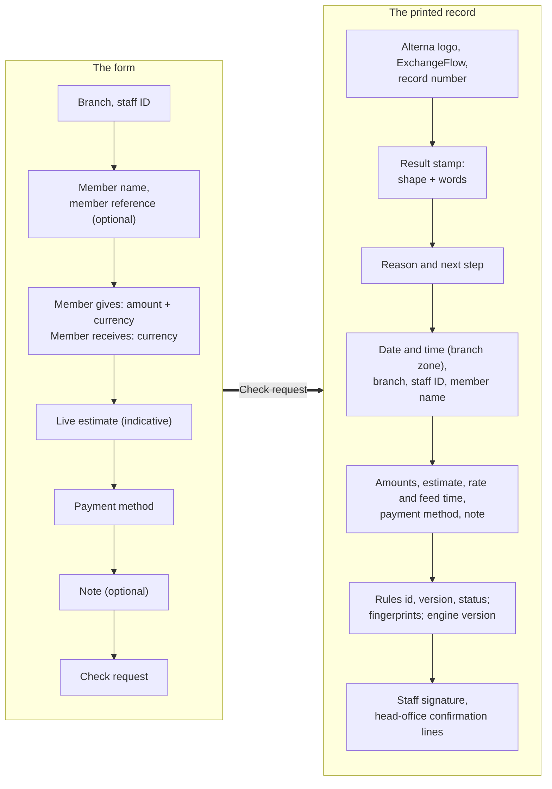
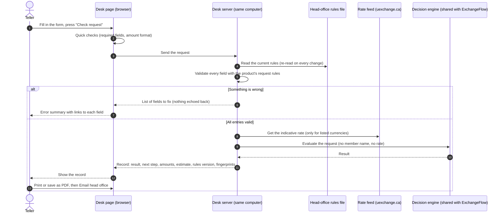
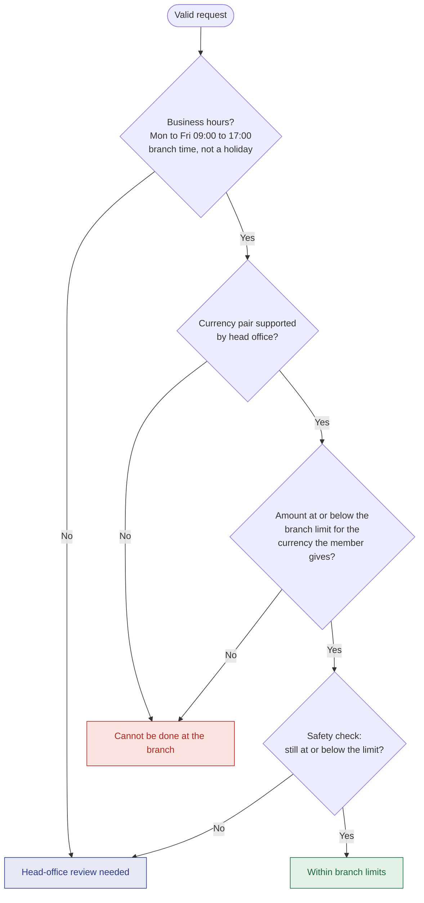
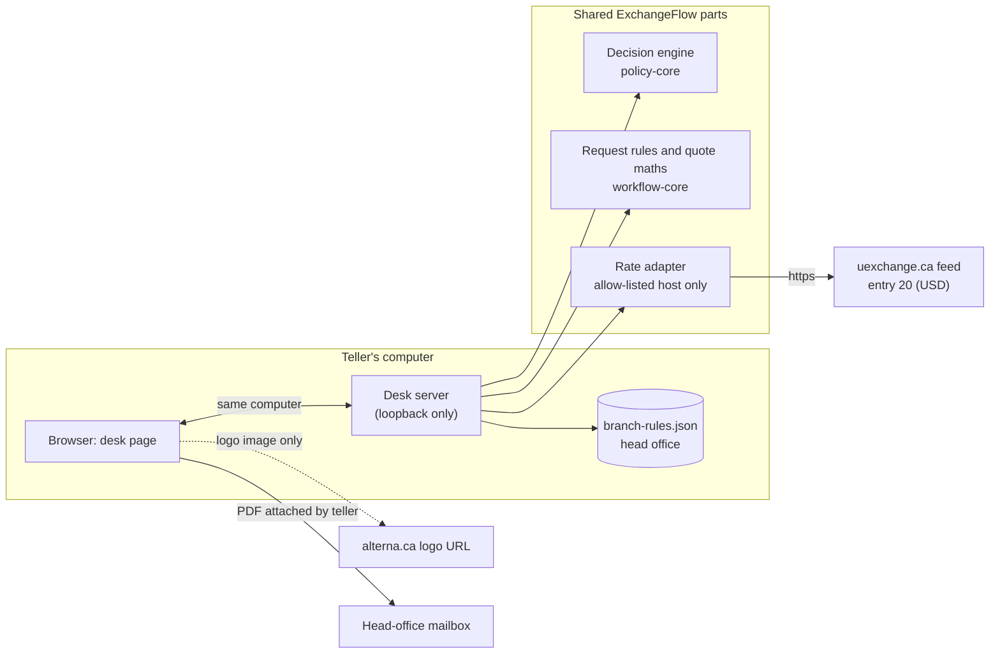
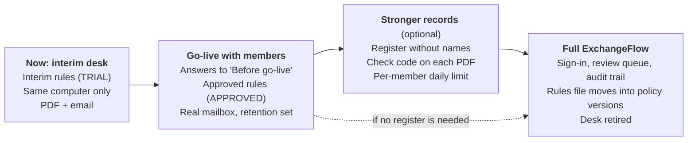

# ExchangeFlow Branch Desk: Product Requirements

| | |
|---|---|
| **Product** | ExchangeFlow Branch Desk: an interim one-page tool that checks a currency exchange against head-office rules and prints a record |
| **Status** | Draft v0.1, for stakeholder review. The tool exists as a working local build; the rules are **interim** and every value marked `[TBD-Stakeholder]` needs a stakeholder answer |
| **Owner** | Product owner |
| **Last updated** | 2026-10-12 |
| **Decision record** | [ADR-029](adr/adr-029-interim-branch-desk.md) (accepted 2026-10-12) |
| **Decision log** | `reviews/ba-review.md` §4 (DL-N37, DL-N39, DL-N40, DL-N41 to DL-N49) |
| **Evidence** | Team review: `reviews/desk-security.md`, `desk-qa.md`, `desk-ba.md`, `desk-architect.md`, `desk-ui.md`. Code: `exchangeflow/apps/teller-lite/` |
| **Parent product** | [`PRD.md`](../PRD.md): the full ExchangeFlow product. This document covers only the interim desk |

> **For stakeholders: what we are asking.** Approve the interim desk for branch use, and answer the questions in [section 9](#9-questions-for-stakeholders). Eight answers are needed before real members are served (marked **Before go-live**).

---

## 1. Summary

The full ExchangeFlow product, with sign-in, a review queue and an audit trail, is still being built. In the meantime, the **Branch Desk** gives tellers one page that:

1. **collects** a currency exchange request;
2. **checks** every entry and applies the **head-office rules** (limits, supported currencies, opening hours);
3. **shows the result**: *Within branch limits*, *Head-office review needed* or *Cannot be done at the branch*;
4. **produces a record** the teller prints or saves as a PDF and **emails to head office** for confirmation and bookkeeping.

It **never moves money**. The teller still completes the exchange in the banking system.

---

## 2. Why

### 2.1 The problem

| Problem | Effect today | What the desk changes |
|---|---|---|
| Exchange rules live in people's heads or scattered documents `[TBD-Stakeholder: confirm current procedure, DL-N47]` | Branches may apply limits differently | One rules file, set by head office, applied the same way at every branch |
| There is no consistent written record of why an exchange was allowed | Bookkeeping and later questions depend on memory | Every check produces a numbered record with the rules version and a fingerprint |
| Head office learns about larger or unusual exchanges late, or not at all | Decisions that need head office are taken at the branch | Requests above the limit, outside hours or in unsupported currencies are routed to head office |
| The full product is months away (REL-1 is provisionally six iterations) | Branches wait for any improvement | A small tool now, built on the same decision engine as the full product, so nothing is thrown away |

### 2.2 Goals

| ID | Goal | How we will know |
|---|---|---|
| G1 | Same answer at every branch for the same request | The result comes only from the head-office rules file; the test suite proves it (64 automated tests) |
| G2 | A record for every checked exchange | Every check prints a numbered record with date, branch, staff ID, amounts, result and rules version |
| G3 | Head office sees what needs it | Every result says what the teller does next, and every record is emailed to head office |
| G4 | Better member experience while the full product is built | Teller gets an answer and an estimate in one screen, in seconds `[TBD-Stakeholder: target time per exchange]` |
| G5 | No rework later | The desk uses the full product's engine and request rules, so its rules and records can move into ExchangeFlow |

### 2.3 Non-goals

- Moving money, posting to accounts or replacing the banking system.
- Sign-in, roles or a review queue (these come with the full product).
- Storing records. The desk keeps nothing; the PDF is the record (decided 2026-10-12, DL-N45).
- Regulatory reporting or identity checks. Existing procedures still apply `[TBD-Stakeholder: DL-N47]`.

---

## 3. What

### 3.1 Users

| User | Does | Does not |
|---|---|---|
| **Teller** (branch staff) | Fills in the form, reads the result, completes or holds the exchange, prints and emails the record | Edit rules; see the limits themselves |
| **Head-office officer** | Writes the rules file; receives and confirms records by email | Use the desk to decide (head office replies by email) |
| **Approver** `[TBD-Stakeholder: DL-N42]` | Approves the rules file values before `status` becomes `APPROVED` | |
| **Compliance and privacy officers** `[TBD-Stakeholder: DL-N10, DL-N26]` | Review the rule values and the handling of records with member names | |

### 3.2 Scope

| In scope (built) | Out of scope (for now) |
|---|---|
| One form: branch, staff ID, member name, member reference, amount and currency, currency received, payment method, note | Wire transfers and other request types |
| Validation of every field, on the page and again on the server | Sign-in and verified staff identity |
| Head-office rules from one file: currencies, pairs, payment methods, branch limit per currency, opening hours, holidays | A per-member daily limit (needs a register, DL-N45, DL-N49) |
| Live indicative estimate of what the member receives (CAD/USD only) | Locking a rate for the member |
| Printable record, "Save as PDF", "Email head office" | Automatic email sending, storage, search |
| English | French (DL-N38) |
| Runs on the teller's own computer | Serving a whole branch network (DL-N46) |

### 3.3 The form and the record

---

## 4. How it works

### 4.1 One check, step by step

Two things never reach the decision: **the member's name** (it appears only on the record) and **the rate** (it is for the estimate only). Tests prove both.

### 4.2 How the result is decided

The engine applies the rules in a fixed order. The first that applies wins.

### 4.3 What the teller does next

| Result | Mark on the record | Next step printed on the record |
|---|---|---|
| **Within branch limits** | ✓ in a square | "You may complete the exchange in the banking system. Then email this record to head office for confirmation and keep a copy for the branch file." |
| **Head-office review needed** | open dome | "Do not complete the exchange yet. Email this record to head office and wait for their confirmation before you go ahead." |
| **Cannot be done at the branch** | ✕ in a circle | "Do not complete the exchange. To escalate, email this record to head office and ask them to review it." |

Each result has its own word, shape and colour, so it still reads correctly on a black-and-white printer.

### 4.4 Building blocks

---

## 5. Rules: what, why and how

### 5.1 Head-office decision rules

Head office sets these in `branch-rules.json`. **Current values are interim**, set by the product owner on 2026-10-12 and marked `TO-BE-CHANGED` until head office supplies its rules (DL-N49).

| ID | Rule (what) | Why | How it works | Interim value |
|---|---|---|---|---|
| HR-1 | **Business hours.** Outside opening hours, the request needs head-office review | Head office must be reachable to stand behind a branch decision; after-hours exchanges carry more risk `[TBD-Stakeholder: confirm reason]` | Branch-local time from each branch's time zone; checked first, so it beats every other rule | Mon to Fri, 09:00 to 17:00 |
| HR-2 | **Holidays.** A listed holiday counts as outside hours | Same as HR-1. Today (Thanksgiving, 2026-10-12) shows why: without the list, it counts as open | Dates in the branch's own calendar | List empty: `[TBD-Stakeholder]` |
| HR-3 | **Supported pairs.** Only listed currency pairs can be done at the branch | Branches hold only some currencies; others need head office | `SELL/BUY` pairs; anything else is *Cannot be done at the branch* | CAD/USD and USD/CAD |
| HR-4 | **Branch limit.** At or below the limit: within branch limits. Above: cannot be done at the branch | Caps what a branch commits to without head office | Per currency, in the currency **the member gives**; exact decimal maths | Member sells USD: up to **2,000.00 USD**. Member sells CAD: up to **1,500.00 CAD** |
| HR-5 | **Safety check.** No automatic "within limits" above the branch limit, even if a rule is written wrongly | A second, independent line of defence | The engine's guardrail repeats the limit and can only downgrade a result | Same as HR-4 |
| HR-6 | **Payment methods.** Only listed methods can be chosen | Some payment methods need other checks `[TBD-Stakeholder]` | The form offers only listed methods; the server refuses others | Cash, from the member's account |

**Precedence:** HR-1 and HR-2, then HR-3 and HR-4, then HR-5. Examples, all covered by tests:

| Request | When | Result |
|---|---|---|
| 1,500.00 CAD to USD | Tuesday 11:00 | Within branch limits |
| 1,500.01 CAD to USD | Tuesday 11:00 | Cannot be done at the branch |
| 2,000.00 USD to CAD | Tuesday 11:00 | Within branch limits |
| 1,600.00 USD to CAD (above the CAD limit, within the USD limit) | Tuesday 11:00 | Within branch limits |
| 500.00 CAD to USD | Saturday | Head-office review needed |
| 5,000.00 CAD to USD | Saturday | Head-office review needed (hours beat the limit) |
| 500.00 CAD to USD | 16:59:59 / 17:00:00 | Within branch limits / Head-office review needed |

### 5.2 Entry rules (validation)

| ID | What | Why | How |
|---|---|---|---|
| VR-1 | Branch must be one head office lists | Records must name a real branch | List from the rules file |
| VR-2 | Staff ID: 2 to 20 letters or digits | Identifies who checked it (not verified, see DL-N46) | Remembered on the computer after a successful check |
| VR-3 | Member name: 2 to 80 letters, as on the ID, **no digits** | The record needs the name (decided 2026-10-02); no digits means no card or ID number can be typed here | Same rule as the full product |
| VR-4 | Member reference optional: letters, digits, `-`, `_`, up to 40 | Links to the banking system without personal data | Same rule as the full product |
| VR-5 | Amount: a positive decimal, at most the currency's decimal places | Money is never a rounded float | Exact decimal strings everywhere |
| VR-6 | The two currencies must differ and be listed | Nothing to exchange otherwise | |
| VR-7 | Note optional, up to 200 characters, **no card or SIN-like numbers** | Keeps sensitive numbers off paper and email | Pattern check on the server |

### 5.3 Rate and estimate rules

| ID | What | Why | How |
|---|---|---|---|
| QR-1 | The estimate is **indicative** and never changes the result | A third-party rate is not the credit union's rate board; decisions must not move with the market | The rate is fetched after validation and kept away from the engine |
| QR-2 | Source: uexchange.ca public feed, entry 20 (USD) | Product-owner decision 2026-10-02 | Server-side, allow-listed host, 5 s timeout, 60 s cache |
| QR-3 | Member sells CAD: amount ÷ sell value. Member sells USD: amount × buy value | Matches the feed's meaning (CAD per 1 USD) | Exact decimal maths |
| QR-4 | **Rounded down** to the cent | Never give more than the rate allows (decision 2026-10-02) | 500.00 CAD at 1.4499 = **344.85 USD**; 250.00 USD at 1.3500 = **337.50 CAD** |
| QR-5 | No estimate when the amount rounds to nothing, the pair is not CAD/USD or the feed fails | A "0.00" estimate misleads | The check still works without an estimate |

### 5.4 Record, privacy and security rules

| ID | What | Why | How |
|---|---|---|---|
| RR-1 | Every record has a number, the branch-time date, the rules id, version and status, and two fingerprints | Head office can tell which rules produced it | `EFD-YYYYMMDD-XXXXXX`; fingerprints of the rules and of the request |
| RR-2 | The PDF file name is the record number only | No member name in file names, tabs or email subjects | |
| RR-3 | The email the desk opens carries the record number, result and staff ID, **not the member name** | Email subjects and bodies are widely copied | The teller attaches the PDF |
| RR-4 | The desk stores nothing | No new store of personal data (decided 2026-10-12) | No database, no logs with names |
| SR-1 | Runs on the teller's own computer only | No sign-in or encryption yet | The server refuses any network address (until DL-N46) |
| SR-2 | No third-party requests except Alterna's logo image | Privacy and integrity of the page | Security policy allows images from `www.alterna.ca` only; no referrer sent |
| SR-3 | A broken rules file stops all checks | Never guess with bad rules | The page says the rules are unavailable |

---

## 6. Requirements

Status: **Built** = in the local build with tests; **Open** = needs a decision or work.

### 6.1 Functional

| ID | Requirement | Acceptance | Status |
|---|---|---|---|
| BD-FR-01 | The teller enters a request on one page | All fields in section 3.3 on one screen; works on a narrow window | Built |
| BD-FR-02 | Every entry is validated before any check | Errors listed in a summary that links to each field; the server repeats every check | Built |
| BD-FR-03 | The request is checked against the head-office rules | Results follow section 5.1 for all examples | Built |
| BD-FR-04 | The teller sees one of three results with a next step | Wording as in section 4.3 | Built; wording approval open (DL-N48) |
| BD-FR-05 | An indicative estimate shows while typing | Section 5.3; updates within about half a second | Built |
| BD-FR-06 | The record can be printed or saved as PDF | Only the record prints, on one Letter page, readable in black and white and from dark mode | Built; a real print test is still to do |
| BD-FR-07 | The teller can open an email to head office | Address from the rules file; no member name in the email text | Built; real address open (DL-N43) |
| BD-FR-08 | Head office changes rules without a release | Editing the file takes effect on the next check; a bad file is refused | Built; owner and approval open (DL-N42) |
| BD-FR-09 | Rules can name holidays | Holiday dates count as outside hours | Built; dates open |
| BD-FR-10 | Head office can detect edited or repeated records | Register and check code | **Open** (declined for now, DL-N45) |
| BD-FR-11 | A per-member daily limit | Needs a register | **Open** (DL-N49) |

### 6.2 Non-functional

| ID | Requirement | Status |
|---|---|---|
| BD-NFR-01 | Same engine and request rules as the full product (no second rule engine) | Built |
| BD-NFR-02 | Member name never enters the decision, logs, error messages, URLs, page titles or email text | Built, tested |
| BD-NFR-03 | The rate never affects the result | Built, tested |
| BD-NFR-04 | Accessible: keyboard use, visible focus, error summary, results not shown by colour alone, contrast AA | Built; no screen-reader or automated audit yet |
| BD-NFR-05 | Alterna look: palette and form style from alterna.ca, Inter font self-hosted, logo by URL | Built; brand use needs Alterna's sign-off (DL-N37) |
| BD-NFR-06 | Safe by default: same-computer only, strict security headers, request size and rate limits | Built |
| BD-NFR-07 | French interface | Open (DL-N38) |

---

## 7. Decisions already made

| Date | Decision | Where |
|---|---|---|
| 2026-10-02 | Rate source uexchange.ca entry 20; member name recorded; amount rounded down to the cent | DL-N39, DL-N40, `CLAUDE.md` |
| 2026-10-12 | Build the desk as a small app on the shared engine; rules in a file head office edits; record printed or saved as PDF and emailed | ADR-029 |
| 2026-10-12 | Member name is printed on the record | ADR-029 |
| 2026-10-12 | Tellers may act on "Within branch limits" under interim rules (scoped deviation from ADR-021, desk only) | ADR-029, DL-N41 |
| 2026-10-12 | Interim limits: 2,000.00 USD (USD to CAD), 1,500.00 CAD (CAD to USD); above = cannot be done at the branch | ADR-029, DL-N49 |
| 2026-10-12 | No register for now | ADR-029, DL-N45 |
| 2026-10-12 | Interim-rules warning kept in documents, not on the page | ADR-029 |
| 2026-10-12 | Alterna logo shown by URL reference | ADR-029, DL-N37 |

---

## 8. Risks

| Risk | Likelihood | Impact | Mitigation now | Better mitigation (needs a decision) |
|---|---|---|---|---|
| Interim limits are wrong for the business | Medium | Exchanges allowed or refused wrongly | Every record goes to head office; values marked TO-BE-CHANGED | Head office supplies approved values (Q-RULES-1) |
| A teller edits a PDF or re-checks until "within limits" | Low to medium | Records cannot be trusted | Signature lines; head office sees every emailed record | Register and check code (Q-OPS-3) |
| Member names in PDFs and email are kept too long or sent to the wrong place | Medium | Privacy breach | Name only in the PDF, not the email text; file named by record number | Retention and channel rules (Q-PRIV-1) |
| Rate feed terms, accuracy or availability | Medium | Wrong or missing estimates | Indicative only; never affects the result; works without it | Confirm terms or an internal rate source (Q-RATE-1) |
| Staff ID is typed, not verified | Medium | Wrong person on the record | Hand signature on the record | Sign-in (full product) |
| Logo used without Alterna's permission | Low | Brand complaint | Logo by URL only, not copied | Written permission and official files (Q-BRAND-1) |

---

## 9. Questions for stakeholders

**Before go-live** = must be answered before the desk serves real members.

### 9.1 Rules (head office, policy owner)

| ID | Question | Options | Recommendation | Blocks |
|---|---|---|---|---|
| Q-RULES-1 (DL-N49) | What are the real branch limits per currency and direction? | Keep interim values / supply new values | Supply values; compliance reviews them | **Before go-live** |
| Q-RULES-2 (DL-N49) | Above the limit: should it be "cannot be done at the branch" (current) or "head-office review needed"? | Cannot do / review / a middle band for review with a hard ceiling above | A middle band: up to the limit is fine, up to a ceiling needs review, above the ceiling cannot be done | Rule design |
| Q-RULES-3 | What are the opening hours per branch, and which holidays apply? | One set for all / per branch | One set plus a per-branch holiday list | **Before go-live** |
| Q-RULES-4 (DL-N49) | Is a per-member daily limit needed? | No / yes (needs a register) | Decide together with Q-OPS-3 | Register |
| Q-RULES-5 | Which payment methods are allowed at the branch, and do any need head office? | Cash and account (current) / add others | Keep current until named | |
| Q-RULES-6 | Are other currencies (EUR, GBP) in scope? | CAD/USD only / add more | CAD/USD for the interim | Rates for other currencies |
| Q-RULES-7 (DL-N42) | Who writes the rules file, who approves it, and how are branches told about a change? | One officer / an editor plus a separate approver | Separate editor and approver; version label changed on every edit | **Before go-live** |

### 9.2 Operations (head office operations)

| ID | Question | Options | Recommendation | Blocks |
|---|---|---|---|---|
| Q-OPS-1 (DL-N43) | What is "head-office confirmation"? Who reads the mailbox, how fast, and what does the teller do if no reply comes? | Reply email quoting the record number / phone call | Reply email with "confirmed" or "not confirmed" and the record number; a set turnaround time | **Before go-live** |
| Q-OPS-2 (DL-N43) | Which mailbox receives the records? | A shared head-office mailbox | Shared, restricted mailbox | **Before go-live** |
| Q-OPS-3 (DL-N45) | Should the desk keep a register (no member names) so head office can check PDFs and spot repeated checks? | No (current) / yes, with a check code on each PDF | Yes, once retention is agreed | Detecting edited records |
| Q-OPS-4 (DL-N47) | Does the desk replace any current step, or sit beside it? When is it retired? | Beside / replace | Beside the existing procedure; retire when ExchangeFlow REL-1 is live | **Before go-live** |
| Q-OPS-5 (DL-N46) | Will each teller computer run the desk, or one computer per branch? | Each computer (current) / branch network with access key and HTTPS | Each computer | Deployment |

### 9.3 Privacy, compliance, brand

| ID | Question | Options | Recommendation | Blocks |
|---|---|---|---|---|
| Q-PRIV-1 (DL-N44, DL-N39) | Where do PDFs with member names live, for how long, and how are they destroyed? | Mailbox only / branch file / both | Restricted mailbox; tellers delete the downloaded PDF after sending; period set by the privacy officer | **Before go-live** |
| Q-COMP-1 (DL-N09, DL-N10) | Which regulator applies, and will compliance review the rule values? | | Name the compliance officer and review before `APPROVED` | **Before go-live** |
| Q-COPY-1 (DL-N48) | Who approves the result labels and next-step texts? | Compliance / policy owner | Compliance with the policy owner | **Before go-live** |
| Q-RATE-1 (DL-N40) | Are the uexchange.ca feed's terms acceptable, or should an internal rate source be used? | Keep / replace | Confirm terms in writing, or replace | Estimate |
| Q-BRAND-1 (DL-N37) | May the desk show Alterna's logo, and will Alterna supply official files (colour, black-and-white, dark background)? | Logo by URL (current) / official files / text only | Ask Alterna for written permission and files | Brand use |
| Q-LANG-1 (DL-N38) | Is a French version needed for the interim desk? | English only / French too | English for the interim | |

---

## 10. Roadmap

---

## 11. Not yet verified

- A real print or saved PDF from Chrome, Edge and Safari (print styling was checked on screen only).
- Screen-reader use and an automated accessibility audit.
- Very narrow screens below 500 px.
- The rate feed's terms of use.
- Every value marked `[TBD-Stakeholder]` in this document.

## 12. Glossary

| Term | Meaning |
|---|---|
| Branch limit | The most a member can exchange at the branch without head office, per currency, in the currency the member gives |
| Escalate | The teller asks head office to review a request the desk said cannot be done at the branch |
| Fingerprint | A short code computed from the rules or from the request, printed on the record so head office can match it |
| Indicative estimate | What the member would receive at the feed's rate, rounded down; not a locked rate |
| Rules file | `branch-rules.json`, the head-office rules the desk applies |
| TRIAL / APPROVED | Status of the rules file: interim values, or values approved by head office |
