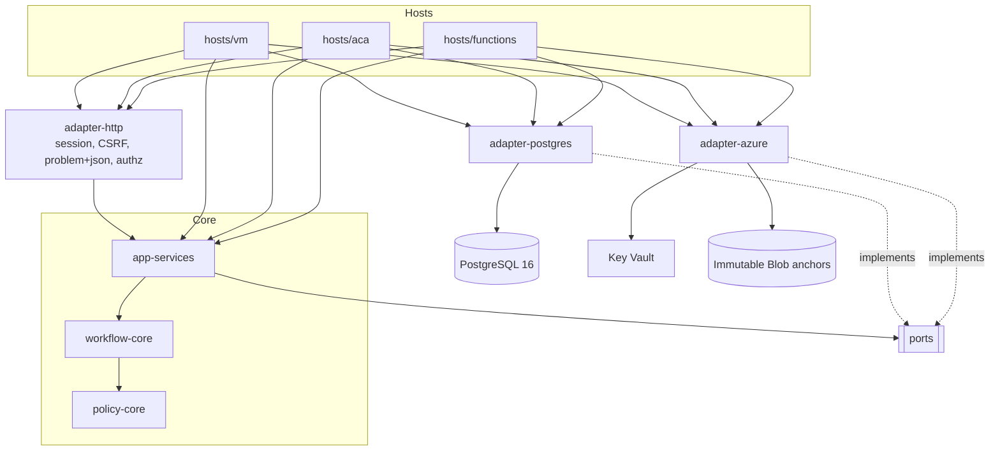
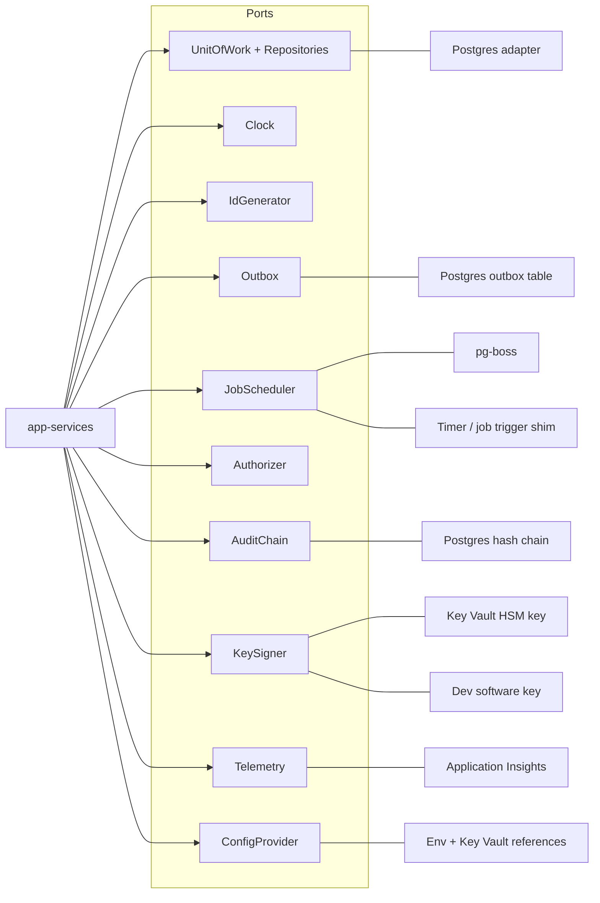
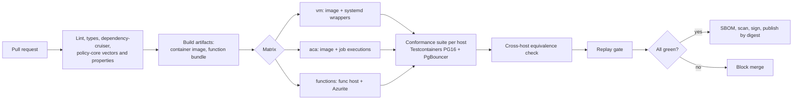
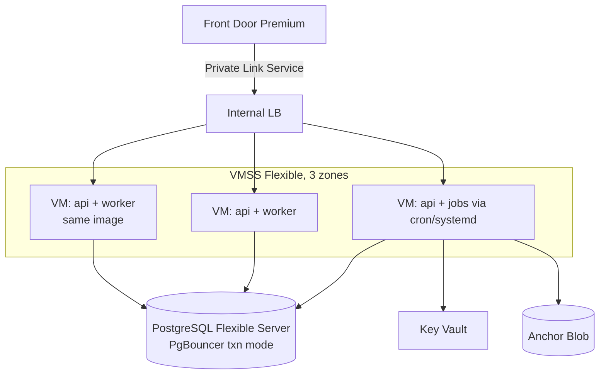
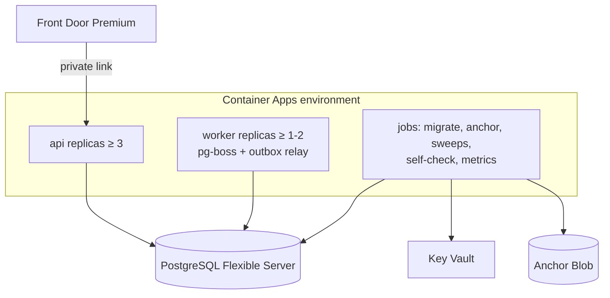
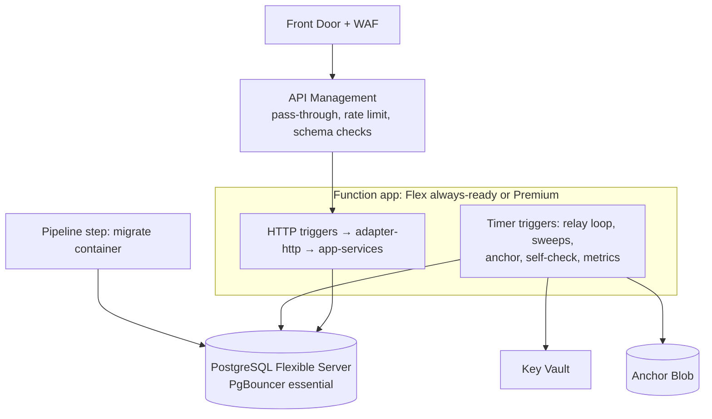

# ExchangeFlow Core Engine Plan — one core, three hosts

**Status:** Draft v0.2 (2026-10-01). Planning only; no code. Revised after the five reviews in `reviews/core-engine-*.md` and the product owner's decisions of 2026-10-01. ADR-023 and ADR-024 are *Proposed*; ADR-025 and ADR-026 are *Accepted*; see §11.
**Bases:** `policy-engine-design.md` v0.2, `PRD.md` v0.2, `azure-architecture-proposal.md` v0.2 §4–§6, ADR-001 to ADR-022.
**Owner:** Technical lead (to be assigned).

All diagrams are Mermaid. Existing IDs (R1–R21, INV-*, DT-*, E-xx, P-xx) are kept. New IDs are marked **new**.

### Changes from v0.1

| Change | Why (finding, decision) |
|---|---|
| Full three-host layout kept for REL-1 (product owner's decision); effort and risk stated honestly in §9. | Decision 2026-10-01; CE-MGR-01/03 |
| Lock-first evaluation at READ COMMITTED, fixed lock order, audit head row and `SECURITY DEFINER` append (§3, INV-LOCK-ORDER). | ADR-027; CE-ARCH-01/02 |
| Ports completed with a coverage matrix and compliance ports (`ComplianceFacts`, `RestrictedStore`, system actor, purge) (§4). | CE-ARCH-03, CE-BA-04, CE-SEC-10, REG-ARCH-02/04 |
| New invariants INV-LOCK-ORDER, INV-HOOKS-1, INV-SIGNER-1; INV-PAUSE-1, INV-PLACEHOLDER-1 and INV-LOG-1 sharpened (§5). | CE-QA-02/06, CE-SEC-01/02/03 |
| Scenarios renamed `CS-xx`; failpoint catalogue, seedable IDs, prod-mode start test, numeric Functions spike criteria (§7). | CE-QA-01/03/04/05/06, CE-BA-05 |
| Expiry and escalation sweeps are gated by BQ-3, BQ-4, BQ-5 and Q7 (§3, §6.3). | CE-BA-01 |
| Sequencing, risks and open decisions reconciled with the project plan and the decision log (§9, §11). | CE-MGR-01..09, CE-BA-03 |

---

## 1. Goal and scope

One hosting-agnostic core (policy engine + workflow domain + application services) that runs **unchanged** on:

| Option | Host | Status in the Azure proposal |
|---|---|---|
| 1 | VMs (VMSS, reserved instances) | Supported alternative |
| 2 | Azure Container Apps (App Service as fallback) | **Recommended** |
| 3 | Azure Functions | Not recommended; kept feasible |

Only thin adapters differ per host. The decision to host on Container Apps (ADR-AZ-1) is not reopened. This plan makes the others cheap to take if IT, cost or a pilot constraint demands it.

**Out of scope:** rule content, thresholds, UI, IaC. Regulatory requirements are researched in `docs/research/canada-credit-union-fx-requirements.md`; their engine consequences (guardrail over all outcomes, compliance facts, restricted channel) are in ADR-025 and ADR-026 and are reflected in the ports and invariants below. The E3a input schema stays `v1-draft` until DL-N12 and DL-N19 are answered.

### Design rules

1. Dependencies point inward: hosts → adapters → application services → workflow-core → policy-core. Enforced by dependency-cruiser (ADR-001).
2. PostgreSQL is the only source of truth for state, queue and outbox (ADR-002). No host adds a second store of request state.
3. `policy-core` has no I/O, no clock and no randomness (ADR-006). `workflow-core` is pure given its inputs.
4. Every invariant in §5 is enforced in application services or the Postgres adapter, never in a host.
5. A host may add: protocol translation, process lifecycle, scheduling triggers, platform telemetry. It may not add business logic.

---

## 2. Package layout

```text
exchangeflow/                      (pnpm workspace monorepo)
  packages/
    policy-core/                   pure evaluate(), rule-schema/v1, canonical JSON, decimal money
    workflow-core/                 transition table (data), commands, cycles, revisions, context builder
    ports/                         TypeScript interfaces only (§4)
    app-services/                  use-case handlers; one unit of work per command
    adapter-postgres/              repositories, UnitOfWork, outbox, audit chain, pg-boss JobScheduler
    adapter-azure/                 KeySigner (Key Vault), anchor writer (Blob), telemetry (App Insights)
    adapter-http/                  framework-neutral request pipeline: session, CSRF, problem+json, authz
    conformance/                   scenarios, decision-table vectors, host driver contract (§7)
  hosts/
    vm/                            container entry points for api, worker, jobs (systemd/cron wrappers)
    aca/                           same entry points; Container Apps job definitions
    functions/                     HTTP and timer/queue triggers wrapping adapter-http and app-services
  apps/
    web/                           React + Vite SPA (served by api hosts; static in Functions via Front Door)
```

| Package | Contains | May import | Must not import |
|---|---|---|---|
| `policy-core` | `evaluate`, AST operators, three-valued logic, precedence table, guardrail check, canonical serialiser, decimal comparison | nothing runtime | any other package, Node I/O, `Date`, `Math.random` |
| `workflow-core` | transition table rows, `applyCommand`, cycle and revision rules, resubmission floor, escalation guard, context builder (given frozen facts), reason rendering | `policy-core` | ports implementations, frameworks |
| `ports` | interfaces and value types | domain types | implementations |
| `app-services` | `submit`, `resubmit`, `escalate`, `decide`, `cancel`, `complete`, `pause`, `resume`, `publishPolicy`, sweeps (`expireApprovals`, `lapseEscalations`), self-checks | `workflow-core`, `policy-core`, `ports` | any adapter or host |
| `adapter-*` | implementations of ports | `ports`, domain types, vendor SDKs | `app-services` internals |
| `hosts/*` | wiring (composition root), triggers | everything | n/a |

Both `api` and `worker` processes in every host use the same composition root function `buildContainer(config)`; hosts differ only in which triggers they register.

### 2.1 Component view



### 2.2 Port/adapter view



---

## 3. Application services

Each command handler has the same shape, so the invariants are enforced in one place:

```text
handle(command):
  authorize(actor, action, object)            // Authorizer port, server-side, per-object SoD
  uow.run(tx =>                                // one transaction (INV-TX-1)
      load request, control row (FOR SHARE)    // INV-CTRL-1
      result = workflowCore.apply(command, state, clock.now())
      write state, revision, decision_record (full input), review decision
      audit.append(event)                      // same tx
      outbox.enqueue(messages)                 // same tx
  )
```

Evaluation happens inside `submit` and `resubmit`, **after** the control row is locked `FOR SHARE` at READ COMMITTED (ADR-027, policy-engine-design §5.1 v0.3). A concurrent pause waits for in-flight submits to commit and every later submit sees it. If the lock wait exceeds a budget the request is stored as `HUMAN_REVIEW` / `ENGINE_PAUSED`. The unit of work never retries after the lock is taken except on serialization or deadlock errors, and a retry restarts from the lock. Locks are taken in a fixed order (INV-LOCK-ORDER): control row, velocity subject rows, request row, audit head row.

Sweeps (`expireApprovals`, `lapseEscalations`) and `cancel` exist only as far as the decision log allows: Q7 and DL-N04 default to no timers and no cancel, so these handlers ship behind BQ-3, BQ-4 and BQ-5 and are not in the REL-1 conformance subset until those are answered.

---

## 4. Ports (TypeScript signatures)

Value types are decimal-string money (ADR-008), UTC instants as ISO-8601 strings (ADR-009) and branded IDs. No port returns a framework or driver type.

```ts
// ---------- shared types ----------
type Uuid = string & { readonly __brand: 'Uuid' };
type InstantUtc = string & { readonly __brand: 'InstantUtc' };   // 2026-10-01T14:03:00.000Z
type Result<T, E> = { ok: true; value: T } | { ok: false; error: E };

// ---------- unit of work and repositories ----------
interface UnitOfWork {
  /** Runs fn in ONE database transaction. Retries only on serialization/deadlock errors,
   *  at most `maxRetries`, with the same idempotency key. Rolls back on throw. */
  run<T>(fn: (tx: Tx) => Promise<T>, opts?: { maxRetries?: number; isolation?: 'read committed' | 'repeatable read' }): Promise<T>;
}

interface Tx {
  readonly requests: RequestRepository;
  readonly decisions: DecisionRepository;
  readonly policy: PolicyRepository;
  readonly control: ControlRepository;
  readonly idempotency: IdempotencyRepository;
  readonly velocity: VelocityRepository;
  readonly users: UserDirectory;
  readonly sessions: SessionRepository;
  readonly rules: RuleRepository;           // rule versions, approvals, guardrail versions (immutable)
  readonly compliance: ComplianceFacts;      // restricted partition read/write (ADR-025)
  readonly restricted: RestrictedStore;      // referrals, restricted reasons, approval steps (ADR-026)
  readonly outbox: Outbox;
  readonly audit: AuditChain;
}

interface RequestRepository {
  get(id: Uuid): Promise<ExchangeRequest | null>;
  /** Optimistic update: WHERE id = $1 AND version = $2. Throws StaleRequestError on 0 rows. */
  update(req: ExchangeRequest, expectedVersion: number): Promise<ExchangeRequest>;
  insert(req: ExchangeRequest, rev: RequestRevision): Promise<void>;
  addRevision(rev: RequestRevision): Promise<void>;
  findDueForExpiry(asOf: InstantUtc, limit: number): Promise<Uuid[]>;     // SKIP LOCKED
  findDueForEscalationLapse(asOf: InstantUtc, limit: number): Promise<Uuid[]>;
}

interface ControlRepository {
  read(): Promise<PolicyControl>;                          // never cached (ADR-016)
  /** SELECT ... FOR SHARE; returns the locked revision. */
  lockShared(): Promise<PolicyControl>;
  /** SELECT ... FOR UPDATE; pause/resume only. Increments controlRevision. */
  lockExclusive(): Promise<PolicyControl>;
  write(next: PolicyControl, event: ControlEvent): Promise<void>;
}

interface PolicyRepository {
  getCurrent(): Promise<PolicyVersion | null>;
  getById(id: Uuid): Promise<PolicyVersion>;               // immutable, cacheable by ID
  publish(manifest: PolicyManifest, signoffs: Signoff[]): Promise<PolicyVersion>;
}

interface DecisionRepository {
  insert(rec: DecisionRecord): Promise<void>;               // UNIQUE(request_id, cycle)
  insertReview(rec: ReviewDecision): Promise<void>;         // UNIQUE(request_id, cycle)
  get(id: Uuid): Promise<DecisionRecord | null>;
}

interface IdempotencyRepository {
  /** UNIQUE(submitterId, key). Returns the stored response when the payload hash matches. */
  begin(submitterId: Uuid, key: string, payloadHash: string):
    Promise<{ kind: 'new' } | { kind: 'replay'; response: StoredResponse } | { kind: 'mismatch' }>;
  complete(submitterId: Uuid, key: string, response: StoredResponse): Promise<void>;
}

// ---------- compliance and restricted data (ADR-025, ADR-026) ----------
type Tristate = 'TRUE' | 'FALSE' | 'UNKNOWN';
interface ComplianceFact { key: string; value: Tristate; source: string; actor: string; at: InstantUtc; ttlSeconds: number }
interface ComplianceFacts {
  /** Written only by service identities; the request body can never supply a fact. Stale facts read as UNKNOWN. */
  read(requestId: Uuid, asOf: InstantUtc): Promise<ReadonlyArray<ComplianceFact>>;
  write(requestId: Uuid, fact: ComplianceFact): Promise<void>;
}
interface RestrictedStore {
  /** Separate database role and column-level encryption. Every read is audited and alerts on unusual access. */
  refer(requestId: Uuid, by: ActorRef, basis: EncryptedText): Promise<void>;
  readReferral(requestId: Uuid, by: ActorRef): Promise<Referral | null>;   // compliance-restricted permission only
  addApprovalStep(step: ApprovalStep): Promise<void>;                       // multi-step PEP/HIO approval
  purge(subject: PurgeSubject, mode: 'delete' | 'crypto-shred'): Promise<PurgeReceipt>;
}
/** System actor for sweeps, relay and self-checks: a distinct identity, never a user, with its own audit trail. */
interface ActorRef { kind: 'user' | 'system'; id: string }

// ---------- other repositories added by the coverage matrix ----------
interface VelocityRepository {
  /** Per-subject lock inside the decision transaction (SEC-15). Subject = pseudonymous key. */
  lockAndIncrement(subject: string, window: string, amount: DecimalMoney): Promise<VelocityState>;
}
interface UserDirectory { get(id: string): Promise<UserRecord | null>; rolesFor(id: string): Promise<Role[]> }
interface SessionRepository { create(s: Session): Promise<void>; get(id: string): Promise<Session | null>; revoke(id: string): Promise<void> }
interface RuleRepository {
  listActiveNonProduction(): Promise<RuleVersionId[]>;       // INV-PLACEHOLDER-1 self-check
  getGuardrail(id: Uuid): Promise<GuardrailVersion>;
}
interface SelfCheckReader {                                  // read-only views for replay, reconciliation and the Sev-1 checks
  sampleDecisions(n: number, seed: string): Promise<DecisionRecord[]>;
  automatedOutcomesAfterPause(): Promise<number>;            // see INV-PAUSE-1
  requestsWithoutDecision(): Promise<number>;
}

// ---------- clock and ids ----------
interface Clock { now(): InstantUtc; }                       // the only source of asOf
interface IdGenerator { uuid(): Uuid; }                      // UUIDv7 in production; counter in tests (the HostDriver can seed it)

// ---------- outbox ----------
interface Outbox {
  /** Must be called with the same Tx as the state change (INV-TX-1). */
  enqueue(msg: { type: string; payload: unknown; dedupeKey: string }): Promise<void>;
  /** Relay: claim rows with FOR UPDATE SKIP LOCKED; at-least-once delivery. */
  claimBatch(limit: number, leaseMs: number): Promise<OutboxRow[]>;
  markDelivered(ids: Uuid[]): Promise<void>;
  markFailed(id: Uuid, error: string, retryAt: InstantUtc): Promise<void>;
  lagSeconds(): Promise<number>;                             // feeds INV-OUT-1 alert
}

// ---------- job scheduler ----------
type JobName = 'relay-outbox' | 'expiry-sweep' | 'escalation-lapse' | 'sampling' | 'self-check'
             | 'rule-metrics' | 'anchor-audit' | 'migrate';
interface JobScheduler {
  /** Idempotent registration of a recurring job (cron expression, UTC). Host decides who fires it. */
  schedule(name: JobName, cron: string, opts?: { singleton?: boolean }): Promise<void>;
  /** Register a handler. In push hosts the trigger calls handler directly. */
  register(name: JobName, handler: (ctx: JobContext) => Promise<void>): void;
  /** Run once now (used by timer triggers, ACA job executions, tests). */
  runNow(name: JobName): Promise<void>;
  /** Cluster-wide mutual exclusion for singleton jobs. Row-based, PgBouncer-safe (no session locks). */
  withLease<T>(name: JobName, ttlMs: number, fn: () => Promise<T>): Promise<T | 'lease-held'>;
}

// ---------- authorization ----------
interface Authorizer {
  /** Roles and branch scope are read from the app database on every call (ADR-014/015). */
  authorize(actor: ActorRef, action: Action, object?: ObjectRef): Promise<Result<AuthzGrant, AuthzDenial>>;
  /** Per-object separation of duties (reviewer != submitter, author != approver). */
  checkSeparation(actor: ActorRef, action: Action, object: ObjectRef): Promise<Result<void, 'SOD_VIOLATION'>>;
  requireStepUp(actor: ActorRef, action: Action): Result<void, 'STEP_UP_REQUIRED'>;
}

// ---------- audit chain ----------
interface AuditChain {
  /** Appends in the caller's transaction; computes hash = H(prevHash || canonical(event)). IDs and hashes only, no PII. */
  append(event: AuditEventInput): Promise<AuditRef>;
  verify(fromSeq: number, toSeq: number): Promise<{ ok: boolean; firstBadSeq?: number }>;
  head(): Promise<{ seq: number; hash: string }>;
}

// ---------- key signer ----------
interface KeySigner {
  /** Sign-only. Non-exportable key (Key Vault HSM in Azure; software key outside production). */
  sign(keyId: string, digest: Uint8Array): Promise<{ signature: Uint8Array; keyVersion: string }>;
  verify(keyId: string, keyVersion: string, digest: Uint8Array, signature: Uint8Array): Promise<boolean>;
  hmac(keyId: string, data: Uint8Array): Promise<Uint8Array>;   // pseudonymous customer key (SEC-14)
}
interface AnchorWriter {
  /** Writes a signed anchor to immutable storage in the audit subscription. */
  write(anchor: SignedAnchor): Promise<{ url: string }>;
}

// ---------- telemetry ----------
interface Telemetry {
  /** Allow-listed attributes only (IDs, codes, outcomes). Implementations drop unknown keys (NFR-07). */
  event(name: TelemetryEvent, attrs: AllowListed): void;
  metric(name: MetricName, value: number, attrs?: AllowListed): void;
  span<T>(name: string, fn: () => Promise<T>): Promise<T>;
  /** Business counts are read from Postgres, not from telemetry. */
}

// ---------- configuration ----------
interface ConfigProvider {
  /** Fails fast at start-up on missing or invalid values; secrets never logged. */
  get(): Readonly<AppConfig>;
}
interface AppConfig {
  environment: 'dev' | 'test' | 'perf' | 'demo' | 'prod';
  allowNonProductionRules: boolean;           // must be false when environment === 'prod' (INV-PLACEHOLDER-1)
  engine: { softBudgetMs: number; hardBudgetMs: number; version: string };
  db: { poolMax: number; usesPgBouncer: boolean; statementTimeoutMs: number };
  outbox: { relayIntervalMs: number; maxLagSeconds: number };
  keys: { anchorKeyId: string; hmacKeyId: string };
}
```

### 4.1 Port coverage matrix

| Use case or job | Ports used |
|---|---|
| `submit`, `resubmit` | Authorizer, Clock, IdGenerator, UnitOfWork (requests, control, policy, rules, idempotency, velocity, compliance, decisions, outbox, audit), Telemetry, ConfigProvider |
| `decide`, `escalate`, `cancel`, `complete` | Authorizer (incl. SoD), UnitOfWork (requests, decisions, outbox, audit), Clock |
| `pause`, `resume`, `publishPolicy` | Authorizer (step-up), UnitOfWork (control `lockExclusive`, policy, rules, audit, outbox), ConfigProvider (production guard) |
| `referToCompliance`, `readReferral` | Authorizer (`compliance-restricted`), RestrictedStore, AuditChain |
| `relay-outbox` | JobScheduler (`withLease`), Outbox, Telemetry (system actor) |
| `expiry-sweep`, `escalation-lapse` (gated by BQ-3/4/5) | JobScheduler, RequestRepository, system actor |
| `anchor-audit` | AuditChain, KeySigner, AnchorWriter |
| `self-check` | SelfCheckReader, RuleRepository, AuditChain, Telemetry |
| `rule-metrics`, `sampling` | UnitOfWork (read), SelfCheckReader, Clock |
| `purge` | RestrictedStore, AuditChain (event only) |

Port rules that make the adapters interchangeable:

- `UnitOfWork.run` is the only way to touch repositories. A repository call outside it is a compile error (no repository is exposed on the container, only `Tx`).
- No port exposes a session-level feature of PostgreSQL (advisory session locks, `LISTEN/NOTIFY`, prepared-statement reuse across calls). That keeps every host valid behind PgBouncer in transaction mode. Singleton jobs use `withLease`, a row-based lease with a TTL.
- `Clock` and `IdGenerator` are injected everywhere; a lint rule bans `Date.now()` and `crypto.randomUUID()` outside the adapters.

---

## 5. Invariants every adapter must keep

Existing IDs are reused as they appear in the design and ADRs. **New** IDs are marked.

| ID | Statement | Enforced in | Adapter obligations | Conformance test |
|---|---|---|---|---|
| **INV-TX-1** (new) | Decision record, request state, audit event and outbox rows are committed in one transaction, or none are. | `app-services` handler shape (§3), `UnitOfWork` | `Tx` shares one connection; the outbox and audit writers accept only a `Tx`; hosts must not write any of the four outside `uow.run` | CS-02 fault injection at each write; nightly reconciliation (NFR-04) |
| **INV-CTRL-1** (new) | The control row is locked `FOR SHARE` at the start of the unit of work, at READ COMMITTED, and evaluation uses the locked revision (ADR-027). If the wait exceeds a budget the request is stored as `HUMAN_REVIEW` / `ENGINE_PAUSED`. | `submit`, `resubmit` handlers, `ControlRepository.lockShared` | Pause and resume take `lockExclusive` on the same row and increment the revision. Isolation must be at least read committed with row locks. | CS-05: barrier failpoints after the control lock and before commit; a pause waits for in-flight submits and later submits see it; plus 1,000 randomized iterations nightly |
| **INV-PAUSE-1** | No automated outcome commits after a pause commits. Global pause: every outcome committed after the pause commit has `applied_outcome = HUMAN_REVIEW`. Per-rule pause: no outcome decided by a rule committed after that rule's pause commit is automated. (Delivered by INV-CTRL-1 and ADR-027.) | as above | as above | CS-05 with barrier failpoints; the production self-check counts automated outcomes whose commit position follows a pause commit, ordered by a monotonic commit sequence on `decision_record` (not timestamps, and not the control revision carried by the decision, which is older for a violating decision). Must be 0, Sev-1; the page goes to operations and security. |
| **INV-IDEM-1** | The same `(submitter, Idempotency-Key, payload hash)` returns the stored response and creates nothing; a different payload returns 422 `IDEMPOTENCY_MISMATCH`. Safe across retries, timeouts and failover. | `IdempotencyRepository.begin` inside the submit transaction, unique constraint | Function and container retries (platform-level) must reuse the client's key; no host generates keys | CS-03: duplicate submit, concurrent duplicate, retry after commit-then-crash |
| **INV-CONC-1** | A command applies only if `expectedVersion` matches; `UNIQUE(request_id, cycle)` on decisions and reviews is the backstop. | `RequestRepository.update`, DB constraints | Constraints live in migrations, not in application code | CS-06: concurrent reviewer decisions |
| **INV-DET-1** | `evaluate` over a stored `EvaluationInput` returns a byte-identical `Decision` for the same `engineVersion`. | `policy-core` purity; stored full input | No host may supply `asOf` except through `Clock`; canonical JSON is one shared function; the same Node major and lockfile in every host image or bundle | Replay gate on DT vectors and a stored-input sample, per host build |
| **INV-3VL-1** | A missing or ill-typed field gives UNKNOWN, never an automated outcome. | `policy-core` | n/a (pure) | DT vectors (DT-15 to DT-17) |
| **INV-OUT-1** | An outbox row is relayed within 10 s of commit; delivery is at-least-once, consumers deduplicate by outbox ID. | `Outbox.claimBatch`, relay job | The host must run the relay at least every `relayIntervalMs`; Functions must not scale the relay to zero (see §6.2) | CS-08: crash after commit, assert relay ≤ 10 s and no loss |
| **INV-PLACEHOLDER-1** (new, implements ADR-021) | In production no `nonProduction` rule is ever ACTIVE with an automated outcome; the app refuses to start if `allowNonProductionRules` is true; images contain no seed files; the decision transaction rejects a decision whose deciding rule is `nonProduction` when `environment=prod`; a self-check alerts Sev-1 as a last line. | `publishPolicy`, `ConfigProvider` validation, start-up check, commit-time check | Each host runs the check as module initialisation that throws before any trigger is registered; on Functions this also covers the cold-start path, so the check is not a warm-up function | CS-09 per host with `environment=prod` |
| **INV-AUD-1** (new) | Audit rows are insert-only for the application role and hash-chained; they hold IDs and hashes only. | `AuditChain.append`, DB grants | Application role has no UPDATE/DELETE on audit tables in any host | CS-10: grants test plus chain verification |
| **INV-LOG-1** (new) | No log, telemetry, response, notification, export or search result visible to a general role receives a canary customer value or a restricted term (ADR-026). Host auto-collection of URLs, query strings, SQL text and exception messages is disabled or filtered; APIM diagnostics omit headers and bodies. | `Telemetry` allow-list | Host platform loggers (Functions host logs, Nest logger, console) are routed through the allow-list or disabled for request bodies | CS-11 canary test (NFR-07) |
| **INV-LOCK-ORDER** (new, ADR-027) | Locks are taken in the order: control row, velocity subject rows, request row, audit head row. | `UnitOfWork`, repositories | No adapter takes a lock out of order; the audit chain appends through one head row and a `SECURITY DEFINER` function; the throughput ceiling is stated and load-tested | CS-14: concurrent submit, pause, decide and audit append show no deadlock; audit throughput test |
| **INV-HOOKS-1** (new) | Test-only clock, failpoints and job triggers are compiled out of production artifacts and have no HTTP route in any deployed host; the Functions admin and master-key surface is disabled. | Build, `ConfigProvider` | CI greps the production bundle for the hook symbols; a start test in `environment=prod` mode of the **shipped** artifact probes for the routes | CS-09 and the prod-mode start test (§7.1) |
| **INV-SIGNER-1** (new) | In production the anchor signer is the Key Vault HSM key; the app refuses to start with a software signer; each anchor records signer type and key ID; the verifier rejects software-key anchors in prod; software key IDs use a distinct prefix. | `KeySigner`, `AnchorWriter`, `ConfigProvider` | Same check in every host | CS-10 |

---

## 6. Per-host adapters: what genuinely differs

### 6.1 Summary table

| Concern | Option 1: VMs | Option 2: Container Apps | Option 3: Functions |
|---|---|---|---|
| HTTP entry | NestJS app, `adapter-http` middleware | Same NestJS app and image as VMs | Functions HTTP triggers, one thin handler per route calling the same `adapter-http` pipeline; route table generated from one shared route manifest |
| Worker / outbox relay | pg-boss worker process (`worker` role), systemd unit with restart | pg-boss worker app, min 1 (2 in prod), never scale to zero | Timer trigger (e.g. every 5 s via a sub-minute schedule or a 1-minute timer plus loop-until-empty for ≤ 55 s) calling `Outbox.claimBatch`; needs always-ready or Premium so the host stays warm. pg-boss is not run inside Functions. |
| Scheduled jobs | cron or systemd timers running the same image with a job entry point | Container Apps jobs (cron), one execution at a time | Timer triggers; `withLease` guards against double-fire on scale-out |
| Connection pooling | Per-VM pool, PgBouncer built into Flexible Server (txn mode) | Per-replica pool; replicas × `poolMax` ≤ server limit | Per-instance pool of 1–3; instances × pool ≤ server limit; PgBouncer essential. Pool is module-scoped to survive warm invocations; connection reuse is not guaranteed after scale-in |
| Cold start | None on always-on VMs | None on the submit path (min replicas); jobs may cold start | Real risk against NFR-01 (2 s p95). Needs Flex Consumption always-ready or Premium plan; measure in the spike (P21 to P23) |
| Config and secrets | Env vars from a systemd drop-in; managed identity for Key Vault | Container Apps secrets and env vars referencing Key Vault by managed identity | App settings with Key Vault references; managed identity |
| Packaging | One container image (api, worker, jobs by start command) | Same image, signed, deployed by digest | Function app bundle (zip, or custom container on Premium), built from the same workspace, SBOM and signature produced in the same pipeline |
| Release | Hand-built blue-green on VMSS | Revisions and traffic split | Slots on Premium; rolling update on Flex (no slots) |
| Telemetry | Application Insights SDK | Application Insights SDK | Functions host integration plus the same SDK; host logger must go through the allow-list (INV-LOG-1) |
| Graceful shutdown | SIGTERM handler drains in-flight commits | Same | Platform-controlled; in-flight invocations complete or are retried, so handlers must be idempotent by design (INV-IDEM-1) |

### 6.2 Host-specific notes

- **Shared HTTP layer.** `adapter-http` exposes `handle(req: NeutralRequest): Promise<NeutralResponse>`. Nest controllers and Functions triggers translate to and from it. Session cookie, CSRF, rate limits, `Idempotency-Key` and RFC 9457 errors live there once.
- **BFF session on Functions.** Sessions are in PostgreSQL, so no in-memory session affinity is needed. The OIDC callback and cookie handling are plain HTTP handlers. APIM in front of Functions (as in §6 of the Azure proposal) must pass the cookie and CSRF header through; `validate-jwt` is not used for browser sessions (ID tokens are never bearer tokens).
- **Outbox relay on Functions.** A timer minimum is one second on Premium and typically one minute on Consumption-class plans. To hold INV-OUT-1 (10 s), either run the relay as a loop inside a 1-minute timer with a lease, or run the relay as a long-running timer-triggered loop on Premium or Flex with always-ready capacity. Timer minimums and plan behaviour are Azure facts marked **verify** until the spike; no Postgres-polling trigger is assumed to exist. This is the main reason Option 3 needs a paid warm instance, and it belongs in the spike.
- **Migration.** `migrate` is a job in every host (manual trigger, migrator identity). On Functions it is a separate deployment-time container or pipeline step, never a function in the app (ADR-AZ-6).
- **Node and dependency parity.** One `.nvmrc`, one lockfile, one build produces all three artifacts. The conformance suite runs against each artifact, not against source.

### 6.2a Security obligations common to all hosts (from CE-SEC-04/05/07/08)

- Cookie baseline pinned in `adapter-http` (`__Host-`, Secure, HttpOnly, SameSite) with a named CSRF mechanism and Origin and Fetch-Metadata checks, tested identically on each host.
- On Functions and APIM: the Function App accepts traffic only from APIM or Front Door (access restriction or private endpoint, `X-Azure-FDID` validated); APIM caching is off for authenticated routes; rate-limit keys come from the session and the trusted-proxy address only; a conformance case proves a direct call that bypasses APIM is refused.
- Separate identities and database roles for web, worker, migrator and anchor signer; lease rows carry an expiry and a fencing token; the manual job trigger is disabled in production or requires a privileged audited identity.
- Secrets are fetched at runtime by managed identity where possible; Kudu and SCM are restricted; VM drop-ins are mode 0600 and separate config from secrets; a rotation test confirms a rotated secret is picked up without redeploy.
- The route manifest is the single source of authorization metadata; the build fails if a route lacks an `Action`; a deny-by-default test enumerates the triggers registered on each host.

### 6.3 Does Option 3 need Durable Functions?

**Recommendation: no (ADR-024, Proposed).**

| Durable use in the Azure proposal | Replacement with PostgreSQL as the source of truth |
|---|---|
| Wait for reviewer or time out | Reviewer queue is a query on `UNDER_REVIEW`; there is nothing to wait on |
| Expiry of approvals (BQ-3) and escalation window (BQ-5) | Deadline columns plus indexed sweeps `findDueForExpiry`, `findDueForEscalationLapse`, run by timer or job with `withLease` through workflow commands |
| "Raise event" on reviewer decision | A normal command in one transaction; no orchestrator to notify |
| Retries of notifications | The outbox relay (at-least-once, dedupe) |

Reasons (ADR-024; this assumes the expiry and escalation windows are an hour or longer, which BQ-3 and BQ-5 have not confirmed): Durable keeps a second store of request state (task hub in Azure Storage) with orchestration payloads that could carry PII, must be kept consistent with PostgreSQL, adds replay-determinism constraints on orchestrator code, and increases lock-in. The only thing it would give us (durable timers) is covered by sweeps whose granularity (1 minute) is far finer than the business windows (hours or days). Revisit only if a future requirement needs long-running multi-step sagas across external systems.

---

## 7. Conformance test suite

`packages/conformance` contains scenarios and vectors and nothing host-specific. Each host supplies a **driver**.

```ts
interface HostDriver {
  start(env: { environment: AppConfig['environment']; clock: 'real' | 'fixed'; failpoints?: string[] }): Promise<void>;
  http(req: NeutralRequest, as: TestUser): Promise<NeutralResponse>;
  runJob(name: JobName): Promise<void>;          // fires the same job the real trigger would
  setClock(t: InstantUtc): Promise<void>;        // in-process only; compiled out of production artifacts (INV-HOOKS-1)
  seedIds(seed: string): Promise<void>;          // makes the IdGenerator deterministic so cross-host comparison is meaningful
  barrier(failpoint: string): Barrier;           // holds a request at a named point until released (deterministic races)
  crashAfter(failpoint: string): Promise<void>;  // see the failpoint catalogue; the mechanism per host is defined there
  db(): ReadOnlyPg;                              // direct read access for assertions
  stop(): Promise<void>;
}
```

### 7.1 Failpoints and the shipped artifact

| Failpoint | Meaning | Mechanism per host |
|---|---|---|
| `after-control-lock`, `before-commit` | Barriers for the pause race (CS-05) | In-process hook in non-production builds only |
| `rollback-before-write-N` | A thrown error before the Nth write inside the unit of work | In-process hook |
| `process-death-after-commit` | Process dies after commit and before the response is sent (lost acknowledgement) | VM and ACA: kill the container; Functions: terminate the host process under `func start`; the test then retries with the same idempotency key (CS-03) |
| `relay-crash-after-claim` | Relay dies holding a lease | Kill the worker or abandon the lease (CS-08) |

Conformance runs against the **shipped artifact**. Test hooks exist only in dedicated non-production builds; a second job starts the production artifact with `environment=prod` and asserts it refuses non-production rules, a software signer and any hook route (INV-HOOKS-1, INV-SIGNER-1, INV-PLACEHOLDER-1). Cross-host equivalence compares the canonical decision, `context_hash` and the audit entry hash with IDs seeded and `asOf` fixed; VM and ACA share an image, so the meaningful comparison is the Functions host against the container hosts.

### 7.1a Contents

| Group | Content | Source |
|---|---|---|
| Decision table | Vectors DT-01 to DT-41 as JSON, expected results per `policy-engine-design.md` §11, run through (a) `evaluate` directly and (b) `POST /requests` on each host | `reviews/qa-review.md` §4, design §11 |
| Properties | P1–P7, ≥ 1,000 cases each, against `policy-core` once; P5 and P6 also end-to-end per host | design §11 |
| Scenarios (**new** CS-xx, conformance scenarios; renamed from S-xx to avoid the workshop IDs S-01 to S-03) | CS-01 happy paths for all three outcomes; CS-02 fault injection at each write inside the transaction; CS-03 idempotency (duplicate, concurrent duplicate, commit-then-crash retry); CS-04 resubmission floor; CS-05 pause race, 1,000 iterations; CS-06 concurrent reviewer decisions; CS-07 escalation once within window; CS-08 outbox crash-after-commit and relay ≤ 10 s; CS-09 placeholder guard in prod; CS-10 audit grants and chain verification; CS-11 canary values in logs; CS-12 expiry and lapse sweeps with double-fire; CS-13 role conflicts and per-object SoD; CS-14 lock order (concurrent submit, pause, decide and audit append) and audit throughput; CS-15 guardrail over approve and decline with each compliance fact true, false, UNKNOWN and stale |
| Replay | Stored inputs re-evaluated under the new build; any diff blocks promotion | ADR-006 |
| Cross-host equivalence | The same scenario run on all hosts against the same seeded database produces identical `decision_record.context_hash`, `outcome`, `fallback_cause` and canonical decision bytes | INV-DET-1 |

Performance (NFR-01 profile) is not a conformance test; it runs per host in the perf environment (P14), and the Functions host adds a cold-start measurement.

### 7.2 Running locally

| Host | How |
|---|---|
| `policy-core` and vectors | `pnpm test` (no services) |
| Postgres | Testcontainers: PostgreSQL 16, and a second container with PgBouncer in transaction mode so every host run goes through the pool |
| VM and ACA | Build the production image; start `api`, `worker` and a one-shot `jobs` container on a Docker network with Testcontainers' Postgres. A compose file mirrors the Container Apps roles. The VM variant adds the systemd-style entry wrappers only |
| Functions | Azure Functions Core Tools (`func start`) on the built bundle with Azurite for host storage and timers; timer triggers fired through `runJob` (admin endpoint) so tests do not wait on the clock |
| Auth | A test OIDC issuer container (or a signed-token stub), the same BFF code path in all hosts |
| Keys | Software `KeySigner`, flagged non-production by `ConfigProvider`; tests assert it is refused when `environment=prod` |

### 7.2a Cloud-only criteria (cannot be shown locally)

Local `func start` bypasses the real timer, so INV-OUT-1, cold start, scale-out and lease double-fire are measured in the Functions spike (P21) against these pass criteria (numbers are proposals for the tech lead to confirm): relay lag p99 ≤ 10 s under load; submit p95 ≤ 2 s including cold starts on the chosen plan; zero lost and zero duplicate-effect outbox deliveries under forced scale-out; zero double-fire effects of a singleton job across overlapping timers; pool saturation alarms silent at 2× peak. Azure behaviours used here are **verify** until measured.

### 7.3 CI



- The conformance matrix is a **blocking** gate for hosts that are in use. A host nobody deploys (for example Functions while Container Apps is chosen) runs nightly, so it stays viable without slowing every PR. This is an assumption to confirm (decision for the sponsor in the review summary).
- Pause-race CS-05 runs 1,000 iterations nightly and 100 on pull requests.
- Secrets in CI come from OIDC federation per environment (Azure proposal §3.5). Conformance runs need no cloud access; only the deploy job does.

---

## 8. Deployment views

### 8.1 Option 1: VMs



### 8.2 Option 2: Container Apps (recommended)



### 8.3 Option 3: Functions (feasible, not recommended)



No Durable task hub appears in any view.

---

## 9. Sequencing into the backlog

**Capacity, stated plainly.** The project plan sized REL-1 at about 44 points over three iterations. The full three-host layout adds roughly 9 to 15 person-weeks and the restricted channel 8 to 13 points; at two people REL-1 is provisionally six iterations (It2 to It7). These figures rest on the delivery review's assumptions (1 point is about 1 to 1.5 person-days, 2-week iterations, 2 to 3 people) and are to be re-baselined at the end of REL-0. R24 tracks the slip; if REL-1 slips more than one iteration, scope of ADR-023 is revisited.

Existing items keep their IDs (`application-project-plan.md` §5). **New** items are proposals for the plan owner.

| Order | Item | Change | Notes |
|---|---|---|---|
| 1 | **E2** project structure, conventions, RFC 9457 | Extended: monorepo layout in §2, dependency-cruiser rules, lint bans on `Date.now()` and random UUIDs outside adapters | ADR-001, ADR-023 |
| 2 | **E2a** (new, 5 points) ports and conformance harness skeleton | `packages/ports`, `HostDriver`, Testcontainers PG16 + PgBouncer, `fake` in-memory adapters for unit tests | Inside E2 in It2; E3a and E3 start early on local infrastructure |
| 3 | **E3a** policy engine (and guardrail over all outcomes, tri-state compliance fact schema) | = `policy-core`; DT-01 to DT-41 vectors, P1–P7 properties, INV-DET-1, INV-3VL-1; ADR-003/005/006/007/021 | Pure; no dependency on E2a adapters |
| 4 | **E3** request domain model, transition table as data, revisions, cycles | = `workflow-core`; row-by-row transition tests | ADR-018 |
| 5 | **E4** submit with idempotency and server-built context | First `app-services` handler; adds INV-TX-1, INV-CTRL-1, INV-IDEM-1, CS-01 to CS-03 on the ACA host | `adapter-postgres` first real adapter |
| 6 | **E9** users, roles, BFF session | `Authorizer`, `adapter-http` session and CSRF | Needed before E5/E6 |
| 7 | **E6** decisions, concurrency, per-object SoD, audit chain | INV-CONC-1, INV-AUD-1, CS-06, CS-10 | `AuditChain` and `KeySigner` software adapter |
| 8 | **E5**, **E7** reviewer queue; staff status, escalation, resubmission | CS-04, CS-07 | |
| 9 | **E12** pause/resume with commit-time guard | CS-05 race gate becomes blocking | INV-PAUSE-1 |
| 10 | **P5** CI/CD with gates | Extended: conformance matrix, cross-host equivalence, replay gate | §7.3 |
| 11 | **E8** inbox notifications via outbox | INV-OUT-1, CS-08; relay as job on every host | REL-2 |
| 12 | **P21** Functions host adapter, CI leg and feasibility spike | Run conformance on `hosts/functions`; measure against §7.2a | Funded in REL-1 (full layout approved); owner named at iteration planning (DL-N29) |
| 13 | **P22** PgBouncer and pool-sizing test | replicas/instances × `poolMax` vs server limit; confirm no session-level features | With P7 and P14 |
| 14 | **P23** VM host wrappers | systemd and cron wrappers | Built in REL-1 (full layout approved) |

Added by the regulatory decisions: **E20** regulatory profile, compliance fact intake and reason-text lint, **E19** restricted compliance channel (both REL-1; see the project plan). The REL-1 conformance subset is CS-01 to CS-04, CS-06, CS-07, CS-09 to CS-11 (the canary is needed from REL-1 because the restricted channel ships), CS-13, CS-14 and the prod-mode start test; CS-05 at 1,000 iterations and CS-08, CS-12 move to REL-2 with pause and shadow, and the anchor adapter ships with the audit anchor job (REL-2). Iteration placement follows the project plan's REL-1 (It2 to It7, provisional), not the earlier v0.1 placement, which collided with platform work in It2.

### 9.1 ADRs

| ADR | Title | Status |
|---|---|---|
| ADR-023 | Hosting-agnostic core with ports and thin host adapters | Proposed (**new**) |
| ADR-024 | No Durable Functions; PostgreSQL is the only request-state store | Proposed (**new**) |
| ADR-025 | Compliance guardrail covers all automated outcomes and reads compliance facts | Accepted (**new**) |
| ADR-026 | Restricted compliance channel | Accepted as scope; design Proposed (**new**) |
| ADR-027 | Lock first, then evaluate | Proposed (**new**) |
| ADR-028 | Regulatory profile as configuration | Proposed (**new**) |
| (follow-ups, after the spike) | Functions relay and timer cadence | Only if Option 3 is chosen |

ADR-023 refines, and does not supersede, ADR-001 (modular monolith) and ADR-019 (hosting and environments). ADR-024 narrows §6 of the Azure proposal. ADR-027 refines ADR-016. Option 3 content in §6 is informative until ADR-023 and ADR-024 are Accepted; acceptance criteria are in ADR-023.

### 9.2 Risks (recorded in `application-project-plan.md` §9 as R22 to R26 with owner, probability, impact and trigger)

| ID | Risk | Mitigation |
|---|---|---|
| R22 | Ports leak host assumptions (for example session-level locks) and one host silently diverges | Conformance matrix; PgBouncer container in every run; port rules in §4 |
| R23 | Functions cannot meet 2 s p95 or INV-OUT-1 without paid warm instances, erasing the cost advantage | Spike P21; Option 3 stays not recommended until measured |
| R24 | Maintaining three hosts and the restricted channel slows REL-1 | Provisional six-iteration REL-1; re-baseline at end of REL-0; revisit ADR-023 scope on slip |
| R25 | Pool exhaustion on scale-out | P22, pool caps in `AppConfig`, alert on connection saturation |
| R26 | CI time and conformance maintenance exceed capacity; flaky race tests muted | Deterministic barrier failpoints; nightly full suite; no muting without owner sign-off |

---

## 10. Traceability

| Requirement or decision | Where it is realised in this plan |
|---|---|
| FR-01 to FR-04, FR-08 (submit, idempotency) | `submit`; ports `IdempotencyRepository`; INV-IDEM-1; CS-01, CS-03 |
| FR-05, FR-06, FR-26, FR-27 (escalate, resubmit, cancel, expiry) | `escalate`, `resubmit`, `cancel`, sweeps (gated by BQ-3/4/5); CS-04, CS-07 |
| FR-07 (completion) | `complete`; release placement per PRD §10 (REL-3) is flagged for the PRD owner |
| FR-10 to FR-15 (evaluation, determinism) | `policy-core`; INV-DET-1, INV-3VL-1; DT vectors |
| FR-16 to FR-19 (rules, guardrail, velocity) | ADR-025; `VelocityRepository`; INV-LOCK-ORDER; guardrail vectors |
| FR-23, FR-24 (stale decision, one decision per cycle) | INV-CONC-1; CS-06 (`409 STALE_REQUEST`) |
| FR-34 (pause) | INV-CTRL-1, INV-PAUSE-1, ADR-027; CS-05 |
| FR-43, FR-44 (search, audit) | `AuditChain`, INV-AUD-1; CS-10; restricted projection (ADR-026) |
| FR-50 to FR-52 (notifications) | `Outbox`, INV-OUT-1 (10 s relay supports the 30 s display target; the 10 s figure is provisional like DL-N08 items) |
| FR-60 to FR-64 (roles, authorization, scope, step-up) | `Authorizer`, `adapter-http`; CS-13 |
| FR-80 to FR-83 (compliance support) | ADR-025, ADR-026, ADR-028; `ComplianceFacts`, `RestrictedStore`; CS-11 canary |
| NFR-01 (2 s p95) | Per-host acceptance in the perf environment; Functions spike §7.2a |
| NFR-02 (50/200 ms budget) | `AppConfig.engine`; deterministic step budget (`TIMEOUT` is excluded from replay equality; CE-ARCH-05) |
| NFR-03, NFR-15, NFR-18 (availability, scale, restore) | Per-host acceptance (perf and drill environments), not core conformance |
| NFR-04 (one transaction) | INV-TX-1; CS-02; nightly reconciliation |
| NFR-07 (log allow-list) | INV-LOG-1; CS-11 |
| NFR-09 (replay) | INV-DET-1; replay gate |
| Use cases | UC-01 to UC-03 (staff), UC-02 (review), UC-05 (users), UC-06 and UC-10 (monitoring, audit), UC-08 (decisioning), UC-09 (policy admin); the compliance referral is a new use case (FR-80) |

## 11. Decisions and open items

Recorded in the decision log (`reviews/ba-review.md` §4): DL-N28 (do undeployed hosts gate pull requests), DL-N29 (owner and criteria of the Functions spike), DL-N30 (`AuditChain` on `Tx`, `KeySigner` outside it). Decided 2026-10-01: ADR-023 full layout (scope), ADR-025, ADR-026.
