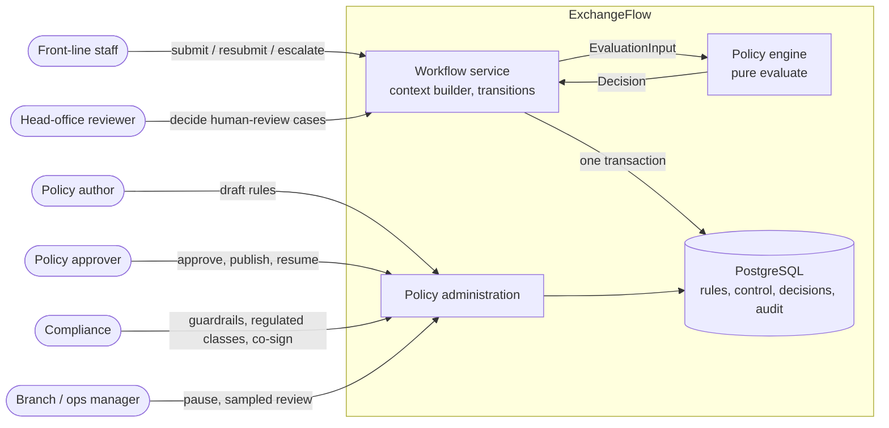
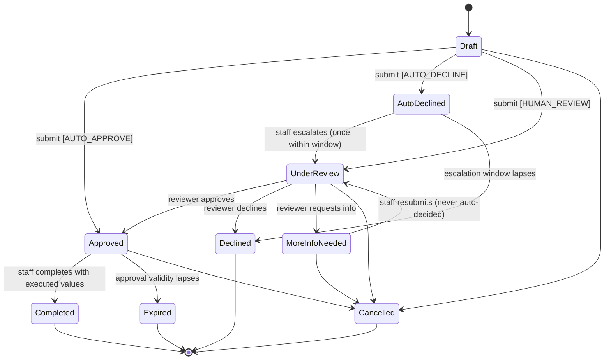
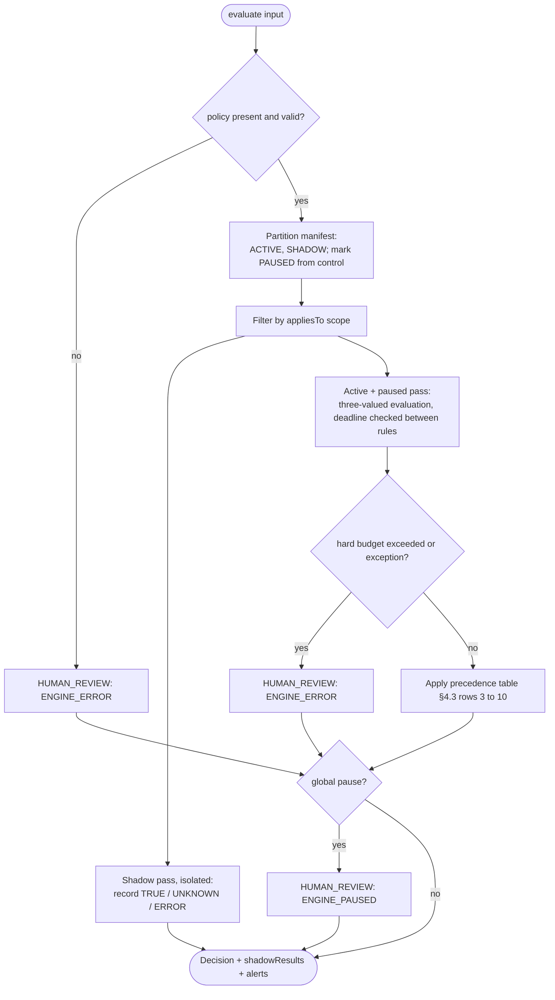
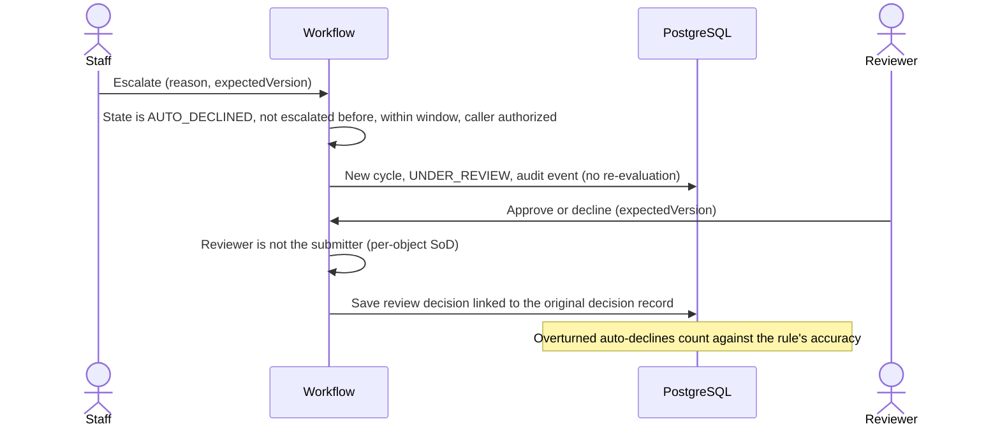
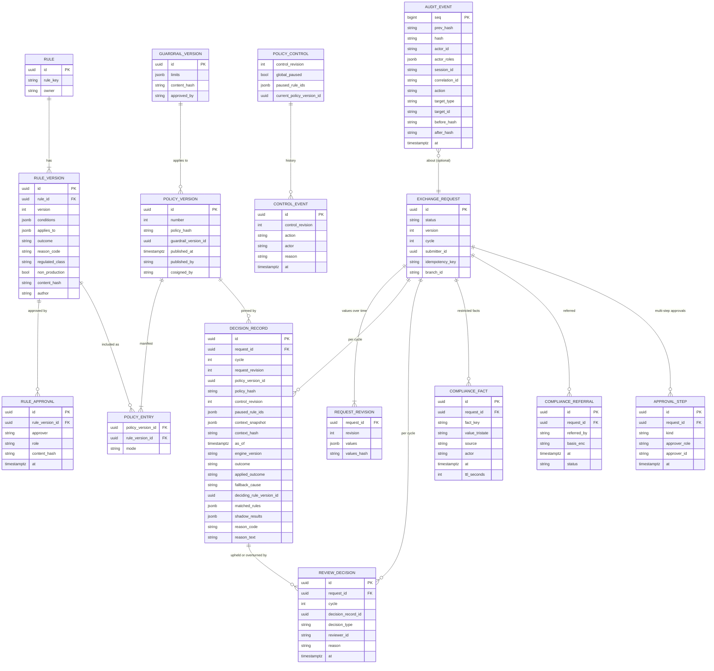
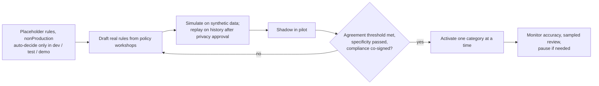

# ExchangeFlow Decision Policy Engine — Design

**Status:** Draft v0.3. Revised after the core-engine and regulatory reviews in `reviews/` (v0.2 followed the architecture, security, QA and BA reviews). Implements backlog item E3a and use cases UC-08, UC-09 and UC-10, and supports E3b (policy elicitation).
**Owner:** Technical lead (to be assigned). **Decision authority for rule content:** Policy owner (business) with compliance.
**Decisions recorded as ADRs:** see `docs/adr/README.md`.

All diagrams are Mermaid.

### Changes from v0.2

| Change | Why (review finding, decision) |
|---|---|
| The guardrail now applies to every automated outcome, including `AUTO_DECLINE`, and may read compliance facts that ordinary rules cannot (§4.1, §4.3 row 9). | ADR-025 (product owner, 2026-10-01); REG-ARCH-01, REG-QA-01, REG-BA-05 |
| Evaluation input is partitioned into general and restricted parts; general readers see a projected `Decision` (§4.1, §6.1, §6.3). | ADR-026; REG-ARCH-02, REG-SEC-01/02/03 |
| Submit and resubmit lock the control row first, at READ COMMITTED, then evaluate (§5.1); fixed lock order; audit chain head row. | ADR-027; CE-ARCH-01/02, CE-QA-01/02 |
| New compliance role, restricted store, refer-to-compliance action, multi-step PEP/HIO approval, extended role-conflict matrix (§6.3, §7). | ADR-026; REG-ARCH-04/05, REG-SEC-06, REG-MGR-04 |
| Regulatory profile is configuration, recorded on each decision. | ADR-028; REG-MGR-01 |
| Test strategy, failure modes and open items extended (§9, §11, §13). | CE-QA-01..06, REG-QA-01..04 |

### Changes from v0.1

| Change | Why (review finding) |
|---|---|
| Pausing a rule now sends every request that rule would have affected to human review. It can no longer make an outcome more permissive. | QA H1, SEC-13 |
| Shadow and paused rules are separated *before* evaluation; their errors and missing data never change the applied outcome | Architecture F-02, QA H2, BA IC-08 |
| Three-valued logic for missing fields, and rule scope (`appliesTo`) | Architecture F-03, SEC-22 |
| Explicit precedence of fallback causes; `RULE_PAUSED`, `GUARDRAIL` and `TIMEOUT` added | Architecture F-03, QA A8/A9 |
| Rule content is immutable; a policy version is an immutable manifest; pause is a separate revisioned control row | Architecture F-04, SEC-08 |
| Every decision stores its full input, so it can be replayed | Architecture F-01, QA H3 |
| Commit-time control-revision check under a row lock | Architecture D6, SEC-19, QA-AZ-08 |
| Lifecycle adds AutoDeclined, Cancelled and Expired; Submitted and Evaluated become events | Architecture F-05, BA IC-09/IC-10 |
| Resubmission is re-evaluated but can never be auto-decided | Decision on BQ-1 (2026-10-01) |
| Placeholder rules may auto-decide only outside production | Decision on REL-1 demo scope (2026-10-01), ADR-021 |
| Compliance guardrail policy, system-derived regulated flag, two-person activation, role-conflict matrix | SEC-01 to SEC-06 |
| Money as decimal strings with currency; thresholds per currency | Architecture F-09 |
| Shadow-agreement metric defined | QA H7, Architecture F-18 |

---

## 1. Purpose and scope

The policy engine decides which path an exchange request takes:

| Outcome | Meaning |
|---|---|
| `AUTO_APPROVE` | Request meets an approved policy and proceeds without human review. |
| `AUTO_DECLINE` | Request matches a hard-stop policy and is refused with a recorded, generic reason. |
| `HUMAN_REVIEW` | Request needs a head-office reviewer. This is the default and the safe fallback. |

**In scope:** rule model, versioning, deterministic evaluation, conflict resolution, shadow mode, pause controls, guardrail policy, decision record, rule lifecycle and approval, test strategy.

**Out of scope:** the actual criteria and thresholds (collected from stakeholders, task E3b), machine-learning or opaque scoring, executing or settling a transaction, and the human review UI itself.

### Design principles

1. **Fail safe to a human.** Anything not clearly covered goes to `HUMAN_REVIEW`.
2. **Monotonic safety.** Pausing, adding a human-review rule, adding a shadow rule, or adding a guardrail can only move outcomes *toward* `HUMAN_REVIEW`, never away from it.
3. **Policy is data, not code.** Criteria live in versioned, approved records in the database. No criteria are hard-coded. Files are a seed format only.
4. **Pure and deterministic.** `evaluate` is a pure function of an explicit input. It does no I/O, reads no clock and has no randomness.
5. **Explainable and replayable.** Every decision stores its full input and output, so it can be re-run and compared.
6. **Earn trust.** New or changed rules run in shadow mode before they can affect a request.
7. **Separation of duties, enforced per object.** The person who writes a rule cannot approve it, and activating an auto-approve rule needs two people other than the author.

---

## 2. System context



The engine is a dependency-free module inside the backend (modular monolith). It is called through a port, so it could later move to a worker thread without changing callers.

---

## 3. Request lifecycle

`Submitted` and `Evaluated` are **audit events, not states**. Submission and evaluation happen in one transaction that moves the request from `Draft` straight to its outcome state.



### Canonical states

| Code | Display name | Terminal | Notes |
|---|---|:-:|---|
| `DRAFT` | Draft | | Saved, not submitted |
| `UNDER_REVIEW` | Under review | | In a reviewer queue |
| `MORE_INFO_NEEDED` | More information needed | | Waiting on staff |
| `APPROVED` | Approved | | By rule or reviewer; decision path stored separately |
| `AUTO_DECLINED` | Declined by rule | | Escalatable once, within the escalation window **[TBD-Stakeholder: window, BQ-5]** |
| `DECLINED` | Declined | ✔ | By reviewer, or auto-decline whose window lapsed |
| `COMPLETED` | Completed | ✔ | Executed values recorded and reconciled (§3.2) |
| `EXPIRED` | Expired | ✔ | Approval not completed within validity **[TBD-Stakeholder: BQ-3]** |
| `CANCELLED` | Cancelled | ✔ | Reason required; who may cancel **[TBD-Stakeholder: BQ-4]** |

The transition table (`from`, `command`, `guard`, `to`, `allowedRoles`, `reasonRequired`) is held as data and tested one row at a time (ADR-018).

### 3.1 Cycles, resubmission and escalation

- A **cycle** is one evaluation or one escalation of a request. `cycle` increments on submit, resubmit and escalation. Each cycle has at most one `decision_record` and at most one final `review_decision` (enforced by `UNIQUE(request_id, cycle)`).
- **Resubmission** (after "more information needed") re-evaluates the new request revision under the *current* policy, as a new cycle. The engine result is recorded for information, but the **applied outcome is always `HUMAN_REVIEW`**, routed back to the same queue and, where possible, the same reviewer. A reviewer who asked a question always sees the answer. (Decision on BQ-1, 2026-10-01.)
- **Escalation** of an auto-decline does **not** re-evaluate. The reviewer sees the original decision, its pinned policy version and its reason. The review decision links to the decision record it upholds or overturns, which feeds the accuracy metrics.
- Request business fields are immutable after submission. Any change creates a new `request_revision` (SEC-18).

### 3.2 Completion reconciliation

`Completed` records the executed amount, currency pair and transaction reference from the existing system. A mismatch with the approved values beyond a compliance-set tolerance blocks completion and alerts compliance (SEC-17). **[TBD-Stakeholder: tolerance]**

---

## 4. Evaluation

### 4.1 Inputs and outputs

`evaluate(input: EvaluationInput) → Decision` is pure and total. Identical input gives an identical output, byte for byte after canonical serialisation (ADR-006).

**`EvaluationInput`**

| Part | Content | Source |
|---|---|---|
| `context` | Request facts, frozen by the context builder: request type, currency pair, sell and buy amounts (decimal string + ISO 4217 currency), branch ID, branch-local date, business-hours flag, and velocity facts if any approved rule needs them | Built **server-side** from the session, the user directory in the database and the validated request body. Never from client-supplied branch, role or time (SEC-28). |
| `policy` | The pinned policy version: its manifest of `(ruleVersionId, mode)` and each rule's content and hash, plus the active guardrail version | Policy store, cached in-process by immutable ID |
| `control` | `controlRevision`, `globalPaused`, `pausedRuleIds` | `policy_control` row, read on every evaluation, never cached |
| `asOf` | Evaluation instant (UTC) | Injected clock in the workflow |
| `engineVersion` | Semantic version of the evaluator | Build metadata |
| `compliance` (restricted part) | Compliance facts for the guardrail only: identity-verified, PEP/HIO flag, screening result, directive-country flag, cash flag, entity flag, compliance hold. Each is tri-state (true, false, UNKNOWN) with provenance (source, actor, timestamp, time to live). Missing or stale = UNKNOWN. | Written by service identities from compliance-owned systems, never from the request body or client (ADR-025) |

Derived facts (business hours, branch-local date, velocity counts) are computed by the context builder and frozen into `context`. The engine computes nothing from the environment.

**General and restricted parts (ADR-026).** `context`, `policy`, `control`, `asOf` and `engineVersion` form the general part. `compliance` and any restricted reason form the restricted part, stored in a separate restricted store with its own role and column-level encryption. The decision record keeps a hash of the canonical full input in the general chain, so replay verifies integrity; after a purge the replay reports "input purged". Ordinary rules cannot reference `compliance` fields (schema-enforced); only the guardrail reads them.

**`Decision`**

| Field | Description |
|---|---|
| `outcome` | `AUTO_APPROVE`, `AUTO_DECLINE`, or `HUMAN_REVIEW` |
| `fallbackCause` | Set when the outcome is `HUMAN_REVIEW`: `ENGINE_PAUSED`, `ENGINE_ERROR` (sub-cause `TIMEOUT`, `NO_POLICY`, `INVALID_POLICY`, `EXCEPTION`), `GUARDRAIL` (restricted detail `COMPLIANCE_GUARDRAIL`), `RULE_REQUIRES_HUMAN`, `RULE_PAUSED`, `MISSING_DATA`, `CONFLICT`, `NO_MATCH`, or `RESUBMISSION_FLOOR` |
| `decidingRuleVersionId` | For automated outcomes: the lowest `ruleId` among the rules supporting the outcome |
| `matchedRules` | Active rules that evaluated TRUE, sorted by `ruleId` |
| `unknownRules` | Active in-scope rules that evaluated UNKNOWN |
| `pausedMatches` | Paused rules that evaluated TRUE or UNKNOWN |
| `shadowResults` | Per shadow rule: would-be outcome, or `UNKNOWN` / `ERROR`. Never applied. |
| `alerts` | `CONFLICT` and similar signals, computed independently of the outcome (so a conflict masked by a human-review rule is still reported) |
| `reasonCode` and `reasonText` | Generic, approved text rendered once with a closed set of placeholders; no customer fields and no numeric limits (SEC-16, Architecture F-16) |
| `policyVersionId`, `policyHash`, `controlRevision`, `asOf`, `engineVersion`, `contextHash` | Echoed for storage and replay |

### 4.2 Rule matching: three-valued logic and scope

- **Scope.** Each rule declares `appliesTo` (for example request types), tested on fields that are always present. An out-of-scope rule is skipped entirely and cannot produce `MISSING_DATA`.
- **Three-valued (Kleene) logic.** A comparison on a missing or ill-typed field returns `UNKNOWN`. `not UNKNOWN = UNKNOWN`. `all` is FALSE if any child is FALSE, else UNKNOWN if any child is UNKNOWN, else TRUE. `any` is the dual. Only TRUE counts as a match.
- A field missing in an `any`/`all` branch that the result does not depend on is irrelevant: the Kleene result decides, not short-circuit order.
- Comparisons on amounts use decimal arithmetic, never floating point or string comparison. Thresholds carry a currency, and a comparison across different currencies is UNKNOWN unless the rule provides a per-currency threshold map (BQ-2).

### 4.3 Resolution and precedence

The engine resolves the outcome in this fixed order. The first row that applies wins.

| # | Condition | Outcome | `fallbackCause` |
|---|---|---|---|
| 1 | Global pause on | `HUMAN_REVIEW` | `ENGINE_PAUSED` |
| 2 | No current policy, policy invalid, exception, or hard time budget exceeded | `HUMAN_REVIEW` | `ENGINE_ERROR` + sub-cause |
| 3 | Any **active** in-scope rule with outcome `HUMAN_REVIEW` is TRUE | `HUMAN_REVIEW` | `RULE_REQUIRES_HUMAN` |
| 4 | Any **paused** in-scope rule is TRUE or UNKNOWN | `HUMAN_REVIEW` | `RULE_PAUSED` |
| 5 | Any **active** in-scope rule is UNKNOWN | `HUMAN_REVIEW` | `MISSING_DATA` |
| 6 | Active `AUTO_APPROVE` and `AUTO_DECLINE` rules are both TRUE | `HUMAN_REVIEW` | `CONFLICT` (alert) |
| 7 | Only active `AUTO_DECLINE` rules are TRUE | `AUTO_DECLINE`, then guardrail check (row 9) | — |
| 8 | Only active `AUTO_APPROVE` rules are TRUE | `AUTO_APPROVE`, then guardrail check (row 9) | — |
| 9 | Guardrail policy rejects an automated outcome (`AUTO_APPROVE` or `AUTO_DECLINE`), or a compliance fact the guardrail requires is UNKNOWN or its hold is set | `HUMAN_REVIEW` | `GUARDRAIL` (restricted detail `COMPLIANCE_GUARDRAIL`) |
| 10 | No active rule is TRUE | `HUMAN_REVIEW` | `NO_MATCH` |

After resolution, the workflow applies the **resubmission floor**: on a resubmission cycle any automated outcome becomes `HUMAN_REVIEW` / `RESUBMISSION_FLOOR`, with the engine's outcome kept in the record.

Why each rule is safe:
- **Row 4 (pause).** A paused rule is still evaluated, but only to find the requests it would have affected; they go to a human. Pausing any rule therefore never turns `HUMAN_REVIEW` into an automated outcome, and never turns `AUTO_DECLINE` into `AUTO_APPROVE` (property P5).
- **Shadow rules** are evaluated in an isolated pass. Their TRUE, UNKNOWN or exceptions are recorded in `shadowResults` and never reach rows 2–10 (property P3).
- **Row 6 (conflict).** Open decision D3 (does decline beat approve?) stays defaulted to human review. The conflict alert is raised even when row 3 decides the outcome.
- **Row 9 (guardrail).** The compliance-owned guardrail policy (max auto-approve amount per currency, prohibited request types and currencies, required compliance facts) runs after the rules, applies to approve and decline alike, and can only downgrade to human review (SEC-06, ADR-025). Thresholds are compliance parameters in the guardrail version, never literals; values are supplied by compliance.
- **Global pause (row 1).** Shadow and active rules are still evaluated to record would-be results for reporting, so agreement data is not lost (QA A15). Any failure in that evaluation is ignored.

### 4.4 Algorithm



The whole body runs inside a guard. Any uncaught exception becomes `HUMAN_REVIEW` / `ENGINE_ERROR` (`EXCEPTION`), never an automated outcome (property P4).

**Time budget.** Policies are rejected at publish time if they exceed static complexity limits (rules ≤ 500, AST depth ≤ 8, nodes per rule ≤ 200, `in` list ≤ 1,000; to confirm by load test). The engine checks a cooperative deadline between rules: 50 ms soft (metric and warning), 200 ms hard (`ENGINE_ERROR` / `TIMEOUT`) (ADR-017).

---

## 5. Interactions

### 5.1 Submit and evaluate

```mermaid
sequenceDiagram
    actor Staff
    participant API as API (BFF + workflow)
    participant PE as Policy engine
    participant DB as PostgreSQL

    Staff->>API: POST /requests (session cookie, CSRF, Idempotency-Key)
    API->>API: Session, roles and branch from DB; validate body
    API->>DB: Look up (submitter, key)
    alt key already used
        API-->>Staff: 200 stored response, or 422 IDEMPOTENCY_MISMATCH
    end
    API->>API: Build context server-side; asOf = clock.now()
    API->>DB: BEGIN (READ COMMITTED); SELECT control FOR SHARE (waits for any pause in progress)
    API->>DB: Read policy pointer by immutable ID; read compliance facts (restricted store)
    API->>PE: evaluate(context, policy, control, asOf, compliance)
    PE-->>API: Decision
    API->>DB: INSERT request + revision (unique key), decision_record (general chain + restricted part), audit event, outbox; update velocity counters (fixed lock order); COMMIT
    API-->>Staff: 201 (id, status, version, outcome, generic reason)
```

Pause and resume take `SELECT ... FOR UPDATE` on the same control row and increment `control_revision`. Because submit holds `FOR SHARE` from the start, a pause waits for in-flight submits to commit and every later submit sees the pause. **Invariant INV-PAUSE-1:** no automated outcome commits after a pause commits. If the lock wait exceeds a budget, the request is stored as `HUMAN_REVIEW` / `ENGINE_PAUSED`. This replaces the earlier evaluate-then-lock sequence (ADR-027; v0.2 re-evaluated once on a revision change).

**INV-LOCK-ORDER:** locks are always taken in the order control row, velocity subject rows, request row, audit head row. The audit chain appends through a single head row and a `SECURITY DEFINER` function (ADR-027); its throughput ceiling is stated and load-tested.

### 5.2 Shadow mode

```mermaid
sequenceDiagram
    participant API as Workflow
    participant PE as Policy engine
    participant DB as PostgreSQL
    actor Reviewer

    API->>PE: evaluate(input)
    PE->>PE: Active rules give HUMAN_REVIEW; shadow rule would AUTO_APPROVE
    PE-->>API: Decision HUMAN_REVIEW + shadowResults
    API->>DB: Save decision and shadow results
    Reviewer->>API: Decides request (shadow result hidden until decided)
    API->>DB: Save human outcome
    Note over DB: Agreement report compares shadow and human outcomes (§10.2)
```

Shadow results are hidden from reviewers until after they decide, so the agreement metric measures independent judgment (SEC-09).

### 5.3 Escalate an auto-decline



### 5.4 Reviewer decision and concurrency

Every command carries `expectedVersion`. The update is `... WHERE id = $1 AND version = $2`; zero rows means `409 STALE_REQUEST` with the current state. `UNIQUE(request_id, cycle)` on final review decisions is the backstop. Errors use RFC 9457 problem details with stable codes (`STALE_REQUEST`, `INVALID_TRANSITION`, `SOD_VIOLATION`, `IDEMPOTENCY_MISMATCH`).

---

## 6. Data model

### 6.1 Entities



Rules:
- **Rule versions are immutable** once approved (database trigger, not only application code). "Revise" creates a new draft version. Approval records the content hash, and publishing re-checks it (SEC-08).
- **A policy version is an immutable manifest** of `(ruleVersionId, mode)`. Enabling shadow, activating or retiring a rule publishes a new policy version. Exactly one is current (pointer in `policy_control`).
- **Pause is not a new policy version.** It changes `policy_control` and increments `control_revision`, so it is instant (FR-34) and is snapshotted per decision.
- **Decision records store the full evaluation input** (context snapshot, policy hash, control revision, paused rules, `asOf`, engine version), so any decision can be replayed (INV-DET-1).
- **Audit** is insert-only for the application role, hash-chained, and anchored outside the database (ADR-012). Audit rows hold IDs and hashes, not customer PII, so PII can be purged at end of retention without breaking the chain.
- `COMPLIANCE_FACT`, `COMPLIANCE_REFERRAL` and restricted reasons live in the restricted store (separate role, column-level encryption). `APPROVAL_STEP` records approvals that do not fit one review decision per cycle, such as senior-management approval of a PEP/HIO relationship.
- The context snapshot is personal data. It holds only the fields rules may reference and follows the request's retention and encryption rules.

### 6.2 Rule expression format

Rules are a typed JSON AST validated against `rule-schema/v1` at approval time (ADR-003). There is no scripting or `eval`.

- Operators: `all`, `any`, `not`, `exists`, and comparisons `eq`, `neq`, `lt`, `lte`, `gt`, `gte`, `in`, `between`.
- Values are typed. Amounts are decimal strings with a currency (`{"value": "1000.00", "currency": "CAD"}`) or a per-currency map. Strings are compared exactly after normalisation by the context builder.
- **Forbidden by schema:** user identity, user ID, any individual-level field; `branch` in an `AUTO_APPROVE` rule without compliance approval; `eq` on amounts in `AUTO_APPROVE` rules; regular expressions; string-to-number coercion; unknown fields (SEC-05, SEC-29).
- Every `AUTO_APPROVE` rule must pass a **specificity test** in replay (it matches requests from at least M users and K branches) before activation. **[TBD-Stakeholder: M, K]**

Illustrative **placeholder** rules (labelled `nonProduction`; not real policy):

```json
{
  "ruleKey": "PLACEHOLDER-001",
  "nonProduction": true,
  "appliesTo": { "requestType": ["TBD_TYPE"] },
  "outcome": "AUTO_APPROVE",
  "conditions": {
    "all": [
      { "field": "sell.amount", "op": "lte",
        "value": { "CAD": "TBD_THRESHOLD_A", "USD": "TBD_THRESHOLD_A_USD" } },
      { "field": "currencyPair", "op": "in", "value": ["TBD_PAIR_LIST"] }
    ]
  },
  "reasonCode": "WITHIN_APPROVED_LIMIT"
}
```

```json
{
  "ruleKey": "PLACEHOLDER-002",
  "nonProduction": true,
  "appliesTo": { "requestType": ["TBD_TYPE"] },
  "outcome": "AUTO_DECLINE",
  "conditions": { "not": { "field": "currencyPair", "op": "in", "value": ["TBD_SUPPORTED"] } },
  "reasonCode": "CURRENCY_NOT_SUPPORTED"
}
```

```json
{
  "ruleKey": "PLACEHOLDER-003",
  "nonProduction": true,
  "appliesTo": { "requestType": ["TBD_TYPE"] },
  "outcome": "HUMAN_REVIEW",
  "conditions": { "field": "sell.amount", "op": "gt", "value": { "CAD": "TBD_THRESHOLD_B" } },
  "reasonCode": "REQUIRES_HEAD_OFFICE_REVIEW"
}
```

With three-valued logic, PLACEHOLDER-002 on a request with no `currencyPair` gives UNKNOWN, so `HUMAN_REVIEW` / `MISSING_DATA`, never `AUTO_DECLINE` (INV-3VL-1).

**Placeholders by environment (ADR-021).** `nonProduction` rules may be published as ACTIVE automated rules only where the environment is not production and data is synthetic. This lets dev, test and demo show all three paths. In production:
1. publishing rejects any `nonProduction` rule with an automated outcome;
2. the application refuses to start if a non-production flag is set;
3. production images contain no rule seed files;
4. a scheduled self-check alerts (Sev-1) on any decision whose deciding rule is `nonProduction`.

### 6.3 Restricted compliance channel (ADR-026)

- **Partition.** General and restricted evaluation input (§4.1). General readers (staff, reviewers, managers, search, exports, notifications, telemetry) see a projected `Decision`: restricted causes appear as generic `HUMAN_REVIEW`.
- **Reason text** is an approved enum (English and French). Restricted topics (suspicion report, sanctions or listed-person match, PEP, FINTRAC) never appear in `reasonText`, staff screens, notifications or telemetry. A lint and a canary test enforce this (extends INV-LOG-1). The staff-visible `fallbackCause` list excludes restricted detail.
- **Refer to compliance.** Available on every decided, declined or cancelled request. The referrer gets a generic confirmation; the request shows a neutral display state. Only the compliance role sees the referral and its basis. Reporting to FINTRAC stays with compliance and the core system.
- **Audit.** General chain uses opaque event names. Every read of restricted data is audited and alerts on unusual access.
- **Purge.** Restricted and PII fields are separable; a purge deletes or crypto-shreds them without touching the chain.

---

## 7. Rule lifecycle and governance

Lifecycle "states" are derived from immutable records (is the rule version approved; is it in the current manifest, and in which mode; is it paused), not stored as mutable columns.

```mermaid
stateDiagram-v2
    [*] --> Draft : author creates version
    Draft --> InReview : author submits
    InReview --> Draft : rejected (new version needed to change)
    InReview --> Approved : approver signs content hash (not the author)
    Approved --> Shadow : new policy version published with mode SHADOW
    Shadow --> Active : new policy version published with mode ACTIVE (two-person sign-off)
    Shadow --> Retired : new policy version without the rule
    Active --> Retired : new policy version without the rule
    Active --> Paused : control row (instant)
    Shadow --> Paused : control row (instant)
    Paused --> Active : resume (approver; two-person for AUTO_APPROVE rules)
    Retired --> [*]
```

### Governance rules

- **Role conflicts (enforced by the server, at assignment and at action time; SEC-01):** no user may hold both policy author and policy approver; admin may not hold author, approver, reviewer or compliance; a reviewer may not decide a request they submitted or edited; the compliance officer cannot hold submitter, reviewer, author, approver or administrator roles; the same user cannot both raise and clear a screening hit or referral; PEP/HIO senior-management approval is never the submitter or reviewer; compliance-role grants need a second person.
- **Approval** binds to the content hash and needs someone other than the author. Regulated categories also need compliance approval. The **regulated class is derived by the system** from rule content against a compliance-owned classification table; the author cannot set it (SEC-04).
- **Activation of an `AUTO_APPROVE` rule** needs two people other than the author: the approver plus the policy owner or compliance (SEC-03). Activation also needs:
  - a shadow-mode agreement report meeting the agreed threshold (§10.2);
  - a minimum shadow duration and sample size that effective dating cannot shorten (SEC-07);
  - a replay on synthetic or approved historical data (historical data only after privacy approval, DL-N03);
  - the specificity test.
- **Pause** is always safe (§4.3 row 4), so it is quick to use: staff with pause permission can pause any rule or the engine immediately, with a mandatory reason and an alert. Policy authors cannot pause.
- **Resume** needs a policy approver. Resuming an `AUTO_APPROVE` rule needs two people (SEC-13).
- **Every administration action is audited** and raises a security alert where listed in §10.3.
- **Policy rollback** means publishing a new policy version equal to an earlier approved manifest. Rolling back an application release does not change rule data.

### Permission matrix

The matrix is a machine-readable, version-controlled artefact used by both enforcement and tests. Roles: Staff (S), Reviewer (R), Policy author (PA), Policy approver (AP), Policy owner (PO), Compliance (C), Manager (M), Administrator (AD).

| Action | S | R | PA | AP | PO | C | M | AD |
|---|:-:|:-:|:-:|:-:|:-:|:-:|:-:|:-:|
| Create, submit, resubmit, cancel own branch requests | ✔ | | | | | | | |
| View own branch requests and history | ✔ | | | | | | ✔ | |
| Escalate an auto-decline (once, within window) | ✔ | | | | | | | |
| Mark Completed with executed values | ✔ | | | | | | | |
| View review queue and request detail | | ✔ | | | | | | |
| Decide human-review cases (not own submissions) | | ✔ | | | | | | |
| View shadow results (after deciding, for reviewers) | | ✔ | ✔ | ✔ | ✔ | ✔ | ✔ | |
| Create and edit draft rules | | | ✔ | | | | | |
| Run simulation on synthetic data | | | ✔ | ✔ | ✔ | ✔ | | |
| Approve rule version (not own) | | | | ✔ | | ✔ (regulated) | | |
| Publish shadow policy version | | | | ✔ | | | | |
| Co-sign activation of AUTO_APPROVE rule | | | | | ✔ | ✔ | | |
| Pause rule or engine | | | | ✔ | ✔ | ✔ | ✔ | |
| Resume rule or engine | | | | ✔ (+ second person for AUTO_APPROVE) | ✔ (second) | ✔ (second) | | |
| Manage guardrail policy and regulated classes | | | | | | ✔ | | |
| View shadow agreement and accuracy reports | | | | ✔ | ✔ | ✔ | ✔ | |
| Sampled review of automated decisions | | | | | | ✔ | ✔ | |
| Search requests and view audit history (scoped) | | | | | | ✔ | ✔ (own branches) | |
| Export audit | | | | | | ✔ | | |
| Refer a request to compliance | ✔ | ✔ | | | | ✔ | ✔ | |
| Read restricted compliance information (separate `compliance-restricted` permission; not inherited, not grantable to administrators) | | | | | | ✔ (compliance officer) | | |
| Manage compliance parameters and facts sources (tightening: one approver; loosening: two people) | | | | | | ✔ | | |
| Manage users and roles (second person approves; never self) | | | | | | | | ✔ |

Branch scoping is enforced in the data-access layer on every query, including search, reports and exports. Out-of-scope objects return 404 (SEC-12).

---

## 8. Interfaces

### 8.1 Evaluation port (internal)

```text
PolicyEngine.evaluate(input: EvaluationInput) -> Decision
```

- Pure, synchronous, no I/O; deterministic over `input`.
- `ENGINE_VERSION` is bumped whenever operator semantics change. Replays under a different engine version are reported, not silently compared.

### 8.2 Administration API (draft)

| Operation | Purpose |
|---|---|
| `POST /rules`, `POST /rules/{id}/versions` | Create a rule or a new draft version (author) |
| `POST /rule-versions/{id}/submit` | Submit for approval |
| `POST /rule-versions/{id}/approve` or `/reject` | Approver action, bound to content hash |
| `POST /policy-versions` | Publish a new manifest (shadow, activate, retire), with co-signatures where required |
| `POST /rules/{id}/pause`, `/resume` | Per-rule control |
| `POST /engine/pause`, `/resume` | Global control |
| `POST /policy/simulate` | Run a draft manifest against synthetic requests with the same `evaluate` package; no writes except an optional saved report |
| `GET /reports/shadow-agreement` | Agreement per rule (§10.2) |
| `GET /decisions/sample` | Server-chosen random sample of automated decisions (CSPRNG, seed logged; SEC-27) |

All endpoints check permissions and per-object separation of duties on the server. Privileged actions need a fresh MFA step-up.

---

## 9. Failure modes

| Failure | Effect | Handling |
|---|---|---|
| No rule matches | Unexpected volume to humans | Human review; report the most common unmatched request shapes to the policy owner |
| Conflicting rules | Ambiguous outcome | Human review; alert, deduplicated per rule pair per hour; simulation blocks publishing a conflicting manifest |
| Missing or malformed input | Active rule cannot evaluate | Human review (`MISSING_DATA`) |
| No current policy, invalid policy | No rules available | Human review (`ENGINE_ERROR`); alert |
| Policy store or database unreachable | Nothing can be saved | `503`, nothing committed; the client retries with the same idempotency key |
| Pause lands between evaluation and commit | Automated outcome after a pause | Commit-time revision check under lock (§5.1) |
| Rule published during evaluation | Inconsistent result | Evaluation uses the policy version pinned at read |
| Wrong auto-decision found | Customer or financial harm | Pause rule (safe), query affected decisions by `deciding_rule_version_id`, review, publish a corrected version |
| Concurrent reviewer decisions | Double decision | `expectedVersion` + `UNIQUE(request_id, cycle)` |
| Concurrent submissions defeating velocity limits | Structuring | Velocity counters updated under a per-subject lock in the decision transaction (SEC-15) |
| Placeholder rule active in production | Unapproved automation | Blocked at publish and start-up; Sev-1 self-check alert |
| Compliance fact missing, stale or unavailable | Guardrail cannot clear a request | UNKNOWN: human review; no automated outcome (ADR-025) |
| Restricted information leaks to a general reader | Tipping off | Projection, enum reason text, canary test, read audit (ADR-026) |
| Lock wait on the control row exceeds budget | Slow submit during pause | Store `HUMAN_REVIEW` / `ENGINE_PAUSED`; metric and alert |

---

## 10. Observability, metrics and audit

### 10.1 Audit and replay

- Every evaluation stores the decision record of §6.1.
- Audit events (§6.1) cover authentication, authorization denials, role changes, rule administration, pause and resume, decisions, escalations and audit-view access (SEC-11, SEC-30).
- Nightly self-checks: replay a random sample of decisions (must match for the same engine version), verify the audit hash chain against the latest external anchor, and reconcile that every request has a decision record and every decision an audit event.

### 10.2 Shadow agreement and automation accuracy

**Shadow agreement (FR-37), per rule:**
- *Compared cycles:* cycles where the rule's shadow result was `AUTO_APPROVE` or `AUTO_DECLINE` and a human made a final decision (Approved or Declined) in the same request's review.
- *Agree:* shadow `AUTO_APPROVE` with human Approved, or shadow `AUTO_DECLINE` with human Declined.
- *Excluded and reported separately:* cycles ending Cancelled or Expired, still open, or with shadow `UNKNOWN` / `ERROR`. A "more information" cycle is compared with the final decision of the next cycle.
- *Reported with:* sample size n, agreement rate, and a 95 % Wilson lower bound, segmented by branch and reviewer.
- *Activation threshold:* lower bound ≥ **[TBD-Stakeholder]** with n ≥ **[TBD-Stakeholder]**.

**Automation accuracy after activation, per rule:** a rule's error rate is the share of overturned escalations plus the share of sampled-review flags, over its automated decisions in the period. A nightly job computes it into `rule_metrics`. If it exceeds the agreed threshold with at least the minimum sample, an alert goes to the policy owner and a pause task opens. Auto-pause is optional and needs a policy-owner decision. **[TBD-Stakeholder: threshold, minimum sample]**

### 10.3 Alerts

| Alert | Route |
|---|---|
| Engine error rate, timeout, no policy | Operations |
| Conflict (deduplicated) | Policy owner |
| Missing-data or no-match spike | Policy owner |
| Rule published, activated, paused or resumed; guardrail changed | Security and compliance |
| Role grant; repeated author/approver pair; off-hours admin action | Security |
| Automated outcome after a pause (must be 0) | Sev-1, security and operations |
| Non-production rule decided in production (must be 0) | Sev-1 |
| Hash-chain verification or anchor failure | Sev-1, security |
| Rule accuracy below threshold; auto-approve rate shift | Policy owner and compliance |

Business counts come from PostgreSQL, not sampled telemetry. Logs use an allow-list: IDs, codes and outcomes only, never names, ID numbers, amounts or free text.

---

## 11. Test strategy

| Level | What to verify |
|---|---|
| Decision table | The fixture suite in `reviews/qa-review.md` §4 (DT-01 to DT-41), updated to this precedence table. Rows formerly marked GAP now have the expected results below. Stored as JSON vectors shared by the engine, simulator and replay tool. Blocking CI gate. |
| Operators | Every operator at the threshold, ± one minor currency unit, decimal equivalence (`"100.1"` = `"100.10"`), scale beyond the minor unit, `between` ends, empty `in`, `not` of a missing field (UNKNOWN), currency mismatch (UNKNOWN), zero and negative amounts |
| Properties (≥ 1,000 cases each) | P1 order independence; P2 determinism; P3 adding a human-review or shadow rule never turns human review into automated; P4 any injected exception never automated; P5 pausing any rule never turns human review into automated and never turns decline into approve; P6 global pause always `ENGINE_PAUSED`; P7 guardrail only downgrades |
| Replay | Stored inputs re-evaluated under the new build; any diff blocks promotion unless approved |
| Concurrency | INV-PAUSE-1 race (1,000 iterations), INV-IDEM-1, INV-CONC-1, velocity counters under parallel submit |
| Governance | Author cannot approve own rule; role conflicts blocked; two-person activation; placeholder blocked in production; pause needs reason; resume needs approver |
| Integration | Decision, state change, audit event and outbox commit together; notification failure does not roll back |
| Security | `reviews/security-review.md` §4 test cases |
| Guardrail (new vectors) | Guardrail over approve and decline; each compliance fact true, false, UNKNOWN and stale; hold set; missing fact never automated; guardrail never upgrades (P7 extended); restricted cause not visible in the general projection (vectors GR-01 to GR-19 are proposed in `reviews/regulatory-qa.md`) |
| Pause ordering | Deterministic barrier failpoints after control lock and before commit; submit waits for pause, then sees it (INV-PAUSE-1, INV-LOCK-ORDER) |
| Restricted channel | Canary values across responses, notifications, logs, metrics, exports, search and replay bundles; refer action indistinguishable for the referrer; role-conflict cases |

Resolution of the former GAP rows:

| Row | Expected now |
|---|---|
| DT-03/05 several same-outcome rules | Automated; `decidingRuleVersionId` = lowest `ruleId` |
| DT-06 human rule | `RULE_REQUIRES_HUMAN`, deciding rule = lowest human rule |
| DT-10 approve + decline + human | `RULE_REQUIRES_HUMAN`, and conflict alert raised |
| DT-15/37 shadow missing data or exception | Applied outcome unchanged; shadow result `UNKNOWN` / `ERROR` |
| DT-16 paused rule missing data | `RULE_PAUSED` |
| DT-17 missing field in a branch the result does not depend on | Kleene result; irrelevant missing field ignored |
| DT-19 timeout | `ENGINE_ERROR` / `TIMEOUT` |
| DT-21 malformed rule | Rejected at approval; at runtime `ENGINE_ERROR` / `INVALID_POLICY` |
| DT-22 no policy | `ENGINE_ERROR` / `NO_POLICY` |
| DT-23 global pause | `ENGINE_PAUSED`; shadow and would-be results still recorded |
| DT-26/28/29 paused rule matches | `RULE_PAUSED` |
| DT-30 decline active, approve paused | `RULE_PAUSED` (the paused approve rule matched) |
| DT-32 shadow conflict | Recorded; informational alert to policy owner |
| DT-40 pause during evaluation | Commit-time check: re-evaluate, else `ENGINE_PAUSED` |

---

## 12. Rollout plan



Start with the lowest-risk category the business agrees on, and expand one category at a time.

---

## 13. Decisions and open items

The single decision log is `reviews/ba-review.md` §4. Engine-related items:

| ID | Decision | Status | Owner |
|---|---|---|---|
| D1 | Rule format | **Decided:** in-house typed JSON AST (ADR-003) | Architect |
| D2 | Rule storage | **Decided:** PostgreSQL, immutable content-hashed rows; files are seed only (ADR-004) | Architect |
| D3 / Q4 / BQ-8 | Decline beats approve, or conflict to human? | Default: conflict to human | Policy owner, compliance |
| D4 | Categories prohibited from automation | Default: human-only until compliance confirms; enforced by guardrail policy | Compliance |
| D5 | Two-person activation | **Decided:** for AUTO_APPROVE rules, approver + policy owner or compliance; author excluded | Policy owner |
| D6 | Timeout and caching | **Decided:** 50 / 200 ms budgets; control state never cached; policy cached by immutable ID (ADR-016, ADR-017) | Tech lead |
| D7 | Context fields necessary and permitted | Minimal set; confirm in E3b | Policy owner, privacy |
| D8 / Q1 | Does auto-approve trigger the transaction? | Default: no; staff complete in the existing process | Product owner |
| D9 | Customer notifications | Out of scope (recorded) | Product owner |
| BQ-1 | Resubmission may be auto-decided? | **Decided 2026-10-01:** no; floored at human review | Product owner |
| BQ-2 | Threshold currency | Per-currency threshold maps until a rate source exists | Policy owner |
| BQ-3, BQ-4, BQ-5 | Approval expiry, cancellation, escalation window | Open; states exist with TBD timings | Operations |
| BQ-6 | Can a user decide their own branch's requests? | Default: may not decide own submissions; branch rule TBD | Compliance |
| BQ-7 | Retention vs immutable audit | Open; PII kept out of audit rows | Compliance |
| REL-1 demo | Placeholders auto-deciding in the REL-1 demo | **Decided 2026-10-01:** only outside production (ADR-021) | Product owner |
| ADR-025 | Guardrail covers all automated outcomes and reads compliance facts | **Decided 2026-10-01** | Product owner |
| ADR-026 | Restricted compliance channel built in REL-1 | **Decided 2026-10-01** (scope) | Product owner |
| DL-N09 to DL-N27, BQ-7 | Regulatory questions, tiered by what they block | Open; Ontario provincial assumption recorded in DL-N09 | See `reviews/ba-review.md` §4 |

---

## 14. Traceability

| This design | Plan / requirement |
|---|---|
| §4, §6, §8.1 | E3a; UC-08; FR-10 to FR-19 |
| §7, §8.2 | UC-09; FR-30 to FR-37 |
| §5.3, §10 | UC-10; FR-05, FR-42 |
| §3 | FR-01 to FR-08, FR-26, FR-27 |
| §13 and the TBD markers | E3b workshop (`reviews/ba-review.md` §3) |
| §9, §11 | Risks R11 to R14 and the review findings listed in "Changes from v0.1" |
| §12 | Releases REL-2 (shadow) and REL-3 (controlled automation) |
