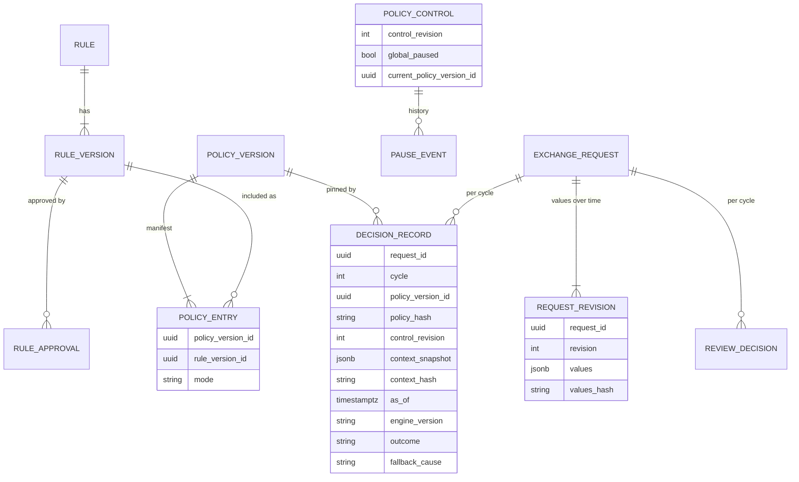
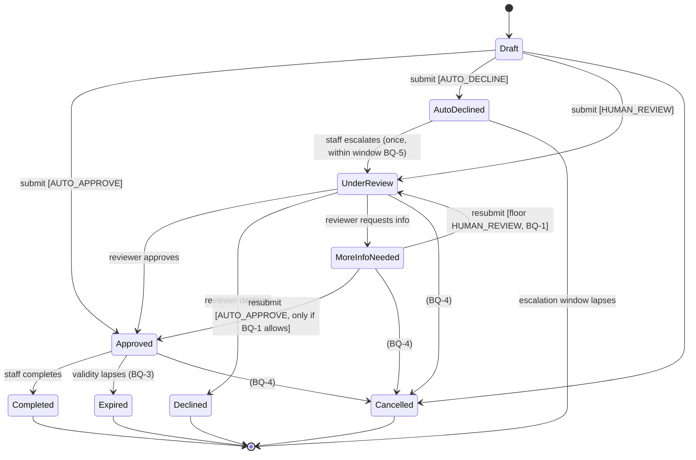
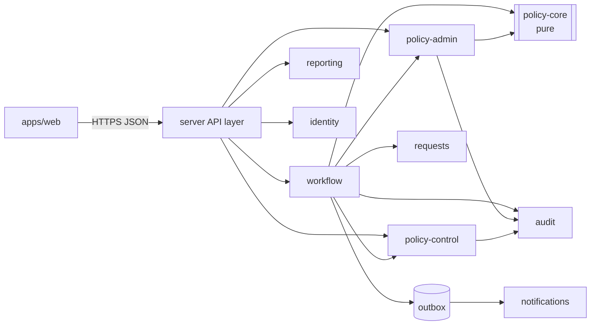

# ExchangeFlow — Architecture Consultancy Review

| | |
|---|---|
| **Reviewed** | `PRD.md` (Draft v0.1), `policy-engine-design.md` (Draft v0.1), `application-elaboration-plan.md`, `application-project-plan.md` (v0.2), `project-brain-stoming.md` |
| **Not reviewed** | `template/insiption_plan.md` (unrelated course brief) |
| **Date** | 2026-10-01 |
| **Status** | Advisory. Nothing here changes the source docs. Each recommendation needs an owner to accept it into the PRD, the design doc or an ADR. |

Severity labels: **High** means fix before building the affected component, because it breaks a Must requirement or is costly to retrofit. **Medium** means settle it before the release that uses it. **Low** is hygiene.

References like `PE §4.3` point to `policy-engine-design.md`, `EP §5` to the elaboration plan, and `PP §6` to the project plan.

---

## 0. Top recommendations (read this first)

1. **Treat the engine as a pure function with an explicit input snapshot**, not "request + policy version". Per-rule pause state, `evaluatedAt`, effective dates, branch time zone and velocity counts all change the outcome today, yet none of them is part of the pinned policy version. As a result FR-14 and NFR-09 cannot be met as written. (F-01)
2. **Fix the evaluation order bug.** In `PE §4.3`, missing data is checked *before* shadow, paused and out-of-scope rules are filtered out, so a shadow rule can force `HUMAN_REVIEW`. That breaks FR-15. Use three-valued logic and rule scoping. (F-02, F-03)
3. **Split immutable rule content from mutable deployment state.** `RULE_VERSION.mode/state` conflicts with "approved versions are immutable". A policy version should be an immutable manifest of `(ruleVersionId, mode)`. Pause is a separate, revisioned control plane. (F-04)
4. **Close the state-machine holes** (cancel, expiry, escalation limits, rule decline vs reviewer decline) and specify concurrency and idempotency mechanically. (F-05 to F-08)
5. **Define money properly.** A threshold on `amount.value` is meaningless across currencies, and string or float comparison silently gives wrong answers. (F-09)
6. **Stack:** TypeScript modular monolith (React SPA + NestJS or Fastify), PostgreSQL, OIDC via the corporate IdP, one container on a managed platform, and an **in-house JSON-AST evaluator** (not json-rules-engine, not DMN) for now.

---

## 1. Assumptions

| # | Assumption | If wrong |
|---|---|---|
| A1 | Team of 2–4 developers, generalists, comfortable with TypeScript. | If the organisation is a .NET or Java shop, use the alternative backend column in §2. The architecture does not change. |
| A2 | Volume is modest: tens of branches, at most a few hundred users, and at most tens of thousands of requests per day (Q9 still open). | Above about 50 req/s sustained, revisit caching (D6) and the reporting read model. |
| A3 | The organisation has, or will accept, an OIDC identity provider (likely Microsoft Entra ID for a corporate desktop estate). | Use Keycloak, self-hosted or managed. |
| A4 | Data residency: assumed to be a single country/region (the `uexchange.ca` reference suggests Canada). Still unconfirmed. | Pick the hosting region to match. |
| A5 | No money movement (D8/Q1 default holds). | If ExchangeFlow must trigger transactions, idempotency, outbox and reconciliation become High-severity integration concerns, and a new ADR is needed. |
| A6 | One operating currency for "base" reporting exists, but there is **no** approved rate source (FR-70 is optional). | See F-09. Cross-currency thresholds cannot be computed without one. |

---

## 2. Recommended technology stack

| Concern | Recommendation | Alternative 1 | Alternative 2 | Trade-off |
|---|---|---|---|---|
| **Frontend** | React 18+ + TypeScript + Vite SPA, TanStack Query (server state and polling), React Hook Form + Zod (forms with the same schemas as the server), an accessible component kit (Radix-based, e.g. shadcn/ui, or MUI) | Next.js (App Router) | Angular | An SPA served by the backend is the simplest deployment and auth story (one origin, cookie session). Next.js adds SSR the app doesn't need (authenticated desktop tool, no SEO) and a second runtime. Angular suits larger, Java-style teams but is heavier for 2–4 devs. |
| **Backend** | Node.js 22 LTS + TypeScript, **NestJS** (its modules map onto the modular monolith, and it has DI for ports and adapters) | Fastify + plain TS modules (lighter, less magic, and you enforce boundaries yourself) | .NET 8 / ASP.NET Core or Spring Boot (if the IT estate is Microsoft or Java) | TS gives one language end to end and shared Zod schemas. Its weakness is **no native decimal** (you need `decimal.js`/`big.js`, see F-09). C# `decimal` and Java `BigDecimal` are native, and the platform fit with corporate IT may be better. Pick by team skills, not fashion. |
| **Database** | **PostgreSQL 16** (managed): `numeric`, `timestamptz`, `jsonb`, partial unique indexes, row locks, triggers, and column/table `GRANT`s for append-only audit | SQL Server / Azure SQL (if Microsoft shop: equivalent features, `decimal`, temporal tables) | MySQL 8 | Postgres covers every need in this review, including the outbox and job queue, with no extra infrastructure. MySQL is weaker on transactional DDL, partial indexes and check constraints. |
| **Data access** | Kysely or Drizzle (SQL-close, explicit transactions and `FOR UPDATE`), with their migrations | Prisma | TypeORM / MikroORM | Concurrency and locking are central here (F-06, D6), so explicit SQL is easier to reason about than Prisma's interactive transactions. Prisma is faster to start with but hides locking. |
| **Jobs / outbox** | `pg-boss` (Postgres-backed) | Graphile Worker | Redis + BullMQ | No new infrastructure. Redis is only worth it at a scale this product does not have. |
| **AuthN** | OIDC Authorization Code + PKCE against the corporate IdP, with a **server-side session** (BFF pattern: HttpOnly, Secure, SameSite=Lax cookie, CSRF token on mutations). MFA enforced by the IdP for policy, approver, compliance and admin roles. | Keycloak (self-hosted IdP) | Auth0 / Clerk (SaaS) | BFF keeps tokens out of the browser. SaaS IdPs are quick but add a vendor and data processor that IT and privacy must approve. |
| **AuthZ** | **Roles held in the app DB** (FR-60, FR-63 need audited role changes), permission checks in code via one `authorize(actor, action, resource)` function, plus **per-object SoD checks** (F-11) | Roles from IdP groups | Policy engine for authZ (Cerbos/OPA) | IdP groups move role changes out of the app's audit trail. Cerbos/OPA is overkill for 7 roles. |
| **Hosting** | One container image (API + static SPA) on Azure Container Apps / App Service, or AWS ECS Fargate / App Runner. Managed Postgres with point-in-time recovery (PITR). Region per A4. Two environments plus prod (dev/test synthetic-only, NFR-08). | Kubernetes | PaaS (Render/Fly) for demo only | K8s is unjustified operational load for a small team. Render/Fly are fine for R1 demos but unlikely to pass corporate security review. |
| **Rule evaluation** | **In-house evaluator** over a typed JSON AST, validated with JSON Schema/Zod at approval time, decimal comparisons, three-valued logic. About 300–500 lines in a dependency-free package. | json-rules-engine | DMN (Camunda/Kogito FEEL) | See D1 below. |
| **Real-time UX** | Polling every 15–30 s via TanStack Query (FR-50/51 are Should, and the queue is the source of truth, FR-52) | Server-Sent Events | WebSockets | Polling is the simplest correct option. Move to SSE only if reviewers complain about latency. |
| **Observability** | `pino` structured logs with redaction allow-list; OpenTelemetry traces/metrics; platform alerting | Vendor APM | — | NFR-07 requires a redaction **allow-list**, not a deny-list. |
| **Testing** | Vitest, `fast-check` (property tests from `PE §11`), Testcontainers Postgres for integration, Playwright + axe for E2E and WCAG | Jest | Cypress | Property tests directly cover FR-11 and FR-14. |

---

## 3. Open decisions

### D1 — Rule format → **Keep a declarative JSON AST with an in-house evaluator** (High)

| Option | For | Against |
|---|---|---|
| **In-house JSON AST** (recommended) | Full control of semantics: decimal comparison, three-valued missing-data logic (F-02), no I/O, deterministic ordering, bounded complexity (D6). Small, auditable, and easy to property-test. The schema doubles as the authoring-UI contract. | You own the code (small). No out-of-the-box UI. |
| json-rules-engine | Popular and has a JSON format. | Evaluation is **async** and facts can be **dynamic or async functions**, so I/O inside evaluation is possible and purity becomes a convention instead of a guarantee. Rule `priority` and event emission push toward order-sensitive designs (FR-11 says order-independent). Built-in numeric operators use JS numbers (float; see the check in F-09). Missing facts are handled by `allowUndefinedFacts` (true/false), not three-valued logic. You would override most operators and still carry the library. |
| JSONLogic | Tiny and portable. | JS truthiness semantics, float arithmetic, no typed "unknown". Same objections. |
| DMN / FEEL (Camunda, Kogito, Drools) | Industry standard. Decision tables with explicit hit policies (`COLLECT` maps well to the §4.2 resolution). FEEL has decimal numbers. Business-readable. | Needs a JVM engine or a JS FEEL interpreter of uneven maturity. Big operational and skills cost for a small team. Governance (approval, shadow, pause) still has to be built around it. Revisit only if the policy owner insists on authoring decision tables directly. |

**Recommendation.** Write the AST format as a versioned JSON Schema (`rule-schema/v1`). Keep the operator set from `PE §6.2` plus `exists`. Add a rule-level `appliesTo` scope (F-03). Choose an AST shape that a decision-table view could later render, which keeps the DMN door open.

### D2 — Rule storage → **PostgreSQL as system of record, immutable rows, content-hashed, with file import for seeding** (Medium)

- `rule_version` rows are append-only once state ≥ `APPROVED`, enforced by a trigger and not only by app code.
- Each rule version and policy version stores `content_hash = sha256(canonical JSON)`. A decision record stores the policy hash, so tampering or drift is detectable.
- **Git/config repository rejected as the source of truth:** business approvers would need git, runtime pause would need a deploy, and SoD would live in branch protection rules outside the app's audit trail.
- **Reconciles EP §7** ("first increment uses rules defined in configuration files"): files are a *seed format* loaded by a migration or CLI into the same tables, as a published policy version with author `system:seed`. There is one code path at runtime.

### D6 — Timeout and caching (High)

**Timeout.** Evaluation is synchronous CPU work in Node. `Promise.race` cannot interrupt a blocked event loop, so a wall-clock timeout alone is not a real safeguard. The proposal:

1. **Make worst-case cost bounded by construction.** At approval and publish time, reject policies that exceed these limits: rules per policy ≤ 500, AST depth ≤ 8, nodes per rule ≤ 200, `in` list ≤ 1,000 items. Evaluation is then O(total nodes), roughly microseconds to low milliseconds. The numbers are starting proposals, to be confirmed by load test.
2. **Cooperative deadline.** Check the elapsed time between rules. Soft budget 50 ms (warn and metric), hard budget 200 ms (→ `HUMAN_REVIEW`/`ENGINE_ERROR`). Both are configurable and sit well inside the NFR-01 2 s p95.
3. **Out-of-process later (optional).** If evaluation moves to a worker thread or service, a real preemptive timeout becomes possible. The port interface (§5) already allows for that.

**Caching.**

| Data | Cache? | Why |
|---|---|---|
| Policy version content (by ID) | **Yes, indefinitely, in-process** | Immutable, so the cache can never be stale. |
| "Which policy version is current" + control state (global pause, paused rule IDs) | **No.** Read on every evaluation from one row, `policy_control` (indexed, sub-millisecond). | Pause latency becomes zero (effective from the next evaluation after commit), which satisfies FR-34 with nothing to document. |
| Commit-time guard | **Required** | A request whose evaluation began just before a pause could commit an automated outcome *after* the pause commits. Fix: the pause transaction takes `SELECT … FOR UPDATE` on `policy_control` and increments `control_revision`. The decision-persist transaction takes `FOR SHARE` and checks that the revision is unchanged. If it changed, re-evaluate once; if it changes again, persist `HUMAN_REVIEW`/`ENGINE_PAUSED`. Invariant: *no automated outcome commits after a pause commit.* |

If an out-of-process cache is ever needed, use a TTL of 5 s or less and record it as a deviation in an ADR.

### Determinism and pinning (High)

FR-14 says "same request and policy version → same outcome". In the current design that is **false**, because the outcome also depends on mutable or ambient inputs (see F-01). Redefine it as:

> `evaluate(input: EvaluationInput) → Decision` is a pure, total function, where `EvaluationInput = { context, policy, control, asOf, engineVersion }`. Identical `EvaluationInput` gives an identical `Decision`, byte for byte after canonical serialisation.

Rules for implementers:

- Nothing ambient: no `Date.now()`, `Math.random()`, I/O, environment variables or locale. `asOf` is injected (a `Clock` port in the workflow).
- Every derived fact (business-hours flag, velocity count, branch-local date) is computed **by the workflow's context builder** and frozen into `context`. It is never computed by the engine.
- Canonical order: rules are evaluated and output sorted by `ruleId`. `matchedRules` and `shadowResults` are sorted. `decidingRuleId`, when several rules support the winning outcome, is the lowest `ruleId`, and all of them are listed in `matchedRules`.
- String comparisons are exact and case-sensitive. The context builder normalises values first (for example ISO 4217 upper-case).
- **Persist the full input:** context snapshot (canonical JSON + hash), `policyVersionId` + `policyHash`, `controlRevision` + paused rule IDs, `asOf`, `engineVersion`. Replay means re-running `evaluate` on the stored input and asserting equality. Add this as a CI test over a fixture corpus and as a periodic production self-check.
- `engineVersion` (semver) is bumped on any change to operator semantics. Replays under a different engine version are reported, not silently compared.

**Invariant INV-DET-1.** Take any stored decision `d`. Replay `evaluate(d.input)` with `engineVersion == d.engineVersion`. The result must equal `d.output`. Example: context `{amount:{value:"500.00",currency:"CAD"}, currencyPair:"CAD/USD"}`, a policy with PLACEHOLDER-003 (threshold "1000.00") active, no pauses → `HUMAN_REVIEW`/`NO_MATCH`. Replaying 1,000 times gives the identical output.

---

## 4. Findings

### High

**F-01 (High) — The pinned policy version does not capture everything that determines the outcome.** Per-rule pause (`PE §7`) is mutable and lives outside `POLICY_VERSION`. `effective_from/to` depend on time. "Business hours flag" and "request count in window" (`PE §4.1`) depend on clock, time zone and DB state. A decision therefore cannot be reproduced from `(request, policyVersion)`, which breaks FR-14 and NFR-09. **Fix:** the snapshot model in §3 "Determinism and pinning", and add `context_snapshot`, `context_hash`, `control_revision`, `paused_rule_ids`, `as_of`, `engine_version` and `policy_hash` to `DECISION_RECORD`.

**F-02 (High) — Missing-data check runs before shadow, paused and inactive filtering, so shadow rules can change outcomes.** In the `PE §4.3` flowchart, step G ("any rule hit missing data → MISSING_DATA") comes *before* step I ("split ACTIVE vs SHADOW, drop PAUSED"). A shadow or paused rule that touches a missing field therefore routes the request to human review. That violates FR-15 and makes the kill switch leaky. **Fix:** filter first, then evaluate. Missing data in a shadow rule is recorded as shadow result `UNKNOWN` and never affects the applied outcome.

**F-03 (High) — No defined semantics for missing fields. `not` on a missing field can auto-decline.** PLACEHOLDER-002 is `not(currencyPair in [...])`. A naive evaluator treats a missing `currencyPair` as "not in" → `true` → `AUTO_DECLINE`. Also, "any rule hits missing data → whole request to human" means a rule written for request type B (which needs a field type A lacks) sends *every* type-A request to human review. **Fix:**
- *Three-valued (Kleene) logic.* A comparison on a missing or ill-typed field returns `UNKNOWN`. `not UNKNOWN = UNKNOWN`. `all` is `FALSE` if any child is `FALSE`, else `UNKNOWN` if any is `UNKNOWN`, else `TRUE`. `any` is the dual. Only `TRUE` counts as a match.
- *Rule scope.* Each rule has `appliesTo` (e.g. request types), evaluated on always-present fields. An out-of-scope rule is skipped.
- `MISSING_DATA` applies only when an **in-scope ACTIVE** rule evaluates to `UNKNOWN` and **no** `HUMAN_REVIEW` rule matched. State its precedence explicitly in the §4.2 table.
- *Precedence (proposed):* `ENGINE_PAUSED` > `ENGINE_ERROR` > `RULE_REQUIRES_HUMAN` > `MISSING_DATA` > `CONFLICT` > single outcome > `NO_MATCH`. A human-review match outranks missing data, because the result is the same and the cause is more informative.
- **INV-3VL-1:** context without `currencyPair`, PLACEHOLDER-002 ACTIVE, in scope → `HUMAN_REVIEW`/`MISSING_DATA`, never `AUTO_DECLINE`.

**F-04 (High) — The rule/policy data model contradicts immutability.** `RULE_VERSION` has `mode` and `state` columns, and the lifecycle mutates an *approved* version (Approved → Shadow → Active → Paused → Retired). `Shadow → Draft : revise` reopens an approved artifact. `POLICY_VERSION` "contains" rule versions, but nothing says when a policy version is cut, or whether moving a rule from shadow to active or pausing it creates a new one. **Fix:**
- `rule_version`: immutable content (conditions, outcome, reason template, scope, schema version, hash) plus approval records. "Revise" means creating a new draft version.
- `policy_version`: an immutable manifest of `{ruleVersionId, mode: ACTIVE|SHADOW}`. Enabling shadow, activating or retiring a rule **publishes a new policy version**, which needs the sign-off record. Exactly one policy version is `current` (pointer in `policy_control`).
- `policy_control`: mutable, revisioned global pause flag and paused-rule set. Pausing is **not** a new policy version, which keeps it instant (FR-34). It is snapshotted per decision (F-01).
- Rule lifecycle states become derived views (is this rule version in the current manifest, and in which mode; is it paused). They stop being stored mutable columns.



**F-05 (High) — State machine holes (`PE §3`, `EP §4`).**

| Hole | Problem | Proposal |
|---|---|---|
| `Submitted` and `Evaluated` as persisted states | Evaluation is synchronous, so these states are never observable. Crash recovery is undefined if one *is* persisted (stuck in `Submitted`). | Make them **audit events, not states**. Submit is one transaction from `Draft`/none to `Approved`, `Declined`, or `UnderReview`. |
| `Declined` is terminal (`--> [*]`) yet escalatable, with no distinction between rule and reviewer declines | Diagram allows a reviewer decline to be escalated again (an infinite loop). `PE §5.3` checks "declined by rule", but the state model doesn't encode it. | Split into `AutoDeclined` (escalatable) and `Declined` (final). |
| Escalation limits | Unbounded and with no time window. | One escalation per auto-decline. Window **[BQ-5]**. |
| No `Cancelled` / `Withdrawn` | Customers walk away (Q7). Requests in `MoreInfoNeeded` or `UnderReview` linger forever and pollute queue-age metrics. | Add `Cancelled` from any non-terminal state (staff or reviewer, reason required) **[BQ-4]**. |
| No approval expiry | An `Approved` request can be completed days later, after policy or rate changes. | `Expired` after N hours **[BQ-3]**. |
| `MoreInfoNeeded` has no timeout | Same as above. | Auto-cancel or expire **[BQ-4]**. |
| `Approved → Completed` only | Approved but never completed in the existing system is invisible. | Report or expire. |
| Reviewer reassignment / routing (FR-25) | Not modelled. | Add `queueId` on the request, set from the decision (future rule output, additive). |

Proposed lifecycle (items marked BQ need business confirmation):



Specify the transition table as data (`from`, `command`, `guard`, `to`, `allowedRoles`, `reasonRequired`). One table test per row.

**F-06 (High) — Concurrency control is named but not specified (FR-23, FR-24, `PE §9`).** **Fix:**
- Optimistic concurrency: every command carries `expectedVersion`, applied as `UPDATE exchange_request SET status=…, version=version+1 WHERE id=$1 AND version=$2`. Zero rows updated → 409 `STALE_REQUEST`, returning the current state.
- Add a defence-in-depth constraint: `UNIQUE (request_id, cycle)` on `review_decision` where `decision_type IN ('APPROVE','DECLINE')`. Plus `UNIQUE(request_id, cycle)` on `decision_record`.
- `cycle` increments on each evaluation (submit, resubmit) and on escalation. It is the "review cycle" in FR-24, which the PRD never defines.
- Escalate vs. reviewer action, and resubmit vs. cancel, both resolve through the same version check.
- **INV-CONC-1:** two reviewers both load v3 and both POST approve/decline with `expectedVersion=3`. Exactly one gets 200, the other gets 409, and exactly one `review_decision` row exists for the cycle.
- (Medium) Add an optional soft claim ("Rana is looking at this", expires in 10 min) to avoid duplicate reviewer effort. This is UX only and never a correctness mechanism.

**F-07 (High) — Idempotent submission (FR-08) has no mechanism.** **Fix:** the client generates `Idempotency-Key` (UUIDv4) when the form is *opened* and sends it on every retry. Server: `UNIQUE(submitter_id, idempotency_key)` on `exchange_request`. A replay with the same key and the same payload hash returns the original response (same ID, status, decision). The same key with a different payload returns 422. Keys are retained for at least 24 h. Reviewer and other commands get idempotency from `expectedVersion` (a repeat after success returns 409 with the current state, and the client shows "already decided by you"). **INV-IDEM-1:** POST submit twice with key K → one request row, two identical 201/200 bodies.

**F-08 (High) — Resubmission and escalation × pinning semantics are undefined.**
- **Escalation must not re-evaluate.** The reviewer sees the original decision and its pinned version. Overturn metrics link `review_decision` to the `decision_record` it overturns.
- **Resubmission re-evaluates** under the *then-current* policy (new pin, new cycle), per FR-10. Open risk: a reviewer asked for more information because they wanted to judge the case, and re-evaluation could now **auto-approve** it, bypassing that reviewer. Or it could auto-decline it mid-conversation. **Route to BA as BQ-1.** Proposed default (conservative, consistent with "fail safe to human"): on resubmission the applied outcome is floored at `HUMAN_REVIEW`, sent back to the same queue or reviewer, with the engine result recorded for information.
- **Policy changes after an auto-decision.** When a rule is paused for being wrong (`PE §9`, "review affected requests via audit query"), there must be a query: decisions where `decidingRuleId = X` and `cycle` is latest and state is `AutoDeclined`/`Approved`. Define it as a report now so the schema supports it (index on `deciding_rule_version_id`).

**F-09 (High) — Money and multi-currency handling are underspecified.**
1. A currency exchange has **two amounts** (sell and buy) and a rate. `amount.value` is ambiguous.
2. `amount.value lte 1000` compares 1,000 JPY and 1,000 USD identically. Thresholds need either a per-currency threshold map or a **base-currency equivalent**. The latter needs a rate, and rates are out of scope (A6). **Route to BA as BQ-2.** The engine can support both shapes. The choice is business-owned.
3. **Representation:** amounts are decimal strings in API and JSON (`"1000.50"`), `numeric(20,6)` in Postgres, and `decimal.js` in TS. Never `number`. The scale is validated against ISO 4217 minor units (JPY 0, CAD 2, KWD 3) at input. Rule values are typed `decimal` in the schema and parsed at approval time, so `"TBD_THRESHOLD_A"` is rejected unless the rule is a labelled placeholder.
4. Rules do no arithmetic, so the engine needs no rounding. Any derived amount (e.g. base equivalent) is computed in the context builder with a stated rounding mode (proposal: HALF_EVEN to the target currency's minor unit), and stored in the snapshot.
5. **Check run (Node 22):** `"100.00" > "99.99"` → `false` (lexicographic string compare gives the wrong answer). `0.1 + 0.2 <= 0.3` → `false` (float). Both failure modes are live risks with the JSON examples as written, because values are strings. **INV-DEC-1:** threshold `"1000.00"`, `lte`: `"1000.00"` → TRUE, `"1000.01"` → FALSE, `"999.99"` → TRUE, `"1000"` → TRUE (scale-insensitive equality).

**F-10 (High) — Audit immutability is only "through the application" (FR-44).** **Fix:**
- The app connects as a DB role with `INSERT, SELECT` only on `audit_event`, `decision_record` and `review_decision`. A trigger raises on `UPDATE`/`DELETE` for every role except a break-glass migration role.
- Hash chain: `audit_event.prev_hash` and `hash = sha256(prev_hash || canonical(event))`, with a nightly verifier. This gives tamper evidence without a ledger DB.
- The `PE §6.1` `AUDIT_EVENT` lacks `target_type/target_id`, `request_id`, `correlation_id`, `before/after` (or a diff), `reason` and `policy_version_id`. Add them.
- **Retention vs immutability (NFR-10):** purging is a DBA-run, audited procedure that deletes whole partitions by age, never single rows. Keep customer PII **out of audit rows**: reference `request_revision` IDs, so PII can be purged or redacted without breaking the chain. **[BQ-7]**

**F-11 (High) — Separation of duties is role-based, so a multi-role user defeats it.** FR-60 allows one user to hold several roles, and the matrix checks roles only. **Fix:** per-object checks: `approver ≠ author` for each `rule_version`; the activation or publish signer ≠ the author. A reviewer cannot decide a request they submitted **[BQ-6]**. An admin cannot grant roles to themselves, and admin plus policy-approver on one user should be blocked or flagged. "Approver ≠ activator where team size allows" (`PE §7`) is not testable. Make it a config flag with a default of `true`.

### Medium

**F-12 (Medium) — Time zones and effective dating.** `effective_from/to` are `date`, but whose midnight? Branches can sit in different zones. Node parses `"2026-10-01"` as UTC midnight but `"2026-10-01T00:00"` as **local** time (checked: `…T00:00:00Z` vs `…T04:00:00Z` on this machine). **Fix:** all instants are `timestamptz` in UTC. Effective dating is a half-open `[from, to)` interval of instants, entered in a named IANA zone in the UI. The branch has an IANA zone. `isBusinessHours` and `branchLocalDate` are computed by the context builder with `Temporal` or `date-fns-tz` and frozen in the snapshot. **INV-TZ-1:** rule effective from `2026-11-01T00:00 America/Toronto`, evaluation at `2026-11-01T03:59Z` → not effective; at `04:00Z` → effective.

**F-13 (Medium) — Notifications need a transactional outbox.** `PE §5.1` calls `N` after the DB save, so a crash in between loses the notification. **Fix:** write an `outbox` row in the same transaction. A `pg-boss` worker delivers it with retries and records delivery status (FR-52, R5).

**F-14 (Medium) — Request history and revisions (FR-06).** `EXCHANGE_REQUEST` holds only `status` and `version`. "Earlier values preserved" needs `request_revision` (immutable values plus hash). Each `decision_record` references the revision it evaluated.

**F-15 (Medium) — Cross-document inconsistencies.**
- `EP §7` says placeholders demonstrate *all three paths*. FR-17 says placeholders can only be shadow or human-review. Resolve this with a `NON_PRODUCTION` environment flag: placeholders may auto-decide only where `env ≠ prod` and data is synthetic. Otherwise R1 cannot demo FR-03 automated outcomes.
- `EP §5 A0` step 2, "exactly one applicable rule", contradicts `PE §4.2` (several approve rules → approve).
- PRD R1 includes FR-10–14 (engine). PP §6 says Workflow MVP sends all requests to human review, with the engine in iterations 5–6. Align the release mapping.
- `PE §7` matrix: Policy author may pause, which is reasonable, but Manager pausing a compliance-regulated rule may need compliance notification. Minor.
- `decidingRuleId` is undefined when several same-outcome rules match. Use the lowest `ruleId` (§3).

**F-16 (Medium) — Reason text.** `reasonTemplate` interpolation with request values can leak PII into notifications or logs, and re-rendering later can change the text. **Fix:** a closed set of placeholders (no customer fields), rendered once and stored on the decision.

**F-17 (Medium) — Velocity facts are racy.** "Request count in window" read during concurrent submissions lets both see N. If any velocity rule is approved, compute it under an advisory lock per subject key (`pg_advisory_xact_lock`) within the submit transaction, and snapshot it. Otherwise drop it from scope until needed.

**F-18 (Medium) — Shadow agreement report semantics (FR-37).** Define "agreement": the shadow `AUTO_APPROVE` vs the human **final** outcome of the same cycle. How do `MoreInfoNeeded`, `Cancelled`, and shadow `UNKNOWN` count? After activation, active-rule cases never reach humans, so accuracy relies on sampling (FR-42), and the sample must be uniformly random per rule with a stored seed for audit.

**F-19 (Medium) — Snapshot storage holds customer data.** The F-01 context snapshot is personal data. Store it in the request's data domain under the same retention and encryption rules, and limit it to fields rules may reference (D7).

### Low

**F-20 (Low) — Conflict alerts can storm.** Deduplicate per `(policyVersion, ruleId pair)` per hour.
**F-21 (Low) — `POST /policy/simulate`** must call the *same* `evaluate` package, against a draft manifest, with zero writes except an optional saved simulation report.
**F-22 (Low) — API conventions.** Use RFC 9457 problem+json errors with stable codes (`STALE_REQUEST`, `INVALID_TRANSITION`, `SOD_VIOLATION`, `IDEMPOTENCY_MISMATCH`) so the UI and tests key on codes.
**F-23 (Low) — FR-34 resume** needs an "approver" permission, but the matrix allows only Policy approver. Confirm whether Compliance may resume compliance-paused rules.
**F-24 (Low) — Unbounded MoreInfo loops.** Report the cycle count and alert when it exceeds N.

### Business questions to route to BA (not decided here)

| ID | Question | Linked |
|---|---|---|
| BQ-1 | On resubmission after "more info", may the engine auto-decide, or is human review the floor? | F-08 |
| BQ-2 | In which currency are thresholds expressed: per-currency, or a base equivalent (needing a rate source)? Which leg (sell or buy)? | F-09 |
| BQ-3 | Does an approval expire if not completed? After how long? | F-05 |
| BQ-4 | Cancellation: who, from which states, and timeouts for MoreInfoNeeded and UnderReview (Q7) | F-05 |
| BQ-5 | Escalation window and limit per auto-decline | F-05 |
| BQ-6 | May a user with staff+reviewer roles decide their own branch's or own requests? | F-11 |
| BQ-7 | Retention periods and erasure duties vs immutable audit | F-10 |
| BQ-8 | D3/Q4: decline beats approve, or conflict to human (already open) | §4.2 |

---

## 5. Module structure and key interfaces

```text
exchangeflow/
├── apps/
│   ├── web/                         # React SPA (staff, reviewer, policy admin, manager views)
│   └── server/
│       └── src/
│           ├── platform/            # db + tx helper, clock, ids, config, logger(redaction), outbox, authn session
│           ├── modules/
│           │   ├── identity/        # users, roles, authorize(), SoD guards
│           │   ├── requests/        # ExchangeRequest aggregate, revisions, queries
│           │   ├── workflow/        # transition table, commands, context builder, decision persistence
│           │   ├── policy-admin/    # rule versions, approvals, publish manifest, simulate, reports
│           │   ├── policy-control/  # pause/resume, control revision
│           │   ├── audit/           # append-only writer, hash chain, verifier, read API
│           │   ├── notifications/   # outbox consumer, in-app inbox
│           │   └── reporting/       # queue age, automation rate, shadow agreement, sampling
│           └── main.ts
└── packages/
    ├── policy-core/                 # PURE: AST schema, evaluator, resolver, decimal ops. Zero runtime deps except decimal.js
    └── contracts/                   # Zod schemas + DTOs shared by web and server
```

Boundary rules, enforced with `dependency-cruiser` in CI:
- `policy-core` imports nothing from `apps/`, has no I/O, and no `Date`/`Math.random` (lint rule).
- Modules talk only through each module's `index.ts` (public API). There are no cross-module table reads except through `reporting` read models.
- Only `workflow` calls `PolicyEngine.evaluate`. Only `audit` writes audit tables.



### Key interfaces (TypeScript)

```ts
// ---------- packages/policy-core ----------
export type Outcome = 'AUTO_APPROVE' | 'AUTO_DECLINE' | 'HUMAN_REVIEW';
export type FallbackCause =
  | 'NO_MATCH' | 'CONFLICT' | 'MISSING_DATA' | 'ENGINE_ERROR'
  | 'ENGINE_PAUSED' | 'RULE_REQUIRES_HUMAN';
export type Truth = 'TRUE' | 'FALSE' | 'UNKNOWN';
export type DecimalString = string;          // validated /^-?\d+(\.\d+)?$/
export type Iso4217 = string;                // 'CAD'
export type InstantUtc = string;             // ISO-8601 with 'Z'

export type Condition =
  | { all: Condition[] } | { any: Condition[] } | { not: Condition }
  | { field: string; op: 'eq' | 'neq'; value: string | DecimalString | boolean }
  | { field: string; op: 'lt' | 'lte' | 'gt' | 'gte'; value: DecimalString }
  | { field: string; op: 'between'; value: [DecimalString, DecimalString] } // inclusive both ends
  | { field: string; op: 'in'; value: string[] }
  | { field: string; op: 'exists' };

export interface RuleVersion {
  ruleId: string; ruleVersionId: string; version: number;
  schemaVersion: 'rule-schema/v1';
  appliesTo: { requestTypes: string[] };
  conditions: Condition;
  outcome: Outcome;
  reasonCode: string; reasonTemplate: string;   // closed placeholder set
  effective: { from?: InstantUtc; to?: InstantUtc }; // half-open [from, to)
  contentHash: string;
  nonProduction: boolean;                       // placeholder flag (FR-17)
}

export interface PolicySnapshot {
  policyVersionId: string; number: number; contentHash: string;
  entries: ReadonlyArray<{ rule: RuleVersion; mode: 'ACTIVE' | 'SHADOW' }>;
}

export interface ControlSnapshot {
  controlRevision: number; globalPaused: boolean; pausedRuleIds: ReadonlySet<string>;
}

export interface EvaluationContext {             // frozen, built by workflow
  requestType: string;
  sell: { amount: DecimalString; currency: Iso4217 };
  buy:  { amount: DecimalString; currency: Iso4217 };
  currencyPair: string;                          // 'CAD/USD', normalised
  origin: { branchId: string; branchTimeZone: string; submitterRole: string };
  derived: { isBusinessHours: boolean; branchLocalDate: string; [k: string]: unknown };
  customer?: Record<string, string | boolean>;   // only D7-approved fields
}

export interface EvaluationInput {
  context: EvaluationContext;
  policy: PolicySnapshot;
  control: ControlSnapshot;
  asOf: InstantUtc;
  limits: { softMs: number; hardMs: number };
}

export interface RuleResult {
  ruleId: string; ruleVersionId: string; mode: 'ACTIVE' | 'SHADOW';
  truth: Truth; outcome: Outcome;
}

export interface Decision {
  outcome: Outcome;
  fallbackCause?: FallbackCause;
  decidingRuleId?: string;                       // lowest ruleId supporting outcome
  matchedRuleIds: string[];                      // sorted, ACTIVE only
  ruleResults: RuleResult[];                     // sorted, all evaluated
  shadowResults: RuleResult[];                   // sorted, never applied
  reasonCode: string; reasonText: string;
  policyVersionId: string; policyHash: string;
  controlRevision: number; asOf: InstantUtc;
  engineVersion: string; durationMs: number;     // durationMs excluded from equality
}

export interface PolicyEngine {
  /** Pure and total: never throws; any internal error → HUMAN_REVIEW/ENGINE_ERROR. */
  evaluate(input: EvaluationInput): Decision;
  /** Static checks at approval/publish: schema, types, complexity limits, conflicts on a sample. */
  validatePolicy(policy: PolicySnapshot): ValidationReport;
}
export interface ValidationReport { ok: boolean; errors: { ruleId: string; code: string; path: string }[] }

// ---------- modules/policy-control ----------
export interface PolicyControlPort {
  /** Single indexed read, no cache. */
  readCurrent(tx: Tx): Promise<{ policyVersionId: string; control: ControlSnapshot }>;
  /** Locks control row FOR SHARE; returns false if revision moved since read. */
  assertUnchanged(tx: Tx, expectedRevision: number): Promise<boolean>;
  pauseRule(cmd: { ruleId: string; actor: Actor; note: string }): Promise<number>;
  pauseEngine(cmd: { actor: Actor; note: string }): Promise<number>;
  resume(cmd: { target: 'ENGINE' | { ruleId: string }; actor: Actor; note: string }): Promise<number>;
}

export interface PolicyRepository {
  getPolicyVersion(id: string): Promise<PolicySnapshot>; // cached forever (immutable)
}

// ---------- modules/workflow ----------
export type RequestStatus =
  | 'DRAFT' | 'UNDER_REVIEW' | 'MORE_INFO_NEEDED' | 'APPROVED' | 'AUTO_DECLINED'
  | 'DECLINED' | 'COMPLETED' | 'CANCELLED' | 'EXPIRED';

export interface Actor { userId: string; roles: string[]; branchId?: string }

export type WorkflowCommand =
  | { kind: 'SUBMIT'; idempotencyKey: string; values: RequestValues }
  | { kind: 'ESCALATE'; requestId: string; expectedVersion: number; reason: string }
  | { kind: 'DECIDE'; requestId: string; expectedVersion: number;
      decision: 'APPROVE' | 'DECLINE' | 'MORE_INFO'; reason?: string }
  | { kind: 'RESUBMIT'; requestId: string; expectedVersion: number; values: RequestValues }
  | { kind: 'COMPLETE' | 'CANCEL'; requestId: string; expectedVersion: number; reason?: string };

export type WorkflowResult =
  | { ok: true; requestId: string; status: RequestStatus; version: number; cycle: number; decision?: Decision }
  | { ok: false; code: 'STALE_REQUEST' | 'INVALID_TRANSITION' | 'FORBIDDEN' | 'SOD_VIOLATION'
      | 'VALIDATION' | 'IDEMPOTENCY_MISMATCH'; current?: { status: RequestStatus; version: number } };

export interface WorkflowService {
  execute(actor: Actor, cmd: WorkflowCommand): Promise<WorkflowResult>;
}

export interface TransitionRule {
  from: RequestStatus | 'NONE'; command: WorkflowCommand['kind'];
  guard?: (ctx: { decision?: Decision; actor: Actor; request?: RequestView }) => boolean;
  to: RequestStatus; roles: string[]; reasonRequired: boolean; incrementsCycle: boolean;
}

export interface ContextBuilder {   // the only place ambient facts are read
  build(values: RequestValues, origin: Actor, asOf: InstantUtc, tx: Tx): Promise<EvaluationContext>;
}

export interface AuditWriter {      // INSERT-only, hash-chained
  append(tx: Tx, e: { actor: Actor | { system: string }; action: string; targetType: string;
    targetId: string; requestId?: string; correlationId: string; reason?: string;
    data?: Record<string, unknown> }): Promise<void>;
}

// placeholder types
type Tx = unknown; type RequestValues = Record<string, unknown>; type RequestView = unknown;
```

### Submit flow (one transaction)

```mermaid
sequenceDiagram
    participant API
    participant WF as Workflow
    participant CB as ContextBuilder
    participant PC as PolicyControl
    participant PE as policy-core
    participant DB
    API->>WF: SUBMIT(idempotencyKey, values)
    WF->>DB: BEGIN; lookup idempotency key
    alt key exists
        WF-->>API: stored result (same payload) or IDEMPOTENCY_MISMATCH
    end
    WF->>CB: build(values, actor, asOf=clock.now())
    WF->>PC: readCurrent()
    WF->>PE: evaluate({context, policy, control, asOf})
    WF->>PC: assertUnchanged(controlRevision)  (FOR SHARE)
    alt revision moved
        WF->>PE: re-evaluate once, else HUMAN_REVIEW/ENGINE_PAUSED
    end
    WF->>DB: insert request, revision, decision_record(snapshot), audit, outbox
    WF->>DB: COMMIT
    WF-->>API: requestId, status, version, decision
```

---

## 6. Recommended ADRs

| ADR | Title | Proposed decision |
|---|---|---|
| ADR-001 | Architecture style | TypeScript modular monolith, one deployable, module boundaries enforced by dependency-cruiser. |
| ADR-002 | Primary datastore | Managed PostgreSQL 16. Also hosts the outbox and job queue (pg-boss). No Redis. |
| ADR-003 | Rule expression format (D1) | In-house typed JSON AST (`rule-schema/v1`) with a pure evaluator; json-rules-engine and DMN rejected for now. |
| ADR-004 | Rule storage (D2) | DB as system of record, immutable content-hashed rule versions; files are a seed/import format only. |
| ADR-005 | Policy version vs control plane | Policy version = immutable manifest of (ruleVersion, mode); pause is a revisioned control row, not a new version. |
| ADR-006 | Determinism and decision snapshot | `evaluate` is pure over `{context, policy, control, asOf}`; full input stored; replay test in CI. |
| ADR-007 | Missing-data semantics | Kleene three-valued logic plus `appliesTo` scoping; explicit fallback precedence order. |
| ADR-008 | Money representation | Decimal strings on the wire, `numeric` in DB, `decimal.js` in code; ISO 4217 scale validation; no floats anywhere. |
| ADR-009 | Time handling | UTC `timestamptz`; IANA zone per branch; half-open effective intervals; injected clock. |
| ADR-010 | Concurrency control | Optimistic `expectedVersion` on every command plus unique `(request_id, cycle)` constraints. |
| ADR-011 | Idempotent submission | Client-generated idempotency key per form, unique per submitter, stored response replay. |
| ADR-012 | Audit integrity | INSERT-only DB grants, mutation-blocking triggers, SHA-256 hash chain with nightly verification; PII kept out of audit rows. |
| ADR-013 | Notifications | Transactional outbox; in-app inbox with polling; delivery status recorded. |
| ADR-014 | Authentication | OIDC (corporate IdP) with BFF server-side session cookies; MFA for policy/admin roles. |
| ADR-015 | Authorization and SoD | Roles in app DB; central `authorize()`; per-object SoD checks (author ≠ approver ≠ publisher; reviewer ≠ submitter). |
| ADR-016 | Pause semantics and caching (D6) | No cache of control state; immutable policy cached forever; commit-time revision guard. |
| ADR-017 | Evaluation timeout (D6) | Static complexity limits at publish plus cooperative 50 ms soft / 200 ms hard deadline; values confirmed by load test. |
| ADR-018 | Request state machine | Transition table as data; Submitted/Evaluated become events; adds AutoDeclined, Cancelled, Expired (pending BQ-3/4/5). |
| ADR-019 | Hosting and environments | Single container on managed PaaS in the agreed region; dev/test synthetic-only; PITR backups. |
| ADR-020 | Frontend stack | React + Vite SPA served by the backend; TanStack Query; shared Zod contracts; WCAG checks with axe in CI. |
| ADR-021 | Placeholder rules by environment | `nonProduction` rules may auto-decide only where `env ≠ prod`; prod rejects them at publish (resolves FR-17 vs EP §7). |

---

## 7. Checks run for this review

| Check | Input | Result | Used in |
|---|---|---|---|
| String compare of decimal amounts (Node 22.12) | `"100.00" > "99.99"` | `false` (wrong) | F-09 |
| Float threshold compare | `0.1 + 0.2 <= 0.3` | `false` (wrong) | F-09 |
| Date parsing zone | `new Date("2026-10-01")` vs `new Date("2026-10-01T00:00")` | `…T00:00:00.000Z` vs `…T04:00:00.000Z` (local zone applied to the second only) | F-12 |
| Flowchart order, `PE §4.3` | Steps G (missing data) and I (filter shadow and paused) | G precedes I, so shadow can affect outcome | F-02 |

No web research was used. All findings are grounded in the five reviewed documents.
